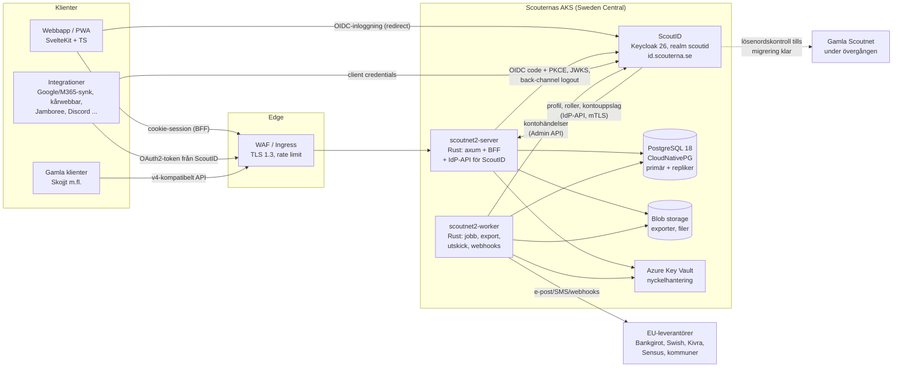
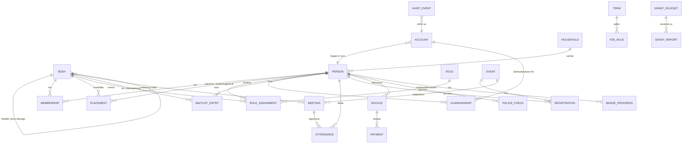
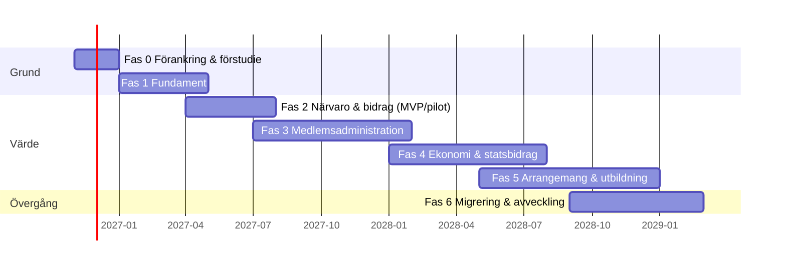

# Plan: Scoutnet 2

> Ett modernt, API-först medlemssystem för Scouterna, skrivet i Rust.
> Bygger på analysen i [01-analys-av-scoutnet.md](./01-analys-av-scoutnet.md).
> Version 0.7, 2026-10-18. Ett levande dokument där beslut dokumenteras som ADR:er i `docs/adr/`.
>
> **Ändringar i 0.7:**
> - Moduler är först ett sätt för utvecklare att bidra utan att störa varandra: en ny modul läggs till utan att kärnan görs om ([06-moduler.md](./06-moduler.md), avsnitt 1.1). De utbyggnadspunkter i kärnan som modulerna behöver är samlade i en tabell (avsnitt 13).
> - Planer för modulerna [Fakturering](./moduler/fakturering.md), [Statsbidrag](./moduler/statsbidrag.md) och [E-postlistor](./moduler/epostlistor.md).
> - Fakturering tar emot betalningar från **Fritidskortet** (statens stöd, utbetalt av E-hälsomyndigheten). De kan täcka hela eller delar av medlemsavgiften ([fakturering.md](./moduler/fakturering.md), avsnitt 11). Kåren anger Scouternas centrala bankgiro, så hanterar kansliet betalningarna centralt och kåren slipper administrationen.
>
> **Ändringar i 0.6:**
> - Scoutnet 2 byggs av en kärna och **moduler** (Närvaro, Bidrag, Statistik, Fakturering, E-postlistor, Aktiviteter …) som slås på per förbund, distrikt eller kår. Se [06-moduler.md](./06-moduler.md), 4.1 och ADR-016.
>
> **Ändringar i 0.5:**
> - Läsbara adresser med Scoutnets nummer (`/kar/1001`, `/avdelning/5003`) som i Skojjt, UUID internt (6.1, 9.1, ADR-015).
> - Klickbara brödsmulor och en ny organisationsöversikt (träd och lista) i stället för Scoutnets organisationsträd (9.1, 9.5).
>
> **Ändringar i 0.4:**
> - Ny 4.3 om policyn för Rust (alltid senaste stabila, konstruktioner som används). Tidigare 4.3 är nu 4.4.
> - Ny [fältkatalog](./04-faltkatalog.md) med alla personfält i Scoutnet, och för varje fält namn i Scoutnet 2, tabell, dataklass, behörighet och kompatibilitetsnamn. Domänmodellen (5.1) och dataklassningen (5.2) följer den.
>
> **Ändringar i 0.3:**
> - Beslutat att Scoutnet 2 blir öppen källkod under **MIT-licens** i GitHub-organisationen **Scouterna** (princip 8, 14.1, ADR-009).
> - Säkerhetsdetaljer om dagens system är flyttade till en konfidentiell bilaga.
> - Rust ska alltid vara senaste stabila version (4.3).
> - En **skunk works-prototyp på 6 veckor** pågår, se [03-prototyp.md](./03-prototyp.md).
>
> **Ändringar i 0.2:** Nya ScoutID (Keycloak) är fastställt som enda inloggning (7.2, 12.5, ADR-003, ADR-013 och ADR-014). Funktionskartan och säkerhetsåtgärderna är uppdaterade efter genomgången av produktion (Scoutnet v5 och admin 4.26.12.1).

## Innehåll

0. [Sammanfattning](#0-sammanfattning)
1. [Vision och mätbara mål](#1-vision-och-mätbara-mål)
2. [Designprinciper](#2-designprinciper)
3. [Omfattning och funktionskarta](#3-omfattning-och-funktionskarta)
4. [Målarkitektur](#4-målarkitektur)
   - [4.3 Rust: alltid senaste stabila version](#43-rust-alltid-senaste-stabila-version-och-nya-konstruktioner)
5. [Domänmodell](#5-domänmodell) – se även [fältkatalogen](./04-faltkatalog.md)
6. [API-design](#6-api-design)
7. [Säkerhet](#7-säkerhet)
   - [7.2 Inloggning via ScoutID (Keycloak)](#72-inloggning-via-scoutid-keycloak)
8. [Integritet och GDPR](#8-integritet-och-gdpr)
9. [UX och design](#9-ux-och-design)
10. [Närvaro och bidrag (Skojjt-integration)](#10-närvaro-och-bidrag-skojjt-integration)
11. [Integrationer](#11-integrationer)
12. [Migrering och parallelldrift](#12-migrering-och-parallelldrift)
    - [12.5 Konton och lösenord](#125-konton-och-lösenord-scoutid-tar-över-lösenorden)
13. [Faser och tidplan](#13-faser-och-tidplan)
14. [Organisation och arbetssätt](#14-organisation-och-arbetssätt)
15. [Kvalitet och test](#15-kvalitet-och-test)
16. [Drift och observabilitet](#16-drift-och-observabilitet)
17. [Risker](#17-risker)
18. [Beslut att fatta (ADR-backlogg)](#18-beslut-att-fatta-adr-backlogg)
19. [Nästa 30 dagar](#19-nästa-30-dagar)
- [Bilaga A – Rust-workspace](#bilaga-a--rust-workspace)
- [Bilaga B – Exempel på endpoints](#bilaga-b--exempel-på-endpoints)
- [Bilaga C – Exempel på behörighetspolicy (Cedar)](#bilaga-c--exempel-på-behörighetspolicy-cedar)

---

## 0. Sammanfattning

Scoutnet 2 ersätter dagens Scoutnet (Custard "membernet", PHP/Symfony 1.4) **etappvis**:

1. **Fundament:** säker plattform på Scouternas befintliga AKS-miljö. **Inloggning sker uteslutande via nya ScoutID** (Keycloak, `id.scouterna.se`, realm `scoutid`). Scoutnet 2 har ingen egen inloggningssida och lagrar inga lösenord. Fundamentet omfattar också en behörighetsmotor, organisationsträd och personregister. Allt exponeras via ett **dokumenterat OpenAPI 3.1-API** som även det egna gränssnittet använder.
2. **Första användarvärde: närvaro och bidragsunderlag.** Det ersätter Skojjt och v5-närvaron, ovanpå medlemsdata som synkas från nuvarande Scoutnet. Det ger tidig nytta med låg risk.
3. **Medlemsadministration:** livscykel, väntelista, självregistrering, vårdnadshavarkonton, roller, registerutdrag, e-postlistor, kraftfulla listor och rapporter.
4. **Ekonomi och statsbidrag.**
5. **Arrangemang och utbildning.**
6. **Migrering, parallelldrift och avveckling** av gamla Scoutnet, med ett **kompatibilitets-API** för befintliga integrationer.

Uppskattad tid är **24–30 månader** till full ersättning med ett kärnteam på cirka 6–7 personer plus volontärbidrag. Första produktionsvärde (närvaro-pilot) nås efter **cirka 8–9 månader**.

**Väsentligt bättre** betyder konkret:

- **Säkerhet:** en gemensam inloggning via ScoutID med MFA-krav per roll, och passkeys och BankID som införs i ScoutID tillsammans med ScoutID-teamet. Därtill kortlivade och scope-begränsade tokens, fältnivåkryptering, loggning av känsliga läsningar och inga tredjepartsskript i appen.
- **Snabbhet:** p95 under 250 ms för listor och en sida som känns omedelbar.
- **Ett enhetligt gränssnitt:** en datagrid med filter, sortering, sparade vyer och bulkåtgärder överallt.
- **Självservice:** ledare kan sköta sin avdelning och vårdnadshavare har egna konton.
- **Inbyggd närvaro:** automatiskt underlag för kommunalt aktivitetsstöd, lägerbidrag, Sensus och statsbidrag.
- **Ett öppet API:** sandbox, webhooks och SDK:er.

## 1. Vision och mätbara mål

> *"Det ska vara lika enkelt att administrera en scoutkår som att vara scout."*

| Område | Mål | Mätning |
|---|---|---|
| Prestanda | API p95 < 100 ms (enskild resurs), < 250 ms (filtrerad lista ≤ 500 rader), p99 < 1 s | OpenTelemetry, SLO-dashboards |
| Prestanda (klient) | LCP < 1,5 s desktop och < 2,5 s mellanklass-mobil på 4G. INP < 200 ms. Initial JS < 200 kB gz. | Lighthouse CI, RUM |
| Sök | Sök medan du skriver < 150 ms p95 | Spårning |
| Skalbarhet | 1 000 samtidiga användare normalt och 10 000 vid toppar (terminsstart, lägeranmälan) utan försämring | Lasttest (k6/Goose) |
| Tillgänglighet (drift) | 99,9 % per månad, RPO ≤ 5 min, RTO ≤ 4 h | Uptime-mätning, återställningsövningar |
| Säkerhet | OWASP ASVS nivå 2 (nivå 3 för autentisering, sessioner och åtkomstkontroll). Inga kritiska eller höga fynd vid extern pentest före go-live. | Pentest, CI-grindar |
| Användbarhet | SUS > 75. Registrera närvaro för ett möte < 30 s. Ta in ny medlem från väntelistan < 1 min. | Användartester per fas |
| Tillgänglighet (a11y) | WCAG 2.2 AA | axe i CI, manuell granskning |
| Självservice | −50 % supportärenden om "kan inte lägga till/ta bort scout", "glömt lösenord" och "dubbletter" | Freshdesk-statistik |
| API | 100 % av UI-funktionerna tillgängliga via publikt dokumenterat API. Sandbox finns. | Kontraktstester |

## 2. Designprinciper

1. **API först.** OpenAPI-kontraktet är produkten. Webbappen är en klient bland andra och har inga privata genvägar.
2. **Säkerhet och integritet inbyggt.** Allt nekas om det inte uttryckligen tillåts. Minsta möjliga behörighet och dataminimering. Personnummer och andra känsliga fält är skyddade som standard.
3. **En sak, ett sätt.** Samma komponenter, samma listmönster och samma ordval överallt. Inga flik-i-flik-labyrinter.
4. **Mobil först för ledare, kraftfullt för administratörer.** Närvaro och medlemsinfo ska fungera på telefon i skogen (offline). Bulkarbete ska fungera på stor skärm.
5. **Historik är data.** Medlemskap, roller och placeringar lagras med giltighetsperioder. Inget hårdraderas utom vid gallring enligt policy.
6. **Regler är data.** Avgifter, bidragsregler och åldersgrupper är versionerade konfigurationsposter per år, kommun och kår, inte kod.
7. **Tråkig teknik i botten.** PostgreSQL för allt som går (data, kö, sök, sessioner). Färre rörliga delar ger mindre att säkra och drifta.
8. **Öppen källkod.** Scoutnet 2 utvecklas öppet i GitHub-organisationen **[Scouterna](https://github.com/Scouterna)** under **MIT-licens** (beslutat, ADR-009). Det gör det möjligt att utnyttja Scouternas volontärekosystem (E-tjänster) och ger granskningsbarhet. Säkerheten bygger på design, inte på hemlighållande (avsnitt 14.1).
9. **Bakåtkompatibelt under övergången.** Befintliga integrationer fungerar via ett kompatibilitets-API tills de migrerats.
10. **En identitet: ScoutID.** All inloggning, för medlemmar, vårdnadshavare, funktionärer och tredjepartsappar, går via ScoutID (Keycloak). Scoutnet 2 äger *medlemsdata och behörigheter*. ScoutID äger *autentisering*. Se avsnitt 7.2.

## 3. Omfattning och funktionskarta

"Idag" avser produktion: Scoutnet v5 (`/f/`) plus Scoutnet admin 4.26.12.1.

| Område | Idag (produktion) | Scoutnet 2 | Fas |
|---|---|---|---|
| Inloggning | Eget formulär (e-post, personnummer eller medlemsnummer plus lösenord), frivillig 2FA. ScoutID (Keycloak sedan oktober 2026) används för *andra* tjänster och verifierar lösenord mot Scoutnet. | **Endast ScoutID** (OIDC). MFA-krav per roll via `acr`, och step-up för känsliga åtgärder. Passkeys och BankID i ScoutID. | 1 |
| Organisationsträd | 10 bodytyper, rollarv via "kopiera roll" | Samma typer i ett `ltree`-träd. Roller har explicit räckvidd (enhet eller enhet + under). | 1 |
| Behörighet | ~50 nycklar, roller per kontext (78 valbara roller på kårnivå) | Cedar-policyer, fältklasser, RLS som extra skydd, förklarbar åtkomst ("varför ser jag detta?") | 1 |
| Närvaro | v5: arrangemang av typen "Möte" med ja/nej-anmälan, återkommande tillfällen och DAK-flagga. Mötesinformation per avdelning. Skojjt separat. | Inbyggt: terminsplanering per avdelning, möten, läger, RSVP, offline-PWA, flera möten per dag | 2 |
| Bidragsunderlag | DAK-export (v5), Skojjt-exporter | Regelmotor per kommun och år, DAK, Excel-mallar, CSV, lägerbidrag, Sensus, MUCF | 2 och 4 |
| Medlemsregister | Profil (v5 och admin), anhöriga som platta fält, språk, SPAR-samtycke | Person, konto och vårdnadshavarrelationer, hushåll, temporala medlemskap | 3 |
| Digitalt medlemskort, intyg och förmåner | v5: digitalt kort per kår, medlemsintyg (PDF), "Mina rabatter" | Behålls: signerat kort (QR, verifierbart offline, kan läggas i Wallet), intyg och förmåner | 3 |
| Kalender | iCal-flöden per enhet och person | iCal-prenumeration med slumpmässig, återkallbar token per användare och flöde | 2 |
| Listor och rapporter | 4-kolumnslistor (668 kB för 266 medlemmar), rapporter som filer | En datagrid med filter, sortering, kolumnval, sparade vyer, bulk och export. Rapporter är sparade vyer plus schemaläggning. | 1 och 3 |
| Väntelista | Lista, flytta manuellt | Kö med prioriteringsregler, erbjudanden, svarsfrist, prognos per avdelning | 3 |
| Självregistrering | Iframe, egen CSS, GA-ID | Hostad, tillgänglig och flerspråkig. Tema via designtokens (ingen fri CSS). Ingen tredjepartsspårning. | 3 |
| Ledarsjälvservice | Endast medlemsregistrerare | Avdelningsledare tar in från väntelistan och begär avslut. Godkännande kan konfigureras per kår. | 3 |
| Registerutdrag | Registrering och påminnelser | Samma regler plus status i listor, självservice-påminnelser och spärr av roll vid utgånget utdrag (konfigurerbart) | 3 |
| E-postlistor och utskick | Mailman-listor (används även som API-urval för Google-synk), SMS-leverantörer | Standardlistor per avdelning, listor från medlemslistans filter med vårdnadshavare som egen målgrupp, utskick via EU-leverantör med arkiv för mottagarna, studsar, synk till Google Workspace och M365, SMS ([plan](./moduler/epostlistor.md)) | 3 |
| Ekonomi | Terminsfakturering, 4 metoder, OCR, återbetalning, Hogia/Visma/Itella, knapp för Fritidskortet vid fakturan | Kansliets omgångar med brytdatum och förhandsgranskning, versionerade avgiftsregler, returpost som skannas in, BgMax/OCR, e-faktura/Kivra, Swish, Fritidskortet (del- eller helbetalning från staten, regler per år, återbetalning till Fritidskortet), SIE4, automatisk avräkning till kår och distrikt ([plan](./moduler/fakturering.md)) | 4 |
| Statsbidrag | Plugin | Kontroll av regler under hösten, låst ögonblicksbild per 31/12, årsmöten i mobilen med protokoll, förifylld ansökan med godkännande via ScoutID, revision och utbetalning ([plan](./moduler/statsbidrag.md)) | 4 |
| Arrangemang och kurser | Formulärbyggare, avgifter, incheckning, mallar, återkommande arrangemang (v5) | Samma kapacitet plus Swish-betalning, väntelista per arrangemang, QR-incheckning och kursflöde för Folkhögskolan | 5 |
| Märken, utmärkelser och CV | Admin-katalog, v5-märkestagning, loggbok | Gemensam märkeskatalog med delmoment (scout eller ledare), översikt per avdelning, CV från kurser | 5 |
| Arkiv, enkäter, resurser | Grundläggande | Fas 5+ efter behovsanalys. Arkiv kan ersättas av Scouternas M365 eller Google. | 5+ |
| API | Nyckel per endpoint, URL-nycklar, odokumenterat | OAuth2 via ScoutID (client credentials med scopes), webhooks, händelseflöde, sandbox och SDK:er | 1 och framåt |

**Medvetet utanför den första omfattningen:** egen e-postserver (Mailman), BBCode, PDF-trycksaker via Itella samt "konvertera medlem till enhet". De utvärderas senare.

## 4. Målarkitektur

### 4.1 Översikt



- **En modulär monolit** i Rust som byggs som två binärer från samma workspace: `server` (HTTP och BFF) och `worker` (bakgrundsjobb). Domänmoduler har tydliga gränser (separata crates) så att de kan brytas ut senare vid behov. Mikrotjänster ger ingen nytta i den här skalan och ökar attackytan.
- **Kärna och moduler.** Funktionsområden som Närvaro, Bidrag, Statistik, Fakturering, E-postlistor och Aktiviteter är moduler med ett gemensamt kontrakt. De slås på och av per förbund, distrikt eller kår, och ett val ärvs nedåt och kan låsas. Externa appar använder API:t med OAuth-scopes från ScoutID. Se [06-moduler.md](./06-moduler.md).
- **Tillståndslösa API-poddar** skalar horisontellt. Sessioner och jobb ligger i PostgreSQL.
- **Samma plattform som ScoutID** (AKS, ArgoCD, CloudNativePG, Prometheus/Loki/Grafana, Velero) ger Scouterna en driftmodell och ett kompetensbehov.
- **ScoutID är den enda utfärdaren av tokens**, både för människor och maskiner. Scoutnet 2 är *relying party* och *resource server* och dessutom datakälla (IdP-API) för ScoutID:s Scoutnet-provider (se 7.2 och 12.5).

### 4.2 Teknikval (förslag, fastställs i ADR:er)

| Lager | Val | Motivering |
|---|---|---|
| Språk | **Rust** (stable, edition 2024), `#![forbid(unsafe_code)]` i appkod | Minnessäkerhet, prestanda, starka typer för domänregler (personnummer, belopp, terminer) |
| HTTP | **axum** + tokio + tower / tower-http (timeouts, gränser, komprimering, spårning) | De facto-standard, bra middleware-ekosystem |
| Databas | **PostgreSQL 18** med `ltree`, `pg_trgm`, `unaccent`, `btree_gist` (exklusionsvillkor för perioder), partitionering | Bevisad, finns redan i Scouternas drift (CNPG) |
| DB-åtkomst | **sqlx** (frågor kontrolleras vid kompilering) + sqlx-migreringar | Ingen ORM-magi, SQL är granskningsbart |
| OpenAPI | **utoipa** (kod först, genererar OpenAPI 3.1) + `oasdiff` i CI som stoppar oavsiktliga brytande ändringar | Kontraktet kan aldrig glida isär från koden |
| Validering | Domäntyper (newtypes) + `garde` | "Parse, don't validate" |
| Behörighet | **Cedar** (`cedar-policy`-craten) + SQL-predikat för listfrågor + PostgreSQL RLS som extra skydd | Policy som kod, analyserbar och testbar |
| Autentisering | **Nya ScoutID (Keycloak 26, realm `scoutid`)** är enda IdP. Scoutnet 2 har ingen egen inloggning. Webben är en konfidentiell OIDC-klient (BFF-mönster: tokens på servern, `__Host-`-cookie). API:et är resource server (JWT/JWKS från ScoutID, kontroll av `aud`). Crates: `openidconnect` och `jsonwebtoken`. | Scouternas gemensamma SSO. En plats för MFA, passkeys och BankID. Inga tokens i webbläsaren. |
| Jobbkö | PostgreSQL-baserad kö (`SELECT … FOR UPDATE SKIP LOCKED`) och transaktionell outbox för händelser och webhooks | Inga extra system (ingen Gearman, Redis eller RabbitMQ) |
| Sök | PostgreSQL FTS + trigram + unaccent. Tantivy/Meilisearch övervägs först om det behövs. | Räcker gott för cirka 0,5 M personer |
| Export | `rust_xlsxwriter`, `csv`, `quick-xml` (DAK), egna generatorer för SIE4 och BgMax | Strömmande export av stora mängder |
| Kryptering | Envelope-kryptering med AES-256-GCM (`aws-lc-rs`), datanycklar wrappade i Azure Key Vault, HMAC-baserade blindindex | Fältnivåskydd för personnummer, skyddad identitet och hälsodata |
| Observabilitet | `tracing` + OpenTelemetry → Prometheus/Loki/Tempo, PII-redigering i loggar | Spårbarhet utan dataläckage |
| Frontend | **SvelteKit (TypeScript)** som SPA/PWA, **TanStack Table** + virtualisering, genererad typad klient från OpenAPI, eget designsystem. Alternativ: Leptos (Rust/WASM), se ADR-002. | Snabbt, litet bundle, moget ekosystem för tabeller och tillgänglighet. Typer följer kontraktet. |
| Leveranskedja | `cargo-deny`, `cargo-audit`, Renovate, SBOM (CycloneDX), signerade images (cosign), distroless som non-root | Säker leveranskedja |

### 4.3 Rust: alltid senaste stabila version och nya konstruktioner

Scoutnet 2 är en applikation, inte ett bibliotek. Vi lovar därför ingen äldre minsta Rust-version (MSRV) utan följer alltid senaste stabila Rust. Det ger säkerhetsfixar och prestanda direkt, och vi kan använda nya språkkonstruktioner i stället för extra beroenden.

**Policy**

| Område | Regel |
|---|---|
| Verktygskedja | `rust-toolchain.toml` pekar på senaste stabila patchversion (i dag **1.99.1**). Renovate öppnar en PR när en ny stabil version släpps (var sjätte vecka). PR:en slås ihop inom en vecka om CI är grön. `rust-version` i workspace följer samma version. |
| Edition | **2024** och `resolver = "3"`. När en ny edition kommer migrerar vi inom en releasecykel med `cargo fix --edition`. |
| Förvarning | CI kör även mot **beta** en gång i veckan (får fallera, ger förvarning). Ett exempel är att `!` (never type) stabiliseras i 1.100. |
| Varningar | `build.warnings = "deny"` (Cargo 1.97) i CI i stället för `RUSTFLAGS=-Dwarnings`, så att byggcachen inte invalideras. `clippy::pedantic` som varning. Undantag skrivs som `#[expect(lint, reason = "…")]`, aldrig som `allow`. |
| Säkerhet | `unsafe_code = "forbid"` i hela workspace. Inga nightly-funktioner i produktionskod. |
| Std före crates | När standardbiblioteket har kommit ikapp tas crates bort: `LazyLock` i stället för `once_cell`/`lazy_static`, `cfg_select!` i stället för `cfg-if`, `assert_matches!` i stället för crate, `File::lock` i stället för `fs2`, `std::io::pipe` i stället för `os_pipe`, `format_into` i stället för `itoa`. |
| Asynkrona traits | Native `async fn` i traits (statisk dispatch). Craten `async-trait` används bara där `dyn` krävs, eftersom dyn-säkra async-traits fortfarande är instabila. |

**Konstruktioner som prototypen redan använder**

| Konstruktion | Stabil sedan | Var i koden |
|---|---|---|
| Edition 2024, resolver 3, workspace-lints | 1.85 | `Cargo.toml` |
| Let chains (`if let … && let …`) | 1.88 | `sn-domain/term.rs`, `sn-server/seed.rs` |
| `LazyLock` (rollkatalog) | 1.80, full paritet 1.94/1.96 | `sn-server/authz.rs` |
| `assert_matches!` | 1.96 | `sn-domain/term.rs` (test) |
| `u16::is_multiple_of` | 1.87 | `sn-domain/personnummer.rs` |
| `#[expect(…, reason)]` | 1.81 | överallt där en lint medvetet undantas |
| Native async i axum-extraktorer (`FromRequestParts` utan `async-trait`) | 1.75 | `sn-server/auth.rs` |
| Parallella databasfrågor med `tokio::try_join!` | – | `sn-server/routes/people.rs` |

Instabilt och därför inte använt: dyn-säkra async-traits, async drop, `gen`-block, try-block och cargo-script.

### 4.4 Kvalitetsattribut i arkitekturen

- **Prestanda:**
  - all filtrering, sortering och paginering sker i databasen med index
  - keyset-paginering
  - behörighetsuppsättningar beräknas en gång per förfrågan och cachas kort i processen
  - repliker används för rapporter och exporter
- **Robusthet:**
  - idempotenta jobb och idempotensnycklar på API
  - outbox-mönster för exakt en publicering av händelser
  - timeouts och kretsbrytare mot externa leverantörer
- **Skala vid toppar:**
  - lägeranmälan som öppnar en viss tid hanteras med kö-baserad anmälan, rate limiting per klient och förberäknade formulär
  - ingen extern cache behövs, till skillnad från j26-scoutnet-cache idag

## 5. Domänmodell

### 5.1 Kärnentiteter



| Entitet | Viktiga fält och regler | Förbättring mot idag |
|---|---|---|
| `body` | `id` (UUIDv7), `kind` (organisation, region, network, district, corps, corps_district, group, section, troop, patrol), `number` (unikt per typ, Scoutnets id vid migrering, används i adresser), `path ltree`, namn, status, `troop_type` och åldersintervall, kommun/län, org.nr, adresser med giltighet | Ett träd och en sökväg. Snabba frågor av typen "allt under X". |
| `person` | Medlemsnummer (bevaras från Scoutnet), namn, födelsedatum, `national_id` (krypterat, plus blindindex), `national_id_kind` (personnummer, samordningsnummer, saknas), kön (självangivet, separat från juridiskt kön i personnumret), `protected_identity`, språk, status (Scoutnets åtta medlemsstatusar), kontaktuppgifter, utskicks- och fakturaval. Alla fält finns i [fältkatalogen](./04-faltkatalog.md). | Stöd för medlemmar utan personnummer. Skyddad identitet är en förstklassig flagga. |
| `person_address` | Typ (hem, post, faktura, tillfällig), c/o, rad 1–3, postnummer, ort, land, giltighet. Vid skyddad identitet lagras bara förmedlingsadress. | Flera adresser med historik i stället för ett platt fält. |
| `household` | Hushåll som samlar syskon och vuxna (familjerabatt, gemensamma utskick) | Ersätter "Länka familjemedlemmar". |
| `account` | Koppling till ScoutID-identitet: `idp_subject` (ScoutID `sub`) och `member_no` (claimet `scoutnet_member_no`). Kopplad till högst en `person`. Preferenser. **Inga lösenord.** | Konto skilt från person ger vårdnadshavarkonton och löser delade e-postadresser. |
| `guardianship` | Konto → barn-person, rättigheter (se, anmäla, betala, redigera kontakt), verifierad av (registrerare, BankID eller inbjudan), giltighet | Ersätter "Anhörig 1/2"-fälten. |
| `membership` | Person, kår, `status` (enum: pending, waiting, active, paused, ended), `valid daterange`, primär-flagga, avslutsorsak | Temporalt. "Vem var medlem 31/12?" blir en enkel fråga. |
| `placement` | Person → avdelning eller patrull, `valid daterange`, ledarflagga | Historik per termin (från Skojjt). Flera placeringar möjliga. |
| `role` / `role_assignment` | Rollnyckel, namn (sv/en), tillåtna bodytyper, **räckvidd** (`self` eller `self_and_descendants`), max uppdragslängd, krav (registerutdrag, MFA, sekretessavtal), `valid tstzrange` | Explicit arv i stället för att kopiera roller. Kräver MFA per roll. |
| `waitlist_entry` | Person, kår, önskad avdelning, prioritet och köplats (regel), erbjudande med svarsfrist | Riktig kö med transparens. |
| `meeting` / `attendance` | Avdelning (eller arrangemang), start/slut, plats, typ (möte, hajk, läger, aktivitet), **flera per dag**. Närvaro: status (närvarande, frånvarande, anmält förhinder), roll (deltagare eller ledare), minuter. | Löser Skojjt #11/#12 och ger underlag för bidrag. |
| `event` / `registration` | Arrangemang, typ, mall, formulär (versionerat JSON-schema), avgifter, kapacitet, väntelista, incheckning | Ersätter "projects". |
| `term` / `fee_rule` / `invoice` / `payment` / `settlement` | Termin (VT/HT), versionerade avgiftsregler (fyra metoder idag som strategi-enum), faktura med rader, betalning (OCR, Swish, manuell), avräkning till kår och distrikt | Regler som data och inga ändringslås per månad. Spårbarhet. |
| `police_check` | Person, uppvisat datum, utfärdandedatum, kontrollerat av, giltigt till (beräknat enligt reglerna i analysen, avsnitt 7). **Inget innehåll lagras.** | Status syns i listor. Automatik. |
| `follow_up_talk` | Uppföljningssamtal: datum, roll, enhet, registrerat av | Kopplas till rollen i stället för fritext. |
| `person_merit` | Utmärkelser, märken, kurser (t.ex. Trygga möten) och certifieringar: datum, utfärdare, plats, arrangör | Ett ställe för Loggbok/CV. |
| `badge` / `badge_part` / `badge_progress` | Gemensam katalog, delmoment (scout eller ledare), avklarad-historik med ångra | Från Skojjt. |
| `grant_ruleset` / `grant_report` | Kommun, år, regler (åldrar, minimum, belopp). Rapport med indata-ögonblicksbild och resultat. | Reproducerbara, granskningsbara underlag. |
| `custom_field_def` / `custom_value` | Definieras per organisationsnivå, typ, synlighet och dataklass | Typade och klassificerade (GDPR). |
| `audit_event` | Append-only, hashkedjad: vem, vad, när, varifrån, syfte, före/efter (för skrivningar) och läsning av känsliga fält | Ny. |
| `consent` | Typ (bildpublicering, nyhetsbrev …), givet av (person eller vårdnadshavare), tid, återkallat | Spårbar historik. |

### 5.2 Dataklassificering (styr behörighet, export, loggning och gallring)

| Klass | Exempel | Standardhantering |
|---|---|---|
| `public` | Kårnamn, publicerade funktionärer | Kan visas publikt |
| `basic` | Namn, medlemsnummer, avdelning | Inom de egna enheterna |
| `contact` | E-post, telefon, vårdnadshavares kontaktuppgifter | Kräver `person.read_contact` |
| `personal` | Födelsedatum, adress, registerutdragsstatus (endast datum och status), uppföljningssamtal | Kräver `person.read_personal`. Adress döljs vid skyddad identitet. |
| `sensitive` | Personnummer, skyddad identitet, hälsa/allergi, noteringar | Krypterat, step-up MFA, varje läsning loggas, maskat i export som standard |
| `financial` | Avgiftsgrupp, terminsavgifter, KID/OCR, fakturor, betalningar, bankkonto | Kräver `economy.*` |

Registerutdragsstatus har flyttats från `sensitive` till `personal`. Bara uppgiften om *att* ett utdrag har visats lagras, och avdelningsledare behöver kunna se att alla ledare i avdelningen har giltigt utdrag. Fältkatalogen ([04-faltkatalog.md](./04-faltkatalog.md)) anger klass och behörighet för varje enskilt fält.

Varje fält annoteras i koden med klass, ändamål, rättslig grund och gallringsregel ("privacy as code"). Utifrån det genereras registerförteckningen enligt artikel 30 och exportfiltren.

### 5.3 Datavolymer (dimensionering)

Cirka 0,5 M personposter inklusive historik sedan 2008, cirka 85 k aktiva medlemmar, 1 000+ kårer och cirka 5 000 avdelningar.
Närvaro ger cirka 300 k möten och 4–5 M närvarorader per år. Revisionsloggen ger tiotals miljoner rader per år och partitioneras per månad.
Allt detta ryms gott i en PostgreSQL-instans med repliker.

## 6. API-design

### 6.1 Konventioner

- **Bas:** `https://api.scoutnet.se/v1` (förslag). JSON. OpenAPI 3.1 publiceras på `/v1/openapi.json` med dokumentationsportal.
- **Resursorienterat:** `/bodies/{id}/members`, `/people/{id}`, `/meetings/{id}/attendance` osv. (se Bilaga B).
- **Identifierare:** varje resurs har ett UUID (v7) som primärnyckel och i alla relationer. Enheter kan dessutom adresseras med en läsbar nyckel `typ-nummer`, t.ex. `/v1/bodies/group-1001`. Numret är unikt per enhetstyp och är för migrerade enheter samma id som i Scoutnet och Skojjt (ADR-015). Personer adresseras bara med UUID, eftersom medlemsnumret är en personuppgift som annars hamnar i loggar och webbläsarhistorik.
- **Lista, filtrera, sortera och paginera med ett gemensamt frågespråk** för alla listor. Gränssnittets datagrid använder exakt samma språk, så sparade vyer och rapporter blir lagrade frågor.
  - `filter[status]=active&filter[birth_date][gte]=2014-01-01&filter[troop]=…&filter[q]=anna`
  - `sort=last_name,-birth_date`
  - `fields=member_no,first_name,last_name,email`. Fält filtreras dessutom alltid mot behörighet. Saknad behörighet ger att fältet utelämnas och redovisas i `meta.redacted_fields`.
  - `page[size]=100&page[after]=<cursor>` (keyset, max 500), `include=total`
- **Konsekventa scheman:** stabila enum-strängar i snake_case, explicit nullbarhet, aldrig `[]` i stället för `{}`, ett adressformat, ISO 8601-datum och belopp i öre (heltal) med valuta.
- **Fel:** RFC 9457 `application/problem+json` med maskinläsbar `code` och fältfel.
- **Samtidighet:** `ETag` och `If-Match` på uppdateringar. **Idempotens:** `Idempotency-Key` på POST.
- **Bulk:** `POST /v1/bulk/memberships` och liknande. Returnerar ett jobb med per-rad-resultat, med torrkörning (`dry_run=true`) som visar effekten innan den genomförs.
- **Export:** `POST /v1/exports` med samma fråga och format (csv, xlsx eller json). Det asynkrona jobbet ger en signerad länk som är giltig 24 h. Exporten stämplas med användare och tid.
- **Versionering:** `/v1` är stabil. Brytande ändringar ger `/v2`, med minst 12 månaders parallellitet. Avvecklade fält flaggas med `Deprecation`/`Sunset`-headers.

### 6.2 Autentisering för klienter

Alla tokens utfärdas av **ScoutID**. Scoutnet 2 validerar dem (signatur via JWKS, `iss`, `aud = scoutnet2-api`, `exp`, `azp`) och slår upp behörigheter i sin egen databas.

| Klienttyp | Mekanism |
|---|---|
| Egen webbapp | Konfidentiell OIDC-klient `scoutnet2-web` i realm `scoutid`. BFF: authorization code + PKCE, tokens stannar på servern. Webbläsaren får en `__Host-`-sessionscookie (`Secure`, `HttpOnly`, `SameSite=Lax`). Back-channel logout från ScoutID avslutar sessionen. |
| Tredjepartsappar för medlemmar | Registreras som klient i ScoutID (via scoutid-keycloak-admin, med kåren som ägare). Använder OIDC + PKCE och begär scopet `scoutnet2` för att få audience `scoutnet2-api`. Kortlivade access tokens (5 min). Anslutna appar visas och kan återkallas på Min sida (via ScoutID:s kontokonsol eller Admin API). |
| Integrationer (maskin) | **OAuth2 client credentials mot ScoutID.** Konfidentiell klient med servicekonto, skapad av kårens IT-ansvarig via scoutid-keycloak-admin. Kåren sätts som ägare via det befintliga attributet `scoutid.owner.group`. **Scopes** som `scoutnet2:members.read`, `scoutnet2:members.contact.read` och `scoutnet2:attendance.write` är Keycloak client scopes. **Bindningen till enheter** (vilka kårer och avdelningar) lagras i Scoutnet 2 per `client_id`. Hemligheten (eller `private_key_jwt`) har utgångsdatum (max 12 månader) och roteras. |
| Personliga åtkomsttoken | Ersätts av vanliga ScoutID-klienter. Scoutnet 2 utfärdar inga egna tokens. |

**Aldrig** nycklar i URL:er (utom tillfälligt i kompatibilitets-API:et, se 6.4).

### 6.3 Händelser och webhooks

- Transaktionell outbox ger `event_log` och därifrån **webhooks** (HMAC-signerade, med återförsök och backoff, SSRF-skydd) samt ett **händelseflöde** via pull: `GET /v1/events?after=<cursor>`.
- Exempel på händelsetyper: `person.updated`, `membership.created|ended`, `placement.changed`, `role_assignment.granted|revoked`, `waitlist.offered`, `attendance.recorded`, `registration.created`, `invoice.paid`.
- Payload innehåller ID:n och ändrade fältnamn, aldrig känsliga värden. Mottagaren hämtar data med sina egna behörigheter.
- Det ersätter polling med `updated_since` och manuella "importera från Scoutnet"-knappar.

### 6.4 Kompatibilitets-API (övergång)

`/api/...` med samma sökvägar och svarsformat som dagens Scoutnet, inklusive `{value, raw_value}`, för de endpoints som ekosystemet använder:

- `group/memberlist`
- `organisation/register/member`
- `organisation/update/membership`
- `organisation/group`
- `project/get/participants`
- `project/get/groups`
- `project/get/questions`
- `project/checkin`

Auth API:ts `authenticate` tillhandahålls **inte**, eftersom lösenord hanteras av ScoutID. De delar av Auth API:t som ScoutID:s provider behöver (`get/profile`, `get/user_roles`) ersätts av IdP-API:t (avsnitt 7.2.6).

Kompatibilitets-API:et har följande regler:

- Nycklar mappas till integrationsklienter med motsvarande scopes.
- Basic Auth stöds. Query-parameternycklar stöds tillfälligt, med maskning i loggar och varningshuvud.
- Varje anrop loggas per klient, så att vi vet vem som behöver migrera.
- **Avveckling:** 12 månader efter att det gamla Scoutnet stängts.

### 6.5 Utvecklarupplevelse

- **Sandbox** med syntetiska data: svenska namn och **Skatteverkets testpersonnummer**, hela organisationsträdet. Den återställs varje natt. Ersätter community-projektet mocknet.
- **Genererade SDK:er:** TypeScript (ersätter `@scouterna/scoutnet`), Python, C# och Rust.
- Dokumentationsportal med "kom igång"-guider för vanliga integrationer (Google Workspace, M365, kårwebb, närvaroappar).

## 7. Säkerhet

### 7.1 Hotbild (sammanfattning)

| Hot | Exempel | Huvudsakliga skydd |
|---|---|---|
| Kontokapning | Lösenordsåteranvändning, phishing mot ledare och registrerare | Inloggning endast via ScoutID med obligatorisk MFA för roller med åtkomst till andras data, passkeys och BankID (7.2), step-up och avvikelsedetektering |
| Överexponering inom organisationen | Ledare ser mer än de behöver | Policy per fältklass, minsta möjliga behörighet som standard, roller med tydlig räckvidd och tidsgräns |
| Massläckage | Export av hela kåren och spridning, kapat adminkonto | Personnummer exkluderat som standard, syftesangivelse, stämplade exporter med kort livslängd, larm vid ovanliga volymer, inga databasdumpar via UI |
| Injektion och XSS | Formulärfält, importfiler | sqlx-parametrar, typad parsing, strikt CSP med nonce, inget `innerHTML`, fuzzing av parsers |
| Tredjepartsrisk | Skript från supportwidget eller analysverktyg på sidor med persondata | Inga tredjepartsskript i inloggad app. Ingen spårning på formulär. EU-leverantörer med biträdesavtal. |
| API-missbruk | Läckta nycklar, skrapning | Scope-begränsade och utgående klienthemligheter, rate limits, inga nycklar i URL, loggning per klient |
| Insider eller superadmin | Missbruk av breda rättigheter | Fyra ögon för superadmin-åtgärder, JIT-elevering (tidsbegränsad), läsloggning, separat granskningsroll |
| Leveranskedja | Komprometterat beroende | cargo-deny/audit, låsta versioner, SBOM, signerade images, reproducerbara byggen |
| Driftstörning | DDoS vid lägeranmälan | WAF, rate limits, köad anmälan, autoskalning |

### 7.2 Inloggning via ScoutID (Keycloak)

**Beslut:** Scoutnet 2 använder **nya ScoutID** som enda inloggning. Scoutnet 2 har ingen egen inloggningssida, lagrar inga lösenord och utfärdar inga egna tokens. ScoutID äger autentiseringen och Scoutnet 2 äger medlemsdata och behörigheter.

#### 7.2.1 Nuläge för ScoutID (oktober 2026)

| Fakta | Värde |
|---|---|
| Plattform | Keycloak 26.5 med Scouternas provider (`scoutid-keycloak-provider`) och Keycloakify-tema. Körs på Scouternas AKS i Sweden Central, med CloudNativePG och Helm/ArgoCD. I produktion sedan cirka 2026-10-01. |
| Realm och värd | `scoutid` på `id.scouterna.se` (produktion) och `dev.id.scouterna.se` (test). Separata realms för stora arrangemang (`jamboree26`, `wsj27`). |
| Hur inloggningen går till | En egen autentiserare skickar användarnamn (personnummer eller e-post) och lösenord till **gamla Scoutnets `/api/authenticate`** och hämtar sedan `/api/get/profile` och `/api/get/user_roles`. Keycloak-användaren `<medlemsnr>@scoutnet` skapas vid första inloggningen. **Keycloak lagrar inga lösenord.** "Kom ihåg mig" sparar en beständig Scoutnet-token. |
| Claims | `sub` (UUID), `preferred_username`, `scoutnet_member_no`, namn, `email`, `scouterna_email`, `birthdate`, `picture`, `locale`. Roller finns i det frivilliga scopet `scoutnet-memberships` som claimet `memberships` (grupper, avdelningar, patruller, organisationer med `{id, key}` per roll). |
| Begränsningar | Rollattributet **trunkeras vid 2048 tecken**: arrangemangsroller är borttagna och `organisations` kan försvinna för personer med många roller. Roller uppdateras bara vid inloggning eller högst var 60:e minut. Det finns **ingen MFA, inga passkeys och ingen BankID**. Brute force-skyddet är avstängt i realmen, eftersom det delegeras till Scoutnet. Den beständiga tokenen lagras okrypterat (öppet ärende provider#69). `offline_access` är standardroll. |
| Sessioner | SSO 1 dygn (30 dagar med "kom ihåg mig"), access token 5 min, offline 60 dagar |
| Klientregistrering | Manuell eller via `scoutid-keycloak-admin` (demo). Klienter ägs av en kår via `scoutid.owner.group`. Kårens IT-ansvarig kan hantera kårens klienter. |

#### 7.2.2 Hur Scoutnet 2 använder ScoutID

- **Klient:** konfidentiell OIDC-klient `scoutnet2-web` (authorization code + PKCE, `private_key_jwt` mot token-endpoint) och en resource server-audience `scoutnet2-api` via ett eget client scope `scoutnet2`.
- **Scopes som begärs:** `openid profile email scoutnet2`. Vi begär **inte** `scoutnet-memberships` och **inte** `offline_access`.
- **Koppling till person:** claimet `scoutnet_member_no` matchas mot `person.member_no`, eftersom medlemsnumren bevaras vid importen. `sub` sparas på `account` vid första inloggningen, och därefter används `sub`. Om ett konto saknar matchande person nekas åtkomst, och användaren hänvisas till support.
- **Behörighet hämtas aldrig från token-claims.** Scoutnet 2 avgör behörighet utifrån sina egna rolltilldelningar (avsnitt 7.3). Det undviker inaktuella roller, trunkeringen vid 2048 tecken och stora tokens (jämför HTTP 431-problemen i Skojjt). Under parallelldriften importeras rollerna från gamla Scoutnet.
- **Sessioner:** Scoutnet 2 har en egen BFF-session som är oberoende av ScoutID:s SSO-session. Inaktivitet ger utloggning efter 30 min, och funktionärer har en absolut gräns på 12 h. **Back-channel logout** (`sid`) från ScoutID avslutar Scoutnet 2-sessionen. När en roll ändras i Scoutnet 2 gäller det direkt, utan ny inloggning.
- **Step-up:** känsliga åtgärder kräver färsk inloggning med rätt nivå. Det gäller att visa personnummer, exportera, ändra roller och ekonomiåtgärder. Scoutnet 2 begär då `acr_values` och `max_age=900` och kontrollerar `acr` och `auth_time` i ID-token. Keycloak hanterar detta med sitt stöd för step-up (Level of Authentication).

#### 7.2.3 MFA, passkeys och BankID (görs i ScoutID, tillsammans med ScoutID-teamet)

| Steg | Innehåll | När |
|---|---|---|
| 1. Andra faktor | Villkorligt OTP-steg (TOTP) eller WebAuthn efter Scoutnet-autentiseraren i webbläsarflödet. Det fungerar redan med dagens JIT-skapade Keycloak-användare. MFA-nivån exponeras som `acr`. | **Krav före pilot (fas 2)** för alla med roll som ger åtkomst till andras personuppgifter |
| 2. MFA-krav per roll | Scoutnet 2 kräver nivån "mfa" för roller med `RequiresMFA` och nekar annars med en tydlig hänvisning till ScoutID-kontot. Rollkravet kan också exponeras för ScoutID, så att ScoutID kan tvinga fram registrering av MFA. | Fas 2–3 |
| 3. BankID | Identity brokering i Keycloak mot en certifierad eID-förmedlare (upphandlas; e-legitimation inom EU). Kontot kopplas genom att personnumret från BankID matchas **på serversidan** via Scoutnet 2:s IdP-API. Personnumret skickas aldrig till andra relying parties. Används för inloggning, verifiering av vårdnadshavare och kontoåterställning. | Fas 3 |
| 4. Passkeys som förstafaktor | Möjligt när lösenorden ägs av Keycloak (se 12.5). Lösenordslös inloggning blir då standard. | Fas 6 |
| 5. Härdning | Kryptera eller ta bort den beständiga Scoutnet-tokenen (#69). Ta bort `offline_access` som standardroll. Aktivera brute force-skydd när Keycloak äger lösenorden. | Fas 1–6 |

#### 7.2.4 Vårdnadshavare och andra icke-medlemmar

Idag kan bara Scoutnet-medlemmar logga in i ScoutID (`registrationAllowed: false`). Scoutnet 2 löser det så här:

1. Scoutnet 2 skapar vårdnadshavaren som `person` med status "vårdnadshavare (ej medlem)", vilket motsvarar dagens "Aktiv icke-medlem", och ger personen ett ID i samma nummerserie.
2. Inbjudan skickas via ScoutID. Kontot skapas med Keycloak Admin API och "execute actions"-e-post (sätt lösenord eller passkey), eller via BankID-verifiering.
3. Behörigheten som vårdnadshavare (`guardianship`) bor i Scoutnet 2.

#### 7.2.5 Konton och livscykel

Scoutnet 2 är källa för konton. Händelser som `person.created`, `person.email_changed`, `membership.ended`, `person.deceased`, `person.protected_identity_set` och `account.locked` synkas till ScoutID via Keycloak Admin API med ett servicekonto med minsta möjliga rättigheter. Det ger:

- ny e-post för återställning av lösenord
- inaktivering av kontot och avslutade sessioner när någon avslutas, avlider eller spärras

Scoutnet 2 speglar **inte** organisationsträdet som Keycloak-grupper (ScoutID har tidigare förlorat tiotusentals gruppmedlemskap vid felaktig gruppsynk). Bara ett litet, avgränsat urval får finnas där vid behov.

#### 7.2.6 IdP-API (Scoutnet 2 → ScoutID-providern)

Ett internt, separat exponerat API (mTLS eller client credentials, tillåtet bara från ScoutID) som ersätter ScoutID:s anrop till gamla Scoutnet:

| Endpoint | Syfte |
|---|---|
| `POST /idp/v1/resolve` | Användarnamn (e-post, medlemsnummer eller personnummer) → medlemsnummer och kontostatus. Används för inloggning och BankID-koppling. Hård rate limiting. |
| `GET /idp/v1/members/{no}/profile` | Det som behövs för standard-claims (namn, e-postadresser, födelsedatum, bild, språk) |
| `GET /idp/v1/members/{no}/memberships` | **Kompakt** roll-sammanfattning för andra relying parties (kårwebbar, Google- och M365-synk). Formatet är kompatibelt med dagens `memberships`-claim men har storleksgräns och versionering. |

**Lösenordskontroll ingår inte.** Den görs mot gamla Scoutnet fram till att lösenorden har migrerats till Keycloak (12.5).

### 7.3 Auktorisering

- **Allt nekas om det inte uttryckligen tillåts.** Varje endpoint deklarerar `action` och `resource`. Ett test i CI verifierar att ingen route saknar policykontroll.
- **Cedar-policyer** (se Bilaga C):
  - Principal är kontot med rolltilldelningar.
  - Resurs är en body eller person, där personens föräldrar är dess placeringar och enheter.
  - Kontexten innehåller bland annat MFA-nivå (`acr` från ScoutID), autentiseringens ålder (`auth_time`) och syfte.
- **Listfrågor:** policyn kompileras till en mängd tillåtna `ltree`-sökvägar per åtgärd, som sedan används som SQL-predikat. Det ger samma svar som Cedar och verifieras med egenskapsbaserade tester.
- **PostgreSQL RLS** som extra skydd: applikationsrollen har inte `BYPASSRLS`. Förfrågans tillåtna sökvägar sätts med `SET LOCAL`.
- **Fältnivå:** serialiseringen filtrerar per dataklass. Känsliga fält kräver uttrycklig åtgärd (t.ex. `person.read_national_id`).
- **Förklarbarhet:** "Varför har jag åtkomst?" och "Vem har åtkomst till den här personen?" finns för administratörer och för den registrerade själv.
- **Tidsbegränsning:** rolltilldelningar har slutdatum enligt rollens max uppdragslängd. Påminnelse skickas före utgång.

### 7.4 Dataskydd

- TLS 1.3 överallt (även internt i klustret via service mesh eller mTLS där det är möjligt). Kryptering av disk (Azure).
- **Kryptering på applikationsnivå** för `sensitive`-fält: envelope-kryptering med datanycklar per tenant-nivå, wrappade av Key Vault-nyckel. Nyckelrotation sker utan omkryptering av allt (omwrappning). **Blindindex** (HMAC-SHA256) ger exakt sökning på personnummer utan dekryptering.
- **Skyddad identitet:**
  - adressen ersätts av förmedlingsadress
  - posten döljs i alla listor, exporter och utskick för andra än behöriga
  - delas aldrig med integrationer (t.ex. Google-synk)
  - varje läsning loggas och kan granskas av dataskyddsombudet
- **Backup:** krypterad, PITR med 35 dagars kontinuerlig WAL. Återställning testas kvartalsvis. Säkerhetskopior lagras i Sverige/EU.

### 7.5 Applikations- och plattformssäkerhet

- **HTTP-headers:**
  - `Strict-Transport-Security` (preload)
  - `Content-Security-Policy` med nonce, `default-src 'self'` och `frame-ancestors 'none'`. Undantaget är publika formulär, som får bäddas in med en explicit tillåtelselista per kår.
  - `X-Content-Type-Options`
  - `Referrer-Policy: strict-origin-when-cross-origin`
  - `Permissions-Policy`
  - `Cross-Origin-Opener-Policy`
  - ingen `Server`-version
- **CSRF:** SameSite-cookies plus anti-CSRF-token för BFF-mutationer.
- **Filuppladdning:** storleksgräns, typkontroll på innehåll, virusskanning och lagring utanför webbroten med signerade URL:er.
- **Webhooks och utgående anrop:** SSRF-skydd (blockera privata nät) och tillåtelselistor.
- **Importer** (Excel, DAK, BgMax/OCR): strikta parsers som fuzzas med `cargo-fuzz`.
- **Plattform:**
  - distroless-images som non-root med read-only rotfilsystem
  - Kubernetes Pod Security "restricted"
  - Cilium NetworkPolicies (default deny)
  - signerade images verifieras vid admission
  - hemligheter via Workload Identity och Key Vault, aldrig i repo (gitleaks i pre-commit och CI)
- **Process:**
  - hotmodellering per epik
  - säkerhetsansvarig i teamet
  - två granskare på säkerhetskritisk kod (`CODEOWNERS`)
  - extern pentest före varje större go-live
  - **`SECURITY.md` med GitHub Private Vulnerability Reporting** och `security.txt` på webbplatsen. Sårbarheter hanteras i privata GitHub Security Advisories och publiceras med CVE först när de är åtgärdade.
  - incidentrutin med 72-timmarsanmälan till IMY

### 7.6 Krav som följer av bristerna i dagens system

Detaljerna om bristerna finns i en konfidentiell bilaga (se analysen, avsnitt 13.3) tills de har rapporterats och åtgärdats. Kraven på Scoutnet 2 är däremot publika:

| Område | Krav i Scoutnet 2 |
|---|---|
| HTTP-headers | Header-middleware i tower-http (HSTS, CSP, frame-ancestors m.m.). Testas i CI (ZAP baseline). |
| Sessionscookie | En enda sessionscookie `__Host-`, `Secure`, `HttpOnly`, `SameSite`, satt av en och samma middleware |
| Beroenden i frontend | Modern ramverkskodbas, Renovate och SCA-grind i CI |
| Tredjepartskod och spårning | Inga tredjepartsskript i appen. Alla beroenden byggs in i bundlen. CSP `script-src 'self'` med nonce. Ingen analys eller spårning. Hjälp och support som egen statisk sida. |
| API-nycklar | OAuth2 via ScoutID och Authorization-header. Endast compat tillfälligt, med maskning. |
| Tokenlivslängd | Inga egna tokens. ScoutID:s access tokens lever 5 min och Scoutnet 2 begär inte `offline_access`. Återkallelse sker i ScoutID. |
| Parametrar och deserialisering | Typade query-parametrar. Ingen deserialisering av godtyckliga strukturer. |
| Databasdumpar och serverfiler | Finns inte i UI. Dataexport för migrering sker via driftprocess med fyra ögon. |
| Inloggning | Ingen egen inloggning. ScoutID hanterar enhetliga svar. Rate limiting på IdP-API:ts `resolve`. |
| MFA | MFA krävs per roll via `acr` från ScoutID. Passkeys och BankID i ScoutID (7.2.3). |
| Prenumerationslänkar (iCal) | iCal-flöden med slumpmässig token (minst 128 bitar) per användare och flöde. Kan återkallas. Inga medlemsnummer eller ID:n i URL:en. Endast det som användaren har rätt att se. |
| Serialisering av svar | Explicita DTO:er per endpoint. Fält filtreras per dataklass. |
| Publika formulär | Tema via designtokens (färg, logotyp), ingen fri CSS |

## 8. Integritet och GDPR

1. **DPIA** (konsekvensbedömning) genomförs före pilot: barns uppgifter, stor skala och personnummer. Den uppdateras per fas.
2. **Rättslig grund per ändamål:**
   - medlemskap och administration: berättigat intresse och medlemsavtal
   - bidragsansökningar: berättigat intresse eller rättslig förpliktelse beroende på bidrag
   - bildpublicering och nyhetsbrev: samtycke
   - hälsouppgifter vid arrangemang: uttryckligt samtycke, gallring
3. **Dataminimering:**
   - personnummer krävs bara där det behövs (bidrag, fakturering, identifiering), annars räcker födelsedatum
   - stöd för medlemmar utan personnummer
   - exporter maskar känsliga fält som standard
4. **Gallring som kod.** Exempel (fastställs med Scouternas jurist):
   - hälsosvar: 90 dagar efter arrangemangets slut
   - kontaktuppgifter: X år efter avslutat medlemskap
   - registerutdragsposter: när giltigheten löpt ut plus 15 månader
   - revisionslogg: 2–5 år
   - minimal historik (namn, medlemsår, uppdrag) behålls för föreningsarkiv enligt Riksarkivets riktlinjer
5. **De registrerades rättigheter som självservice:**
   - registerutdrag (JSON och PDF)
   - rättelse
   - invändning mot publicering
   - begäran om radering eller anonymisering via ett ärendeflöde
   - översikt över vem som har sett eller ändrat mina uppgifter (från revisionsloggen)
6. **Barn och vårdnadshavare:** vårdnadshavare hanterar barnets uppgifter och samtycken. Barnet får ett eget konto från en åldersgräns som kåren eller förbundet bestämmer, med åldersanpassade rättigheter. Den svenska åldersgränsen för samtycke till informationssamhällets tjänster är 13 år.
7. **Biträden:** endast leverantörer med biträdesavtal och behandling inom EU/EES för kärndata. Förteckning publiceras.
8. **SPAR:** utred om Scouterna har rätt till SPAR-uppdatering av adresser. Funktionen finns men är avaktiverad idag. Inför den bara med säkerställd rättslig grund.
9. **Incidenthantering:** larmkedja, bedömning, anmälan till IMY inom 72 h och information till berörda.

## 9. UX och design

### 9.1 Informationsarkitektur

- **Kontextväljare** högst upp: *"Du arbetar i: 2514 Brownsea Island (kår) ▾"*. Användaren byter mellan enheter där hon eller han har roller. Vyn och menyn anpassas efter vald enhet och behörighet, och endast funktioner som användaren kan använda visas.
- **Läsbara adresser** som går att läsa upp och skicka vidare: `/kar/1001`, `/kar/1001/medlemmar`, `/avdelning/5003`, `/distrikt/3/organisation`. Skojjts adresser (`/sk/{kår}/t/{termin}/{avdelning}`) skickas vidare, så att gamla bokmärken fungerar efter sammanslagningen.
- **Klickbara brödsmulor** på alla enhetssidor: *Scouterna › Birka scoutdistrikt › Barkarby-Skälby scoutkår › Bävrarna › Medlemmar*. Enheter där användaren saknar behörighet visas som text.
- **Vänstermeny med samma ordning överallt:**
  - Översikt
  - Medlemmar
  - Väntelista
  - Organisation (träd och lista över alla underliggande enheter, se 9.5)
  - Närvaro
  - Arrangemang
  - Kommunikation
  - Ekonomi
  - Rapporter
  - Inställningar
- **"Min sida"** för medlemmar och vårdnadshavare:
  - Mina scouter (barn)
  - Kalender och närvaro (anmäla förhinder)
  - Arrangemang
  - Fakturor och betalning
  - Märken
  - Integritet och samtycken
  - Anslutna appar
- **Global sökning och kommandopalett** (`Ctrl+K`): personer, enheter, arrangemang och åtgärder ("Ny medlem", "Registrera närvaro").
- **Rollanpassad startsida** med att göra-lista:
  - X väntar på godkännande
  - Y på väntelistan har fått erbjudande
  - Z ledare med utgående registerutdrag
  - obetalda fakturor
  - dagens möten

### 9.2 Tre sidmallar (enhetlig design)

1. **Lista:** datagrid med verktygsrad (filterchips, sök, kolumnval, sparade vyer, export, bulkåtgärder), virtuell scrollning och URL-styrt tillstånd (delbara länkar).
2. **Detalj:** huvud med nyckelinfo och primära åtgärder, högst 6 flikar, sidopanel med relaterat (roller, placeringar, historik).
3. **Guide:** steg-för-steg för komplexa flöden (statsbidrag, terminsfakturering, import, avslut av termin) med förhandsgranskning och torrkörning.

### 9.3 Den kraftfulla listan (exempel: medlemmar i en kår)

- **Filter:**
  - status, avdelning och patrull
  - ålder eller födelseår, "fyller N i år"
  - roll
  - betalstatus per termin
  - registerutdragsstatus
  - närvaro i procent senaste terminen
  - märken
  - medlem sedan, kön och kommun
  - saknar e-post eller vårdnadshavare
- **Sortering** på alla kolumner (flera nivåer). **Kolumnval** och ordning sparas per användare.
- **Sparade vyer** som kan delas inom kåren. Exempel:
  - "Obetalda HT26"
  - "Ledare utan giltigt registerutdrag"
  - "Spårare som fyller 10 i år (flytt till Upptäckare)"
  - "Väntelista 2018–2019"
- **Bulkåtgärder** på markerade rader:
  - flytta avdelning eller patrull
  - sätt avgift
  - skicka meddelande
  - tvinga registerutdrag
  - avsluta medlemskap (med torrkörning och ångra inom 10 minuter)
- **Detaljpanel** öppnas vid sidan av listan, så att listkontexten inte går förlorad.
- **Inline-redigering** för enkla fält, med validering och optimistisk låsning.

### 9.4 Mobil och offline

- PWA som kan installeras på hemskärmen.
- **Närvaro offline:** registreringar köas i IndexedDB och synkas med konfliktlösning (senaste ändring vinner per person och möte, och konflikter visas).
- Stora tryckytor. Närvaroregistrering kräver högst 3 tryck från startsidan.

### 9.5 Organisationsöversikt

Dagens organisationsöversikt i Scoutnet är ett filträd (förbund → distrikt → kår → avdelning → patrull → person) med en mapp per nod och utan siffror. Den gör det möjligt att hitta, men inte att jämföra eller överblicka. Scoutnet 2 ersätter den med en vy under varje enhet (`/distrikt/3/organisation`) med två lägen:

- **Träd** – en tabell med indrag, där varje rad visar typ, nummer och antal scouter, ledare och väntande i hela delträdet. Antalen leder direkt till medlemslistan eller väntelistan för enheten.
  - *Visa ned till Kårer, Avdelningar, Patruller eller Personer* fäller ut hela trädet till vald nivå med ett klick.
  - Personer visas som löv under patrull, avdelning eller kår (de som saknar avdelning blir synliga). Ett klick öppnar personkortet.
  - Enheter laddas nivåvis och personer hämtas en gång per kår, så att även förbundsnivån går snabbt.
- **Lista** – alla enheter av en typ under vald enhet i en sorterbar tabell med sökväg, kommun och summarad. Exempel: "alla spåraravdelningar i distriktet, sorterade på antal scouter". Fritextsök på namn eller nummer ger alltid en lista med sökväg.
- Filter, sortering och läge finns i adressen, så att vyn kan delas och sparas.
- Behörighet som överallt: man ser bara delträd där man har en roll, och personer bara med `members.read`.

### 9.6 Designsystem

- Baseras på Scouternas grafiska profil: designtokens för färg, typografi och avstånd, mörkt läge.
- Komponentbibliotek med dokumentation (Storybook/Histoire) och tillgänglighet inbyggd: tangentbordsnavigering, fokusindikering, ARIA och kontrast.
- **Klarspråk på svenska**, engelska som andraspråk. Publika formulär kan få fler språk (t.ex. arabiska, somaliska, ukrainska) för att nå nya familjer.
- Användartester med medlemsregistrerare, avdelningsledare, kassörer, vårdnadshavare och unga ledare i varje fas.

## 10. Närvaro och bidrag (Skojjt-integration)

### 10.1 Mål

Ersätta Skojjt (v1 och v2) och v5-närvaron med en inbyggd modul som har minst samma funktionalitet. Medlemsdata ligger redan i systemet, så import och nyckelhantering behövs inte.

### 10.2 Funktioner

- **Terminsplanering:**
  - skapa återkommande möten (t.ex. tisdagar 18:30–20:00 hela terminen)
  - undantag för lov
  - hajker och läger som flerdagars-aktiviteter med en dag per sammankomst
  - **flera möten per dag tillåts**
- **Närvaroregistrering:**
  - lista med stora kryssrutor
  - "alla närvarande", "samma som förra mötet"
  - ledare och deltagare särskiljs
  - gäster (provscouter som inte är medlemmar) kan läggas till
  - mötet kan låsas efter rapportering
  - automatisk sparning
  - realtidssynk mellan ledare
  - offline
- **RSVP:** vårdnadshavare och scouter kan anmäla förhinder i förväg via Min sida eller app.
- **Avdelningar som inte finns i organisationsträdet** (tillfälliga grupper) stöds som lokala grupper, med tydlig markering.
- **Läger kopplade till arrangemang:**
  - arrangemangets deltagare och dagar ger närvaro direkt
  - QR-incheckning
  - utcheckning per dag
- **Statistik:**
  - närvaro i procent per person och avdelning
  - aktiva och inaktiva
  - flödesprognos ("vilka flyttar upp till nästa avdelning nästa termin", sankey-diagram)
  - prognos för väntelistan

### 10.3 Bidragsmotor

- **Regeluppsättningar som data:** `grant_ruleset` per kommun och år. Fälten följer Skojjts `AktivitetsbidragSettings`:
  - åldrar för deltagare och ledare
  - minsta antal deltagare och ledare
  - minsta längd
  - belopp (eventuellt per kön)
  - räknas hajk (ja/nej)
  - utdataformat
- Startuppsättningen omfattar **Göteborg 2026** från Skojjt. Fler kommuner läggs till av volontärer via en granskad PR eller admin-UI.
- **Validering per sammankomst** med begripliga felmeddelanden, t.ex. "Mötet 12/3 var 45 min, kräver 60".
- **Utdataformat:**
  - DAK XML (även hela terminen som ZIP)
  - Excel-mallar för Göteborg och Stockholm
  - Göteborgs aktivitetsbidrag-CSV
  - lägerbidrag (Göteborg och Stockholm)
  - JSON
- **Sensus och andra studieförbund:** synk av närvarolistor. Initialt via den reverse-engineerade integrationen från Skojjt (isolerad adapter). Sök formellt avtal och API med studieförbunden.
- **Kvalitetssäkring:** varje genererat underlag sparas med indata-ögonblicksbild och regelversion, så att det är reproducerbart vid revision.
- **Edge cases:** medlemmar utan personnummer redovisas uttryckligen ("ej bidragsgrundande: saknar personnummer") i stället för att tyst försvinna.

### 10.4 Migrering från Skojjt

- Import från skojjt-v2:s PostgreSQL:
  - semester till term
  - troop till avdelning per termin, matchat på Scoutnet-ID
  - meeting och attendance, inklusive de möten som tappades vid v1→v2 om v1-data finns
  - märken och delmoment med referensintegritet
- Avstämningsrapport per kår: antal möten och närvarorader före och efter.
- Skojjt-teamet bjuds in som medutvecklare. Deras domänkunskap och kod för exporter är värdefulla, och reglerna portas från C# till Rust med testfall från Skojjts testsvit.

## 11. Integrationer

| Integration | Lösning | Fas |
|---|---|---|
| ScoutID (Keycloak) | Enda IdP och tokenutfärdare. Scoutnet 2 är OIDC-klient och resource server. ScoutID:s provider läser profil och roller från Scoutnet 2:s IdP-API i stället för från gamla Scoutnet. Lösenorden migreras lat in i Keycloak (12.5). Kontohändelser synkas via Admin API. MFA, BankID och passkeys utvecklas tillsammans med ScoutID-teamet (7.2.3). | 1–6 |
| Google Workspace / Microsoft 365 | Steg 1: webhooks och API så att Google-Scoutnet-synk och Office365-Scoutnet-synk kan migrera. Steg 2: inbyggda kopplingar per kår (Admin SDK och Graph) med mappning av roller till grupper och funktionsadresser. | 3 och 5 |
| Kårwebbar (WordPress m.fl.) | Publika, PII-fria endpoints (kårinfo, publicerade funktionärer, arrangemang) med publika läsnycklar och CORS. Officiellt WordPress-plugin. | 3 |
| Bankgirot | BgMax- och OCR-filer (import), på sikt Bankgirots API. Avstämning automatiskt. | 4 |
| Swish | Swish Handel/Commerce API för arrangemang och avgifter, med återbetalningar | 4 och 5 |
| E-faktura/Kivra | Via Kivra API och e-fakturaväxel (partner) | 4 |
| Bokföring | SIE4-export per kår, distrikt och förbund (fungerar med Fortnox, Visma m.fl.). Hogia-export om förbundet fortsatt kräver det. | 4 |
| E-post | EU-baserad leverantör för transaktionsmejl och utskick, med SPF, DKIM, DMARC och studshantering. Eventuellt inkommande listadresser (motsvarande Mailman) efter behovsanalys. | 3 |
| SMS | EU-baserad SMS-leverantör, kostnad per kår | 3 |
| Kommuner (aktivitetsstöd) | DAK och kommunspecifika format. På sikt direktinlämning där kommunens system har API (t.ex. via Sveriges Föreningssystem). | 2 |
| MUCF statsbidrag | Underlagsrapport och ansökningsflöde | 4 |
| Polisen (registerutdrag) | Inget API finns. Manuell kontroll via Polisens tjänst, där Scoutnet 2 lagrar uppvisat datum, utfärdandedatum och kontrollant. | 3 |
| Jamboree och stora arrangemang | Arrangemangs-API med webhooks och kapacitet för topplast, utan extern cache | 5 |

## 12. Migrering och parallelldrift

### 12.1 Förutsättning: tillgång till data

- **Avgörande första steg (fas 0):** klargör avtalet med Custard om dataägande och export. Begär en **fullständig PostgreSQL-dump plus schemadokumentation** med regelbundna leveranser (t.ex. varje natt) under övergången.
- Om det inte går behövs en reservplan:
  - API-baserad extraktion. Den räcker för medlemmar, roller och arrangemang, men **inte** för fakturahistorik och detaljerad historik.
  - Kompletterande Excel-exporter från rapportcentret.

### 12.2 Strategi: strangler med tydliga ägarskapsbyten

| Steg | Källa till sanning | Flöde |
|---|---|---|
| M1 skuggläge (fas 1–2) | Gamla Scoutnet | Varje natt (sedan oftare) envägsimport till Scoutnet 2. Närvaro är ny och ägs av Scoutnet 2. |
| M2 delvis skrivning (fas 2–3) | Gamla Scoutnet för medlemskap | Placeringsändringar från Scoutnet 2 skrivs tillbaka via `UpdateGroupMembership` (som Skojjt gör). Nya intresseanmälningar via `RegisterGroupMember`. |
| M3 pilotkårer (fas 3) | Scoutnet 2 för pilotkårer | Pilotkårernas medlemsadministration sker i Scoutnet 2 och synkas till gamla Scoutnet för fakturering och statsbidrag. |
| M4 full övergång (fas 6) | Scoutnet 2 | Slutlig migrering under en helg. Gamla Scoutnet blir skrivskyddat arkiv i X månader och avvecklas sedan. |

### 12.3 Tidpunkt för övergång

Undvik avgiftsfönstren (januari, juli–augusti), terminsfakturering och **ögonblicksbilden för statsbidrag 31 december**. Rekommendationen är **slutet av maj eller början av juni** eller **oktober–november**, efter minst 3 lyckade generalrepetitioner.

### 12.4 Avstämning och kvalitet

- Automatiserat avstämningsverktyg som jämför antal och summor per enhet, status, termin och roll, fakturasummor och betalningar.
- Stickprov där registrerare i pilotkårer verifierar sina egna data.
- **Datatvätt före migrering:**
  - dubbletter
  - ogiltiga personnummer
  - skräproller ("Ny roll" ×16, hex-nycklar)
  - föräldralösa poster
- **Mappning:**
  - 8 personstatusar plus membership-status mappas till den nya statusmodellen
  - 4 faktureringsmetoder blir strategier
  - Anhörig 1/2 blir vårdnadshavarkontakter, som bjuds in till konton efter migreringen
- **Återställningsplan:** gamla systemet hålls skrivbart tills avstämningen är godkänd, med en tydlig gräns för om eller när återgång sker.

### 12.5 Konton och lösenord (ScoutID tar över lösenorden)

Idag kontrollerar ScoutID varje lösenord mot gamla Scoutnet och lagrar inget självt. När gamla Scoutnet stängs måste lösenorden ha ett nytt hem. **Det hemmet är ScoutID (Keycloak), inte Scoutnet 2.** Lösenordshasharna i gamla Scoutnet kan sannolikt inte flyttas, så migreringen sker lat, i steg och tillsammans med ScoutID-teamet:

| Steg | Vad som händer | Fas |
|---|---|---|
| A. Nuläge | ScoutID kontrollerar lösenord och hämtar profil och roller från gamla Scoutnet. Scoutnet 2 är en vanlig OIDC-klient och kopplar konton via `scoutnet_member_no`. | 1–5 |
| B. Ny datakälla | ScoutID-providern hämtar profil, roller och kontouppslag från **Scoutnet 2:s IdP-API** (7.2.6). Gamla Scoutnet används bara för lösenordskontroll. `memberships`-claimet för andra relying parties fortsätter fungera. | 3–5 |
| C. Lat lösenordsmigrering | När en kontroll mot gamla `/api/authenticate` lyckas sparas lösenordet som **Keycloak-native credential** (hashas av Keycloak). Användaren erbjuds passkey eller TOTP. Flödet blir: Keycloak-lösenord om det finns, annars kontroll mot gamla Scoutnet. Brute force-skyddet aktiveras för migrerade konton. | 5–6 |
| D. Förprovisionering | Alla aktiva personer med e-post skapas som Keycloak-användare från Scoutnet 2 via Admin API (eller en skrivskyddad User Storage SPI, se ADR-013). Då fungerar "Glömt lösenord" även för den som aldrig har loggat in i ScoutID. | 6 |
| E. Övergång | Gamla Scoutnet stängs och reservflödet tas bort. Den som inte har migrerats använder "Glömt lösenord" i ScoutID (e-post) eller BankID. Passkeys blir förstahandsval. | 6 |

Målbild för andelen migrerade: minst 80 % av alla som loggat in de senaste 12 månaderna, och 100 % av funktionärerna, före övergången. Kommunikationen sker via ScoutID:s inloggningssida och Scoutnet 2.

## 13. Faser och tidplan

Antagande: ett kärnteam med 1 produktägare (Scouterna), 1 UX-designer, 4 fullstack/backend-utvecklare (Rust), 1 frontend-utvecklare, 0,5 drift och säkerhet samt 0,25 jurist/dataskyddsombud, plus volontärer via E-tjänster. Faserna överlappar.



### Fas 0 – Förankring och förstudie (2 mån)

- Styrning: produktägare, referensgrupp (registrerare, ledare, kassörer, vårdnadshavare, distrikt, kansli) och beslutsforum.
- **Avtal och data:** dialog med Custard om export, parallelldrift och avtalsperioder. Juridisk genomgång.
- DPIA (start), dataklassificering och rättslig grund.
- Användarresearch: cirka 20 intervjuer och observation av verkliga uppgifter. Toppuppgifter rangordnas.
- Klickbar prototyp av medlemslista, närvaro och Min sida, testad med 10 användare.
- ADR-001 till ADR-015 beslutade (se avsnitt 18).
- **ScoutID:** överenskommelse med ScoutID-teamet om
  - registrering av klienten `scoutnet2-web` och scopet `scoutnet2` (audience)
  - claims, back-channel logout och `acr`/step-up
  - **MFA-roadmap** (krav före pilot)
  - kontraktet för IdP-API:t
  - ansvarsfördelning och gemensam incidentrutin
- **Klart när:** beslut om finansiering, avtalsläge klarlagt, ScoutID-överenskommelse dokumenterad och prototyp med SUS > 70.

### Fas 1 – Fundament (4 mån)

- Repo, CI/CD, säkerhetsgrindar och miljöer (dev, test, sandbox, prod) på AKS via ArgoCD.
- Rust-workspace (Bilaga A): domäntyper (`Personnummer`, `Term`, `Money`, `BodyKind` …) med egenskapsbaserade tester.
- ScoutID-integration: OIDC-klient mot `dev.id.scouterna.se` och sedan `id.scouterna.se`, BFF och sessioner, kontokoppling via `scoutnet_member_no`, back-channel logout, `acr`- och step-up-kontroll, validering av JWT för API:et.
- Organisationsträd, personer, medlemskap och placeringar (läsande) samt **nattlig import från gamla Scoutnet** (M1).
- Behörighetsmotor (Cedar + SQL-predikat + RLS), revisionslogg och fältkryptering.
- OpenAPI-pipeline, dokumentationsportal och sandbox med syntetiska data.
- Designsystem, app-skal (kontextväljare, meny, sök) och **datagridkomponenten**.
- **Klart när:** inloggning via ScoutID fungerar med korrekt kontokoppling och utloggning, en ledare ser exakt sin avdelning (verifierat med policytester), medlemslistan för 1 000 personer har p95 < 250 ms och säkerhetsgranskningen av fundamentet är godkänd.

### Fas 2 – Närvaro och bidrag: MVP och pilot (4 mån)

- Möten, terminsplanering, närvaro (inklusive offline-PWA), RSVP, läger och statistik.
- Bidragsmotor: DAK, Excel för Göteborg och Stockholm, CSV, lägerbidrag och Sensus-synk.
- Återskrivning av placeringar till gamla Scoutnet (M2).
- Migrering från Skojjt. Skojjt använder redan ScoutID, så användarna känner igen inloggningen.
- **Pilot med 10–20 kårer** (blandat storlek, sjöscout, Göteborg och Stockholm).
- Extern pentest före pilot. **MFA i ScoutID måste vara aktiverat för pilotens ledare** (7.2.3, steg 1).
- **Klart när:** pilotkårerna har lämnat in minst en termins bidragsunderlag från Scoutnet 2, SUS > 75 och Skojjt-användare har migrerats.

### Fas 3 – Medlemsadministration (7 mån)

- Medlemmar: skapa, ändra, avsluta och historik, med dubblettkontroll och flyttar mellan kårer **utan att kansliet behöver involveras** (begäran och godkännande mellan kårer).
- Väntelista med kö-regler och erbjudanden. Självregistreringsformulär.
- **Vårdnadshavarkonton** (inbjudan via ScoutID, BankID-verifiering och rättigheter, se 7.2.4).
- Roller med räckvidd och tidsgräns, ledarsjälvservice och registerutdrag med påminnelser.
- Kommunikation: mottagargrupper, e-post och SMS.
- Sparade vyer och rapporter (ersätter rapportcentrets medlems- och organisationsrapporter).
- Kompatibilitets-API, webhooks och händelseflöde. Google- och M365-synk kan migreras.
- IdP-API för ScoutID och kontohändelser till ScoutID (12.5 steg B).
- Pilotkårer flyttar sin medlemsadministration (M3).
- **Klart när:** pilotkårerna sköter all medlemsadministration i Scoutnet 2, compat-API:et klarar befintliga integrationers testsviter och SUS > 75.

### Fas 4 – Ekonomi och statsbidrag (7 mån)

- Terminer, versionerade avgiftsregler (de fyra metoderna, familjerabatt, delterminsavgift, produktlänkning).
- Fakturering (e-post, e-faktura, Kivra, post via tryckpartner), påminnelser, BgMax/OCR, Swish och manuell betalning.
- Avräkning till kår och distrikt (backpayments), SIE4-export och ekonomirapporter.
- Statsbidrag: underlag, kontroll av regler (6–25 år, 60 %, minst 5 medlemmar) och ansökningsguide.
- **Parallellkörning:** en termins fakturering beräknas i båda systemen och jämförs till öret.
- **Klart när:** parallellkörningen har noll oförklarade avvikelser och revisorer samt kassörsrepresentanter har godkänt.

### Fas 5 – Arrangemang och utbildning (8 mån)

- Arrangemang med mallar, formulärbyggare (versionerade scheman, villkor), avgifter, tillval, kupongkoder, kapacitet och väntelista, Swish samt QR-incheckning.
- Kursflödet för Folkhögskolan (kursteam, katalogpublicering, intyg, CV och uppföljningssamtal).
- Märken och utmärkelser (katalog, märkestagning, översikter).
- Lasttest för stora arrangemang (Jamboree-scenario).
- **Klart när:** ett nationellt arrangemang och minst 5 kurser har genomförts i Scoutnet 2.

### Fas 6 – Migrering, parallelldrift och avveckling (6 mån)

- Generalrepetitioner (minst 3), slutlig migrering (M4) och utbildning samt kommunikation till alla kårer.
- Lösenorden flyttas till ScoutID (12.5 steg C–E): lat migrering, förprovisionering av konton och borttagning av reservflödet mot gamla Scoutnet.
- Hypercare under 8 veckor. Gamla Scoutnet blir skrivskyddat och avvecklas sedan.
- Kompatibilitets-API:et lever 12 månader efter övergången.
- **Klart när:** gamla Scoutnet är avstängt, data är arkiverade enligt gallringsplanen och kontraktet med Custard är avslutat eller omförhandlat.

## 14. Organisation och arbetssätt

- **Produktägare hos Scouterna** med mandat att prioritera. Referensgrupp som träffas varje månad. Öppen roadmap.
- **Öppen källkod (beslutat):** se 14.1.
- **ADR:er** i `docs/adr/` för varje arkitekturbeslut.
- **Trunk-baserad utveckling** med korta grenar, feature flags och kontinuerlig leverans till testmiljö. Produktion varje vecka efter fas 2.
- **Definition of Done:**
  - tester gröna
  - OpenAPI uppdaterad utan oavsiktliga brytande ändringar
  - a11y-kontroll
  - policytester för nya åtgärder
  - dataklass satt på nya fält
  - dokumentation och CHANGELOG
- **Supportmodell:** Freshdesk-kunskapsbasen skrivs om per fas och hjälptexter finns i appen. Supporten utbildas före varje pilot.

### 14.1 Öppen källkod på GitHub (Scouterna, MIT)

| Område | Beslut och praxis |
|---|---|
| Hemvist | Publikt repo i organisationen [github.com/Scouterna](https://github.com/Scouterna) (namnförslag `Scouterna/scoutnet2`). Scouterna äger repot. Maintainers utses av E-tjänster eller produktägaren. |
| Licens | **MIT** (`LICENSE` i roten, "Copyright (c) 2026 Scouterna"). Det är samma licens som `scoutnet-api` och flera andra repon i organisationen. MIT är tillåtande: andra, till exempel andra scoutförbund eller leverantörer, får återanvända koden utan krav på att dela tillbaka. Det accepteras. |
| Bidrag | `CONTRIBUTING.md`, `CODE_OF_CONDUCT.md` (Contributor Covenant), **DCO** (`Signed-off-by`) i stället för CLA, och principen "inbound = outbound" (bidrag licensieras som MIT). "good first issue"-etiketter och ADR:er för större förändringar. |
| Säkerhet i öppet repo | `SECURITY.md` och GitHub Private Vulnerability Reporting. Branch protection med krav på granskning. `CODEOWNERS` för säkerhetskritiska crates (`sn-authn`, `sn-authz`, `sn-crypto`, `sn-audit`, `sn-idp-api`). Signerade commits och taggar. Secret scanning och push protection, Dependabot-larm, Renovate, CodeQL och semgrep, OpenSSF Scorecard. Actions pinnade på SHA. Driftsättning via OIDC-federation till Azure, utan långlivade hemligheter. |
| Det som inte är publikt | Produktionskonfiguration, hemligheter och miljöspecifika värden ligger i ett **privat infra-repo** (som ScoutID:s `scoutid-keycloak-infra`). Hemligheter ligger i Key Vault. Konfidentiella dokument (t.ex. säkerhetsobservationer om andra system före ansvarsfullt avslöjande) ligger i `docs/private/` och är undantagna i `.gitignore`. |
| Personuppgifter | **Aldrig** i repot, issues, PR:er, testdata eller skärmdumpar. All test- och demodata är syntetisk (testpersonnummer). Issue-mallar påminner om detta. Supportärenden med personuppgifter hanteras i Freshdesk, inte på GitHub. |
| Före publicering | Granska historiken (gitleaks över hela historiken). Stäm av med Scouterna, och vid behov med Custard, att sammanfattningarna av Custards systemdokumentation i analysen får publiceras. Annars flyttas de till `docs/private/`. Säkerhetsobservationerna hålls privata tills de är åtgärdade. |
| Releaser | release-please och semver för API:t (`/v1`). CHANGELOG. SBOM och signerade container-images publiceras med varje release i GitHub Container Registry. |

## 15. Kvalitet och test

| Nivå | Verktyg och innehåll |
|---|---|
| Enhetstester | `cargo test`, särskilt domäntyper och regler (avgifter, bidrag, registerutdragets giltighet) |
| Egenskapsbaserade tester | `proptest`: personnummer (Luhn, samordningsnummer), avgiftsberäkning, **"ingen åtkomst utanför tilldelade enheter"** och att SQL-predikat och Cedar ger samma svar |
| Integration | `testcontainers` med riktig PostgreSQL, migreringar upp och ned |
| Kontrakt | OpenAPI-validering av svar, Schemathesis (fuzzing mot spec), compat-API mot dagens svar (inspelade) |
| E2E | Playwright för kritiska flöden: närvaro, ny medlem, väntelista, faktura och anmälan |
| Tillgänglighet | axe-core i E2E, manuella skärmläsartester per fas |
| Prestanda | Lasttester med k6 eller Goose (Rust) i CI-nattkörning mot produktionslik datamängd (syntetisk, 0,5 M personer) |
| Säkerhet | clippy (pedantic), semgrep, cargo-audit/deny, gitleaks, ZAP baseline, `cargo-fuzz` för parsers, extern pentest |
| Migrering | Avstämningssvit per generalrepetition |

## 16. Drift och observabilitet

- **Miljöer:** dev, test, **sandbox** (publik, syntetisk) och prod, med samma Helm-chart och ArgoCD.
- **SLO:er** enligt avsnitt 1, med felbudget och larm i Grafana via OpenTelemetry.
- **Loggar** utan personuppgifter: ID:n i stället för namn, och redigeringslager som testas.
- **Revisionsloggen** är separat från driftloggar och har egen åtkomstkontroll (dataskyddsombud och säkerhet).
- **Databas:** CloudNativePG med synkron replik och läsrepliker, PITR och kvartalsvisa återställningstester.
- **Säkerhetsövervakning:** larm vid massexport, onormala inloggningar, policyavslag i hög takt och rolländringar på hög nivå.
- **Kapacitetsplanering** inför kända toppar: terminsstart, fakturautskick och anmälningsstart för stora läger.

## 17. Risker

| Risk | Sannolikhet | Konsekvens | Åtgärd |
|---|---|---|---|
| Ingen fullständig dataexport från Custard | Medel | Mycket hög | Juridisk genomgång i fas 0, avtalsförhandling, reservplan via API och rapportexporter |
| Omfattningen sväller (20 år av funktioner) | Hög | Hög | Hård prioritering per fas, "Medvetet utanför", mätning av användning i gamla systemet |
| För lite kapacitet eller volontärberoende | Medel | Hög | Finansierat kärnteam, volontärer för avgränsade moduler, god dokumentation |
| Rust-kompetens svår att rekrytera | Medel | Medel | Enkel och idiomatisk kod, mallar och exempel, mentorskap. Frontend i TypeScript breddar rekryteringsbasen. |
| Förändringsmotstånd och dubbla system | Hög | Medel | Tidigt värde (närvaro), piloter, ambassadörer i distrikten, tydlig avvecklingsplan |
| Ekonomifel (fakturor, avräkning) | Låg–medel | Mycket hög | Parallellkörning till öret, revisorsgodkännande, regler som data med tester |
| Säkerhetsincident med barns data | Låg | Mycket hög | Hela avsnitt 7–8, pentester, beredskap |
| Beroende av ScoutID/Keycloak | Medel | Hög | ScoutID är nytt (produktion sedan oktober 2026) och drivs delvis av volontärer. Gemensam roadmap och drift med ScoutID-teamet, HA-konfiguration, nödinloggning (break-glass) för superadmin och gemensam incidentrutin. Scoutnet 2 bidrar med utvecklartid till ScoutID-providern. |
| ScoutID saknar MFA, passkeys och BankID idag | Hög | Hög | MFA är krav före pilot (7.2.3). Planeras och finansieras tillsammans med ScoutID-teamet i fas 0–1. Som reserv körs piloten utan åtkomst till känsliga fält (personnummer, export) tills MFA finns. |
| Lösenordsmigrering till ScoutID når inte alla | Medel | Medel | Lat migrering under lång tid, förprovisionering, "Glömt lösenord" och BankID, och målgivande kommunikation (12.5) |
| Känslig information publiceras i det öppna repot | Medel | Hög | Personuppgifter, hemligheter, produktionskonfiguration och opublicerade sårbarheter hålls utanför repot (14.1). Secret scanning och push protection, granskning av PR:er, syntetiska testdata och gitleaks över historiken före publicering. |
| Reverse-engineerade integrationer (Sensus) går sönder | Medel | Låg–medel | Isolerade adaptrar, larm, sök officiella avtal |
| Regeländringar (bidrag, GDPR, registerutdrag) | Medel | Medel | Regler som data, versionering och snabb releasecykel |

## 18. Beslut att fatta (ADR-backlogg)

| ADR | Fråga | Förslag |
|---|---|---|
| 001 | Backendstack | Rust + axum + sqlx + PostgreSQL 18 |
| 002 | Frontendramverk | SvelteKit + TypeScript + TanStack Table (alternativ: Leptos) |
| 003 | Identitet | **Nya ScoutID (Keycloak) som enda inloggning och tokenutfärdare.** Ingen egen inloggning i Scoutnet 2. BFF för webben. MFA, passkeys och BankID i ScoutID. |
| 004 | Behörighet | Cedar-policyer + SQL-predikat + RLS, roller med explicit räckvidd |
| 005 | API-kontrakt | Kod först med utoipa, oasdiff-grind, `/v1` |
| 006 | Drift | Scouternas AKS (Sweden Central), CloudNativePG, ArgoCD |
| 007 | Bakgrundsjobb | PostgreSQL-kö + transaktionell outbox |
| 008 | Fältkryptering | Envelope-kryptering via Key Vault + blindindex |
| 009 | Licens och hemvist | **Beslutat:** öppen källkod under MIT-licens i GitHub-organisationen Scouterna (14.1) |
| 010 | Kompatibilitets-API | Omfattning enligt 6.4, avveckling 12 månader efter övergång |
| 011 | Betalningar | Bankgirot (BgMax), Swish Handel, Kivra/e-faktura via partner |
| 012 | Personnummer | Krävs bara för bidrag och fakturering. Samordningsnummer och "saknas" stöds. Maskning som standard. |
| 013 | Lösenord och kontoprovisionering | Lösenorden flyttas till ScoutID via lat migrering. Konton förprovisioneras från Scoutnet 2 via Keycloak Admin API (händelsedrivet), med en skrivskyddad User Storage SPI som alternativ. Organisationsträdet speglas inte som Keycloak-grupper. |
| 014 | Behörighetskälla | Scoutnet 2:s egen databas är källa för behörighet, inte token-claims. ScoutID:s `memberships`-claim matas från Scoutnet 2:s IdP-API, med storleksgräns, för andra relying parties. |
| 015 | Identifierare i adresser | **Beslutat i prototypen:** UUID (v7) är primärnyckel och används i alla relationer och integrationer. Enheter har dessutom ett nummer som är unikt per typ, och som för migrerade enheter är Scoutnets id (samma som Skojjt). Webbens adresser använder numret (`/kar/1001`) och API:t godtar nyckeln `group-1001`. Personer adresseras bara med UUID. |
| 016 | Moduler | **Beslutat i prototypen:** inbyggda moduler med ett gemensamt kontrakt (manifest och Rust-trait) i en modulär monolit, aktiverade per enhet med arv nedåt, låsning och beroenden. Regler som data för lokal variation (Wasm bara vid behov). Externa appar via API, OAuth-scopes och webhooks. Inga insticksprogram som laddas vid körning. **Kärnan ändras inte för en enskild modul.** Det som saknas blir generella utbyggnadspunkter i kärnans SDK. Se [06-moduler.md](./06-moduler.md). |

## 19. Nästa 30 dagar

1. **Förankra** planen med Scouterna (kansli, IT, E-tjänster, ScoutID-teamet, Skojjt-teamet) och utse produktägare.
2. **Starta dialog med Custard** om dataexport och avtal (det största enskilda beroendet).
3. **Möte med ScoutID-teamet:** gå igenom 7.2 och 12.5, särskilt MFA-roadmapen, IdP-API:t, klientregistreringen och det öppna ärendet om okrypterad token (#69).
4. **Rapportera säkerhetsobservationerna** (den konfidentiella bilagan i `docs/private/`) ansvarsfullt till Scouterna och Custard **innan repot görs publikt**.
5. **Rekrytera referensgrupp** och boka de första 20 användarintervjuerna.
6. **Teknisk spik (2 veckor):**
   - Rust-workspace med axum, sqlx och utoipa
   - OIDC-klient (BFF) mot `dev.id.scouterna.se`, med kontokoppling via `scoutnet_member_no`, back-channel logout och kontroll av `acr`
   - Cedar-policy för "ledare ser sin avdelning"
   - medlemslista med filter och sortering på 100 k syntetiska personer, med mätt p95
7. **Skapa repot `Scouterna/scoutnet2`** (publikt, MIT) med `LICENSE`, `README`, `CONTRIBUTING.md`, `CODE_OF_CONDUCT.md`, `SECURITY.md`, ADR-mallar, CI-grindar och branch protection (14.1).

---

## Bilaga A – Rust-workspace

```
scoutnet2/
├─ Cargo.toml                 # workspace, gemensamma lints: forbid(unsafe_code), clippy::pedantic
├─ rust-toolchain.toml        # senaste stabila Rust (4.3), uppdateras av Renovate
├─ crates/
│  ├─ sn-domain/              # rena domäntyper: Personnummer, Term, Money, BodyKind, DataClass …
│  ├─ sn-db/                  # sqlx-pool, migreringar, RLS-hjälp, outbox
│  ├─ sn-authn/               # OIDC-klient mot ScoutID (BFF), JWT-validering (resource server), sessioner, back-channel logout, step-up (acr)
│  ├─ sn-idp-api/             # IdP-API för ScoutID-providern (resolve, profile, memberships) + kontohändelser till Keycloak Admin API
│  ├─ sn-authz/               # Cedar-policyer, entitetsbyggare, SQL-predikat, policytester
│  ├─ sn-crypto/              # envelope-kryptering, blindindex, Key Vault-klient
│  ├─ sn-audit/               # append-only hashkedjad revisionslogg
│  ├─ sn-org/                 # organisationsträd, enheter, adresser
│  ├─ sn-members/             # personer, konton, vårdnadshavare, medlemskap, placeringar, väntelista
│  ├─ sn-roles/               # roller, tilldelningar, registerutdrag
│  ├─ sn-attendance/          # möten, närvaro, RSVP, statistik
│  ├─ sn-grants/              # bidragsregler, DAK/Excel/CSV/lägerbidrag, Sensus-adapter, statsbidrag
│  ├─ sn-events/              # arrangemang, formulär, anmälningar, incheckning, kurser
│  ├─ sn-billing/             # terminer, avgiftsregler, fakturor, betalningar, avräkning, SIE4/BgMax
│  ├─ sn-comms/               # mottagargrupper, e-post, SMS, mallar
│  ├─ sn-query/               # gemensamt filter-/sortera-/pagineringsspråk → SQL
│  ├─ sn-export/              # strömmande CSV/XLSX/JSON, signerade länkar
│  ├─ sn-jobs/                # jobbkö (SKIP LOCKED), schemaläggning, webhooks
│  ├─ sn-api/                 # axum-routrar, DTO:er, utoipa-OpenAPI, problem+json
│  ├─ sn-compat/              # v4-kompatibelt API ({value, raw_value})
│  ├─ sn-server/              # binär: HTTP + BFF
│  └─ sn-worker/              # binär: bakgrundsjobb
├─ web/                       # SvelteKit-app, designsystem, genererad API-klient
├─ tools/
│  ├─ migrate-scoutnet/       # import från Scoutnet-dump/API + avstämning
│  ├─ migrate-skojjt/         # import från skojjt-v2
│  └─ synthdata/              # syntetiska testdata (testpersonnummer)
├─ deploy/                    # Helm-chart, Kustomize-overlays, ArgoCD-appar
└─ docs/                      # analys, plan, prototyp, fältkatalog, ADR:er, API-guider
```

I prototypen är allt samlat i två crates: `sn-domain` (domäntyper) och `sn-server` (API, BFF, schema, seed). Modulerna (Närvaro, Bidrag, Statistik, Integrationer) ligger som kataloger i `sn-server/src/modules/` med ett gemensamt kontrakt. Uppdelningen ovan görs i fas 1, när gränserna har prövats: kärnans gränssnitt i en crate (`sn-core`) och varje modul i en egen crate ([06-moduler.md](./06-moduler.md), avsnitt 13).

## Bilaga B – Exempel på endpoints

| Metod och sökväg | Beskrivning |
|---|---|
| `GET /v1/me` | Inloggat konto (kopplat till ScoutID `sub` och medlemsnummer), personer jag företräder (mig själv och mina barn) och rollkontexter |
| `GET /v1/bodies/{id}` · `GET /v1/bodies/{id}/children` | Enhet och underenheter. `{id}` är UUID eller nyckel, t.ex. `group-1001`. |
| `GET /v1/bodies/{id}/descendants?depth=&kind=&q=&sort=` | Organisationsöversikt: alla enheter under en enhet med antal i delträdet, som träd eller lista |
| `GET /v1/bodies/{id}/members?filter[...]&sort=...&fields=...` | Medlemslista (datagridens källa) |
| `GET /v1/people/{id}` · `PATCH /v1/people/{id}` | Person (fält filtreras per behörighet), uppdatering med `If-Match` |
| `POST /v1/people/{id}/national-id:reveal` | Visa personnummer. Kräver step-up och loggas. |
| `GET/POST /v1/memberships` · `POST /v1/memberships/{id}:end` | Medlemskap, avsluta med orsak |
| `GET/POST /v1/bodies/{id}/waitlist` · `POST /v1/waitlist/{id}:offer` | Väntelista och erbjudanden |
| `GET/POST /v1/role-assignments` | Rolltilldelningar med räckvidd och period |
| `GET/POST /v1/bodies/{id}/meetings` · `PUT /v1/meetings/{id}/attendance` | Möten och närvaro (idempotent helhetsuppdatering) |
| `GET /v1/bodies/{id}/attendance?term=` · `/attendance/summary` | Närvarolista (personer × möten) per avdelning och översikt per kår |
| `GET /v1/bodies/{id}/grants?term=` · `GET /v1/bodies/{id}/grants/dak` | Bidragsunderlag mot kommunens regler och DAK 2.2-export (personnummer: step-up, loggas) |
| `GET/POST /v1/bodies/{id}/views` · `DELETE /v1/views/{id}` | Sparade vyer, egna eller delade i enheten |
| `POST/DELETE /v1/bodies/{id}/calendar` · `GET /ical/{token}.ics` | Kalenderprenumeration med återkallbar token |
| `POST /v1/bodies/{id}/bulk` | Massåtgärder i en kår (flytta, ta in från väntelista) med `dry_run` och resultat per rad |
| `GET/POST /v1/bodies/{id}/api-keys` · `DELETE /v1/api-keys/{id}` | API-nycklar per kår med behörigheter (`memberlist`, `memberlist:contact`, `memberlist:ssno`) |
| `GET /api/group/memberlist` | Kompatibilitet med dagens Scoutnet (`{value, raw_value}`), HTTP Basic med kårnummer och nyckel |
| `GET /v1/modules` · `GET /v1/bodies/{id}/modules` · `PUT /v1/bodies/{id}/modules/{module}` | Modulkatalog och val av moduler per enhet (`{enabled, locked}`, `enabled: null` = ärv). En avstängd modul ger 404 `module_disabled`. |
| `GET /v1/bodies/{id}/statistics` | Modul Statistik: medlemsutveckling, ålder och kön, grenar, närvaro och väntelista (bara antal) |
| `POST /v1/grant-reports` | Generera bidragsunderlag (regeluppsättning, period, enheter) som asynkront jobb |
| `GET/POST /v1/events` · `POST /v1/events/{id}/registrations` | Arrangemang och anmälningar |
| `GET /v1/invoices` · `POST /v1/payments` | Fakturor och betalningar |
| `POST /v1/exports` · `GET /v1/jobs/{id}` | Export och jobbstatus |
| `GET /v1/events-feed?after=` · `POST /v1/webhooks` | Händelseflöde och webhooks |
| `GET /v1/people/{id}/audit` | "Vem har sett eller ändrat mina uppgifter?" för personen själv, vårdnadshavare och den som har `audit_read` (i prototypen). Senare även `GET /v1/audit-events?subject=person:{id}` för dataskyddsombudet. |

## Bilaga C – Exempel på behörighetspolicy (Cedar)

```cedar
// Entitetshierarki: Person ∈ Patrull ∈ Avdelning ∈ Kår ∈ Distrikt ∈ Organisation
// principal.leader_of  : Set<Body>  – enheter där kontot har en ledarroll (med räckvidd inräknad)
// principal.registrar_of: Set<Body> – enheter där kontot är medlemsregistrerare

// Ledare får se grund- och kontaktuppgifter för personer i sina enheter
permit (
  principal,
  action in [Action::"person.read_basic", Action::"person.read_contact", Action::"attendance.write"],
  resource
)
when { resource in principal.leader_of };

// Medlemsregistrerare får hantera medlemskap i hela sin kår
permit (
  principal,
  action in [Action::"membership.manage", Action::"person.read_personal", Action::"person.update"],
  resource
)
when { resource in principal.registrar_of };

// Personnummer kräver uttrycklig behörighet, MFA-nivå från ScoutID (acr) och färsk inloggning
forbid (principal, action == Action::"person.read_national_id", resource)
unless { context.acr_mfa && context.auth_age_seconds < 900 };

// Adress för person med skyddad identitet visas aldrig utan särskild roll
forbid (principal, action == Action::"person.read_personal", resource)
when { resource.protected_identity }
unless { resource in principal.protected_identity_officer_of };

// Vårdnadshavare får se och anmäla sina barn
permit (
  principal,
  action in [Action::"person.read_basic", Action::"person.read_contact", Action::"registration.create", Action::"rsvp.write"],
  resource
)
when { resource in principal.guardian_of };
```
