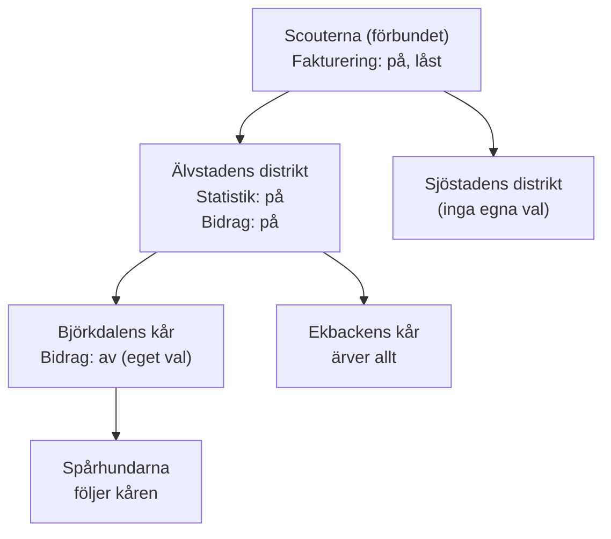
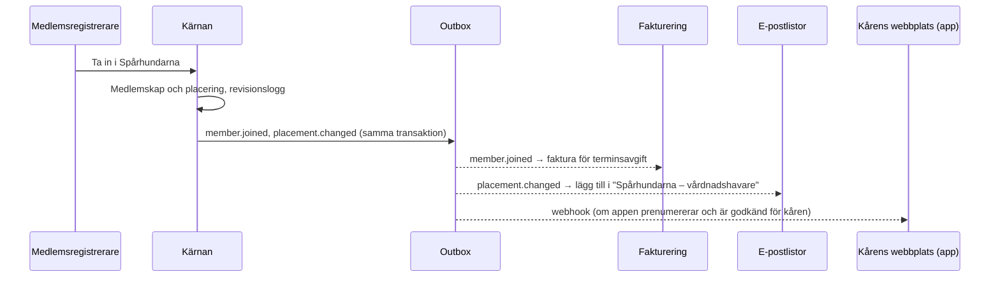

# Moduler i Scoutnet 2

> Förslag till arkitektur, med en fungerande grund i prototypen (oktober 2026).
> Hör ihop med [planen](./02-plan.md) (avsnitt 4 och bilaga A) och [prototypen](./03-prototyp.md).

## Sammanfattning

Scoutnet 2 byggs som en **kärna** och **moduler** ovanpå den. Fakturering, Bidrag (stadsbidrag), Närvaro, Statistik, E-postlistor och Aktiviteter är exempel på moduler. Kåren, distriktet eller förbundet väljer vilka moduler de använder.

Modulerna finns på tre nivåer, och nivån väljs efter hur nära persondatan de behöver komma:

| Nivå | Vad | Vem bygger | Körs | Exempel |
|---|---|---|---|---|
| 1. Inbyggda moduler | Funktioner med full tillgång till kärnan, granskade och levererade med Scoutnet 2 | Scouternas utvecklare och bidragsgivare i det öppna repot | I samma program (modulär monolit) | Närvaro, Bidrag, Statistik, Fakturering, E-postlistor, Aktiviteter |
| 2. Regler och inställningar som data | Lokala variationer utan ny kod | Förbundet, distrikt eller kårer, via gränssnittet | Tolkas av en inbyggd modul | Kommunens bidragsregler, avgiftsmodeller, mallar |
| 3. Externa appar | Egna system som använder API:t | Kårer, distrikt och andra organisationer | Hos dem själva | Skojjt under övergången, kårens webbplats, synk till Google Workspace, Discord |

Rekommendationen i korthet:
- **Inbyggda moduler är Rust-crates** med ett gemensamt kontrakt (ett *trait* och ett *manifest*). De kompileras in i samma program. Det ger typkontroll mellan modulerna, en driftmiljö och inga nätverksanrop mellan dem.
- **Moduler slås på och av per enhet** i organisationsträdet. Ett val ärvs nedåt, ett förbund eller distrikt kan låsa valet, och beroenden kontrolleras (Bidrag kräver Närvaro).
- **Kärnan äger personuppgifterna och behörigheten.** En modul läser och ändrar via kärnans gränssnitt. Den kan aldrig se mer än användaren och loggas i samma revisionslogg.
- **Modulerna talar med varandra genom händelser** (en *outbox* i databasen). Samma händelser går via webhooks till externa appar.
- **Inga insticksprogram som laddas vid körning** (`.dll`/`.so`) och inga mikrotjänster från start. Gränserna är tydliga nog för att en modul kan brytas ut senare om det behövs.

Grunden finns redan i prototypen (avsnitt 12). Närvaro, Bidrag, Integrationer och den nya modulen Statistik är byggda som moduler, och kårer, distrikt och förbundet väljer moduler under *Moduler*.

## 1. Varför moduler

- **Kårerna är olika.** En liten kår vill ha medlemsregister och närvaro. En stor kår vill också ha fakturering, e-postlistor och läger med anmälan. Det som inte används ska inte synas.
- **Förbundet och distrikten behöver kunna styra.** Till exempel: "Fakturering används av alla kårer från 2028" eller "Bidrag är på i alla kårer i Göteborg".
- **Gradvis införande och piloter.** En ny modul slås på i fem pilotkårer och sedan för alla, utan en separat mekanism för funktionsflaggor. Det gör också flytten från Scoutnet och Skojjt stegvis, modul för modul.
- **Fler kan bidra.** I ett öppet projekt (MIT, under Scouterna på GitHub) kan en grupp bygga E-postlistor medan en annan bygger Aktiviteter, utan att röra kärnan.
- **Säkerheten blir lättare att granska.** Persondata och behörighet finns på ett ställe. En modul som bara räknar statistik kan granskas för det den gör.

Det här är **inte** målet: en öppen marknad för insticksprogram där vem som helst kan köra kod nära medlemmarnas personuppgifter. Den sortens utbyggnad sker som externa appar (nivå 3), med samma skydd som andra integrationer.

## 2. Tre nivåer i detalj

### 2.1 Inbyggda moduler: en modulär monolit

En inbyggd modul är en Rust-crate (i prototypen en katalog) som implementerar kontraktet i avsnitt 4. Servern listar sina moduler i kod och kan byggas med eller utan en modul via Cargo-features.

Varför så:

- **Typsäkerhet över gränserna.** Om Närvaro ändrar sitt publika gränssnitt kompilerar inte Bidrag. Fel upptäcks före driftsättning.
- **En driftmiljö och en databas.** Scouterna drivs till stor del av ideella. Ett program att övervaka, säkerhetskopiera och uppgradera är rätt nivå. Mikrotjänster skulle ge distribuerade transaktioner och fler sätt att läcka data.
- **Transaktioner över modulgränser.** "Ta in från väntelistan och skapa faktura" kan ske i samma transaktion via outboxen, så att inget halvt genomförs.

### 2.2 Regler och inställningar som data

Mycket av variationen mellan kårer och kommuner är regler, inte kod. Exempel som redan finns i prototypen: Göteborgs regler för aktivitetsbidrag (`grant_ruleset`, ålder 7–25 år, minst tre deltagare, 60 minuter med mera) är data som modulen Bidrag tolkar.

- Varje modul kan ha **inställningar per enhet** (`module_setting.settings`, JSON), beskrivna med ett JSON Schema i manifestet. Gränssnittet kan då bygga formuläret automatiskt, och servern validerar.
- **Senare, vid behov: WebAssembly.** Om en kommun har regler som inte går att uttrycka som data kan regeln skrivas som en liten Wasm-komponent (wasmtime, WIT-gränssnitt). Den får in sammankomsten och svarar godkänd eller underkänd, utan nätverk och utan annan data. Det är ett tydligt avgränsat ställe för "kod som data", inte en allmän insticksmodell.

### 2.3 Externa appar

Kårer och andra vill bygga egna saker, som en kårwebb med kalender, synk till Google Workspace eller en Discord-bot. De gör det **utanför** Scoutnet 2, via API:t:

- **Identitet och behörighet via ScoutID.** Appen är en OAuth-klient med *scopes* (`scoutnet.members.read`, `scoutnet.members.contact`, `scoutnet.attendance.write` …). En kårordförande godkänner appen för sin kår.
- **API-nycklar för enkla fall.** De finns redan i prototypen: per kår, med behörigheter, och ingen kan ge en nyckel mer än hen själv får se.
- **Händelser via webhooks.** Det är samma händelser som modulerna använder (avsnitt 7), signerade med HMAC.
- **I menyn som länk.** Appen kan visas under *Moduler → Appar* och i menyn. Den öppnas i ett eget fönster med inloggning via ScoutID, inte inbäddad med åtkomst till Scoutnets sida.
- **Insyn.** Varje hämtning syns för medlemmen under "Vem har sett mina uppgifter", med appens namn. Det fungerar redan för API-nycklar.

### 2.4 Varför inte …

| Alternativ | Varför inte (nu) |
|---|---|
| Insticksprogram som laddas vid körning (`.dll`/`.so`) | Rust har inget stabilt binärgränssnitt. Ett fel i en modul kan krascha allt, och koden får samma åtkomst som kärnan utan granskning. |
| Mikrotjänst per modul | Distribuerade transaktioner, fler hemligheter, fler nätverksvägar för persondata och mer drift för en ideell organisation. Kan göras för en enskild modul senare, eftersom gränserna redan finns. |
| Skriptspråk (Lua, JavaScript) i servern | Svårt att begränsa vad skripten får läsa. Om kod behöver köras som data är Wasm med ett snävt gränssnitt bättre (2.2). |
| Funktionsflaggor i stället för moduler | Flaggor är tillfälliga och tekniska. Moduler är ett begrepp som kårer förstår, med beroenden, behörighet, menyval och data. |

## 3. Kärnan

Kärnan är det som alla behöver och som moduler bygger på:

- **organisationsträdet** (förbund, distrikt, kår, avdelning, patrull) med läsbara nycklar
- **personer**, kontaktuppgifter, vårdnadshavare och hushåll
- **medlemskap**, placeringar, väntelista och roller
- **behörighet** (roller → behörigheter → enheter) och fältmaskning per dataklass
- **revisionsloggen**, inklusive "Vem har sett mina uppgifter"
- **konton och inloggning** via ScoutID, sessioner, API-nycklar och OAuth-klienter
- **listmotorn** (filter, sortering, sparade vyer, export), som moduler kan lägga till kolumner i
- **händelser** (outbox), **jobb** (kö i PostgreSQL) och **designsystemet** i webbappen

Kärnan ska vara liten men inte tom. Det mesta som rör personuppgifter hör hemma här, så att skyddet finns på ett ställe.

## 4. Modulkontraktet

### 4.1 Det som finns i prototypen

```rust
pub struct Manifest {
    pub id: &'static str,              // stabilt id, t.ex. "grants"
    pub name: &'static str,            // "Bidrag"
    pub description: &'static str,
    pub icon: &'static str,
    pub availability: Availability,    // Available eller Planned
    pub default_enabled: bool,
    pub depends_on: &'static [&'static str],
    pub nav: &'static [NavEntry],      // menyval: sökväg, enhetstyper, behörighet
}

pub trait Module: Sync {
    fn manifest(&self) -> &'static Manifest;
    fn router(&self) -> Router<AppState>;              // modulens API-anrop
    fn openapi(&self) -> utoipa::openapi::OpenApi;     // modulens del av API-dokumentationen
}

pub static MODULES: &[&dyn Module] =
    &[&attendance::Attendance, &grants::Grants, &statistics::Statistics, &integrations::Integrations];
```

Kärnan gör resten automatiskt:
- Modulens anrop under `/v1/bodies/{id}/…` **spärras** när modulen är av för enheten (404 med felkoden `module_disabled`).
- **Menyn** byggs av manifesten, utifrån vilka moduler som är på och vad användaren får se.
- **OpenAPI** slås ihop, med en tagg per modul.
- **Beroenden** kontrolleras både när en modul slås på eller av och vid varje anrop.

Koden finns i [crates/sn-server/src/modules/](../crates/sn-server/src/modules/mod.rs).

### 4.2 Utbyggnadspunkter i målbilden

| Utbyggnadspunkt | Modulen bidrar med | Exempel | Prototypen |
|---|---|---|---|
| API och OpenAPI | `router()`, `openapi()` | `/v1/bodies/{id}/statistics` | ✅ |
| Menyval | `NavEntry` med enhetstyper och behörighet | Närvaro för kår och avdelning | ✅ |
| Spärr och beroenden | `depends_on`, automatisk spärr | Bidrag kräver Närvaro | ✅ |
| Kolumner och filter i medlemslistan | Fält med SQL-uttryck, dataklass och behörighet | Närvaro %, Avgift | Delvis: kolumnen Närvaro döljs när modulen är av |
| Flikar i personkortet | Komponent och data per person | Närvaro, Fakturor, Anmälningar | Nej |
| Kort på översikten | Komponent med "att göra" | "Registrera närvaro", "12 obetalda fakturor" | Delvis: Närvarokortet följer modulen |
| Behörigheter och rollmallar | Egna behörigheter och vilka roller som får dem som standard | `billing.manage` till kassören | Nej (kärnans behörigheter används) |
| Händelser | Prenumerationer på kärnans händelser och egna händelser | E-postlistor uppdateras när någon byter avdelning | Nej |
| Schemalagda jobb | Jobb i kön, med pausning när modulen är av | Påminnelser om obetalda fakturor | Nej |
| Inställningar per enhet | JSON Schema i manifestet | Bidrag: kommun och regeluppsättning | Kolumnen `settings` finns |
| Databas | Eget schema och egna migreringar | `billing.invoice` | Nej (sqlx 0.9 stöder egen migreringstabell och schema per modul) |
| GDPR | Export av en persons data, gallring, radering | Fakturor sparas i 7 år (bokföringslagen) | Nej |
| Drift | Hälsokontroll och mätvärden per modul | Kölängd för utskick | Nej |

Kontraktet i målbilden blir ungefär:

```rust
pub trait Module: Send + Sync {
    fn manifest(&self) -> &'static Manifest;
    fn migrations(&self) -> Option<sqlx::migrate::Migrator> { None }   // eget schema och egen tabell
    fn router(&self) -> Router<AppState>;
    fn openapi(&self) -> utoipa::openapi::OpenApi;
    fn permissions(&self) -> &'static [PermissionDef] { &[] }         // med rollmallar
    fn member_fields(&self) -> &'static [ListField] { &[] }           // kolumner och filter
    fn handlers(&self) -> &'static [EventHandler] { &[] }             // händelser in
    fn jobs(&self) -> &'static [JobDef] { &[] }
    fn settings_schema(&self) -> Option<&'static str> { None }        // JSON Schema
    fn gdpr(&self) -> Option<&'static dyn GdprHooks> { None }         // export, gallring, radering
}
```

## 5. Aktivering per enhet

Reglerna är implementerade och testade i prototypen:

1. **Standardläge.** Varje modul har ett standardläge i manifestet. Planerade moduler är alltid av.
2. **Närmaste val gäller.** Ett val på förbundet gäller alla. Ett distrikt kan välja annorlunda för sina kårer, och en kår för sig själv. Avdelningar och patruller följer sin kår.
3. **Låsning.** Ett förbund eller distrikt kan låsa sitt val. Då gäller det översta låsta valet, och underliggande enheter kan inte ändra det (409, "Statistik är låst av Älvstadens scoutdistrikt"). Kårens eget val sparas och gäller igen om låset tas bort.
4. **Beroenden.** En modul är bara på om allt den kräver är på. Det går inte att stänga av Närvaro medan Bidrag är på (409, "Bidrag kräver Närvaro. Stäng av Bidrag först.").
5. **Behörighet.** Kårordförande, distriktsordförande och förbundsadministratör får välja moduler (`modules_manage`). Varje ändring loggas i revisionsloggen.

Det här händer när en modul stängs av:
- dess anrop svarar 404 med `module_disabled`
- menyvalen försvinner, och gamla länkar visar en förklaring med länk till *Moduler*
- integrationer som använder modulen slutar fungera
- **data finns kvar**, så att modulen kan slås på igen

I målbilden pausas också modulens jobb och händelser, och data gallras enligt modulens regler om den varit av länge.

Exempel:



Data: tabellen `module_setting (body_id, module_id, enabled, locked, settings, updated_by, updated_at)` ([migration 0010](../crates/sn-server/migrations/0010_modules.sql)). Läget räknas fram av en ren funktion (`modules::resolve`), som har enhetstester för arv, låsning och beroenden.

## 6. Data och gränser

- **Varje modul äger sina tabeller** i ett eget PostgreSQL-schema (`attendance.meeting`, `billing.invoice`). Den har egna migreringar med egen migreringstabell, vilket sqlx 0.9 stöder (`Migrator::dangerous_set_table_name`, `create_schema`).
- **Moduler läser kärnan via ett läsgränssnitt** (Rust-API och vyer som `member_current`). De skriver aldrig direkt i kärnans tabeller, utan via kärnans tjänster. Där finns validering, behörighet och revisionslogg.
- **Moduler läser inte varandras tabeller.** Bidrag använder Närvaros publika Rust-gränssnitt (i prototypen terminshjälparna), eller händelser.
- **Främmande nycklar går från modul till kärna** (`person_id`), aldrig tvärtom. När en person raderas skickar kärnan en händelse, och varje modul raderar eller avidentifierar sin data (GDPR-krok).
- **Gränserna kontrolleras automatiskt:**
  - Beroendegrafen mellan crates kontrolleras i CI.
  - Varje modul får en egen databasroll med rättigheter bara till sitt schema och kärnans läsvyer.
  - Ett arkitekturtest stoppar SQL mot andra modulers scheman.

I prototypen ligger tabellerna kvar i kärnans schema och migreringar. Flytten görs när modulerna blir egna crates (avsnitt 13).

## 7. Händelser mellan moduler

Kärnan skriver händelser i en **outbox-tabell i samma transaktion** som ändringen. En utskickare levererar dem till modulernas hanterare i samma program och via webhooks till externa appar. Leveransen sker minst en gång, så hanterarna måste tåla dubbletter (idempotens).

| Händelse | Skickas när | Används av |
|---|---|---|
| `member.joined` | Någon blir medlem eller tas in från väntelistan | Fakturering (terminsavgift), E-postlistor, appar |
| `member.left` | Medlemskap avslutas | Fakturering (makulera ej förfallna), E-postlistor (ta bort) |
| `placement.changed` | Byte av avdelning eller patrull | E-postlistor, Närvaro (deltagarlista) |
| `role.assigned` / `role.ended` | Funktionärsroll ändras | E-postlistor ("alla ledare"), registerutdrag |
| `person.contact_changed` | E-post eller telefon ändras | E-postlistor, appar |
| `person.erased` | En person raderas (GDPR) | Alla moduler |
| `meeting.held` | Ett möte med närvaro är rapporterat | Bidrag, Statistik |
| `invoice.paid` | En faktura är betald | Aktiviteter (bekräfta anmälan) |

Exempel: en ny medlem tas in från väntelistan.



## 8. Behörighet och dataskydd

- **Modulerna deklarerar sina behörigheter** (t.ex. `billing.read`, `billing.manage`) och vilka roller som får dem som standard. Kärnan avgör behörigheten, i målbilden med Cedar (planen 7.3). Modulerna frågar bara kärnan.
- **Fält klassas** (grund, kontakt, personlig, känslig, ekonomi). Maskning, export och loggning blir då lika i alla moduler. En kolumn som en modul lägger till i medlemslistan maskas på samma sätt som kärnans.
- **En modul ser aldrig mer än användaren.** En app eller nyckel får aldrig mer än den som godkände den. Det är redan implementerat för API-nycklar.
- **Läsning av personuppgifter loggas** via kärnans revisionslogg och syns för medlemmen.
- **Statistik visar bara antal.** I målbilden döljs små grupper (färre än 3) för den som inte får se personerna.

## 9. Webbappen

- **Menyn kommer från servern.** `BodyDto.nav` innehåller de aktiva modulernas menyval som användaren får se. Inget behöver hårdkodas när en modul läggs till.
- **Avstängda moduler.** En undersida till en modul som är av visar en förklaring med länk till *Moduler*, och anropar inte modulens API.
- **Sidor per modul.** I prototypen ligger modulernas sidor under `web/src/routes/[kind=kind]/[nr=nr]/<sökväg>/`. I målbilden ligger modulens komponenter i `web/src/modules/<id>/`, och sidorna är tunna. Sidorna laddas först när de används (koddelning per route).
- **Platser för modulernas komponenter** (personkortets flikar, översiktens kort, kolumner i listan) registreras i en gemensam modulregistrering i webbappen.
- **Enhetlig design.** Modulerna använder samma komponenter (listan, personkortet, kort, dialoger) och samma designsystem. Det är kravet som gör att Scoutnet 2 känns som ett system.

## 10. Externa appar och integrationer

- **Appregister** per förbund, distrikt eller kår:
  - Appen är registrerad som OAuth-klient i ScoutID med de scopes den behöver.
  - Kårens ordförande godkänner, och kan återkalla, åtkomsten för kåren.
  - Godkända appar visas under *Moduler → Appar* och kan få ett menyval som länk.
- **Granskning.** Appar som vill ha personnummer eller känsliga uppgifter granskas av Scouterna och märks "Granskad".
- **Kompatibilitet.** Modulen Integrationer erbjuder Scoutnets gamla format (`/api/group/memberlist`), så att Skojjt och andra integrationer kan flytta utan omskrivning. Den modulen kan stängas av helt när ingen längre använder det gamla formatet.

## 11. De föreslagna modulerna

| Modul | Innehåll | Kräver | Händelser in → ut | Status |
|---|---|---|---|---|
| ✅ **Närvaro** (`attendance`) | Terminsplanering, närvaro i mobilen, kalender (iCal) | – | `placement.changed` → `meeting.held` | Modul i prototypen |
| 📄 **Bidrag** (`grants`) | Kommunala aktivitetsbidrag (stadsbidrag): regler som data, kontroll per sammankomst, DAK-export. Senare även lägerbidrag och statsbidrag. | Närvaro | `meeting.held` → – | Modul i prototypen |
| 📊 **Statistik** (`statistics`) | Medlemsutveckling, ålder och kön, scouter per ledare, närvaro per gren, väntelista | – (använder Närvaro om den är på) | – | **Ny modul** i prototypen |
| 🔌 **Integrationer** (`integrations`) | API-nycklar per kår, Scoutnet-kompatibelt API | – | – → webhooks | Modul i prototypen |
| 💳 **Fakturering** (`billing`) | Terminsavgifter och fakturor, påminnelser, Bankgiro/Swish, export till bokföring. Tar över avgiftsfälten från kärnan. | – | `member.joined`, `member.left` → `invoice.paid` | Planerad (planen fas 4) |
| ✉️ **E-postlistor** (`mailing_lists`) | Listor som uppdateras automatiskt efter avdelning, roll och ålder. Synk till Google Workspace eller en e-posttjänst. | – | `member.*`, `placement.changed`, `role.*`, `person.contact_changed` → – | Planerad (planen fas 3) |
| 🏕️ **Aktiviteter** (`activities`) | Arrangemang och läger: anmälan, formulär, deltagarlistor, specialkost, incheckning | – (använder Fakturering och Närvaro om de är på) | `invoice.paid` → `registration.*` | Planerad (planen fas 5) |

"Använder X om den är på" är ett **valfritt beroende**. Modulen fungerar utan X men får mer funktion med den. Statistik visar till exempel närvaro per gren bara när Närvaro är på. Det är redan implementerat.

## 12. Så ser det ut i prototypen

- **Under *Moduler*** (kårordförande, distriktsordförande eller förbundsadministratör) visas varje modul:
  - om den är på eller av, och varifrån valet kommer ("Ärvt från Älvstadens scoutdistrikt")
  - om valet är låst, och vad modulen kräver
  - planerade moduler, utgråade

  Här slår man på och av, låser valet för underliggande enheter eller går tillbaka till det ärvda valet.
- **Menyn** följer modulerna. När Bidrag stängs av för kåren försvinner Bidrag ur menyn, även för avdelningarna. Gamla länkar visar en förklaring.
- **API:t:**
  - `GET /v1/modules` ger katalogen.
  - `GET /v1/bodies/{id}/modules` visar läget per enhet.
  - `PUT /v1/bodies/{id}/modules/{module}` med `{enabled, locked}` ändrar valet. `enabled: null` ger tillbaka det ärvda valet.
  - En avstängd modul ger 404 med `module_disabled`.
- **Rökprovet** prövar katalog, menyval, behörighet, beroenden, spärr (även via mötes-id), låsning, planerade moduler och statistiken. Det har nu 109 kontroller.

### Lägga till en modul

Modulen Statistik byggdes så här. Rust-delen är cirka 400 rader, och modulen har en sida i webbappen.

1. Skapa `crates/sn-server/src/modules/<id>/mod.rs` med manifest (id, namn, beskrivning, beroenden, menyval) och `impl Module`.
2. Skriv anropen i samma katalog, med `#[utoipa::path]` och en `router()`. Använd `load_visible_body` och behörigheterna för att avgöra vem som får se vad.
3. Lägg till modulen i `MODULES` i [modules/mod.rs](../crates/sn-server/src/modules/mod.rs), efter de moduler den beror på (ett enhetstest kontrollerar ordningen).
4. Lägg sidan i `web/src/routes/[kind=kind]/[nr=nr]/<sökväg>/+page.svelte`, och kör `npm run api:types` för typerna.
5. Lägg till kontroller i `scripts/smoke.py`.

Menyval, spärr, aktivering per enhet, beroenden och API-dokumentation följer med automatiskt.

## 13. Vägen framåt

1. **Klart i prototypen:**
   - kontrakt och katalog
   - aktivering per enhet med arv, låsning och beroenden
   - spärr och meny från servern
   - fyra moduler, varav Statistik är ny
2. **Fas 1 (fundament):**
   - Bryt ut kärnans gränssnitt till en crate (`sn-core`: `AppState`, behörighet, revisionslogg, listmotor, händelser) och varje modul till en egen crate (`sn-mod-attendance` …).
   - Ge modulerna egna scheman och migreringar, outbox och jobb.
   - Låt modulerna deklarera behörigheter och lägga till kolumner i listan.
   - Testa modulgränserna i CI.
3. **Fas 2–5:** bygg modulerna i planens ordning: Närvaro och Bidrag, E-postlistor, Fakturering, Aktiviteter. Varje modul piloteras i några kårer genom att slås på bara där.
4. **Externa appar:** appregister och webhooks när OAuth-scopes finns i ScoutID (planen 6.2–6.3).

## 14. Risker och hur de hanteras

| Risk | Hantering |
|---|---|
| För många, för små moduler | En modul är något en kår kan välja att inte använda. Tekniska lager (export, sök, behörighet) är kärna, inte moduler. |
| Modulgränser som läcker (direkt SQL mot andras tabeller) | Egna scheman, databasroller per modul och arkitekturtester i CI |
| Kombinationer som inte testas | Få moduler och en liten beroendegraf. Rökprovet kör med alla på och med var och en av. |
| Prestanda för kontrollen per anrop | Två små frågor per anrop (under 1 ms). Kan cachas i minnet och uppdateras med `LISTEN/NOTIFY`. |
| Data i avstängda moduler | Data finns kvar, och omfattas av modulens gallringsregler och GDPR-krokar |
| Modul som ändrar beteende i kärnan | Modulen kan bara lägga till, via utbyggnadspunkterna. Kärnans regler (behörighet, maskning, revisionslogg) går inte att stänga av. |
