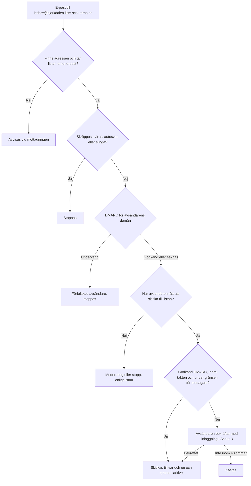
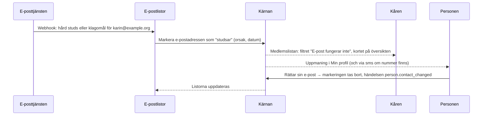

# Plan: modulen E-postlistor

> Version 0.2, 2026-10-19. Del av [modulplanen](../06-moduler.md). Modulens id är `mailing_lists`.
> Bygger på [analysen](../01-analys-av-scoutnet.md) (8.2, 9.1 och 10), Scoutnets manual för kårens kommunikation (Mejllistor), sidan *Redigera maillista* i dagens Scoutnet och erfarenheter från Google-Scoutnet-synk.
>
> **Ändringar i 0.2:** Listadresser som går att komma ihåg, med kontroll av avsändaren så att adresserna inte blir en väg in för skräppost (avsnitt 7). Utskick från Scoutnet 2 med formatering och riktiga bilagor (avsnitt 6).

## Sammanfattning

E-post är kårens viktigaste kanal till vårdnadshavare och ledare. Modulen gör listorna till något som **sköter sig självt**:

- **Listor finns från början.** När en avdelning skapas får den listor för scouter, vårdnadshavare och ledare. Kåren får listor för ledare, styrelse och alla vårdnadshavare. Namn och adresser följer enheten.
- **En lista är ett urval i medlemslistan.** Samma filter som i medlemslistan (gren, ålder, roll, registerutdrag …) plus en **målgrupp**: medlemmen själv, vårdnadshavarna eller båda. "Skapa e-postlista av den här vyn" är ett klick. Mottagarna visas med skälet till att de är med.
- **Vårdnadshavare är en egen målgrupp.** Det är inte samma sak som "barnets e-postfält". En förälder med tre barn i kåren får ett meddelande, inte tre.
- **Tre sätt att skicka:**
  - **skriv i Scoutnet 2**, med formatering, bilagor, mallar, fält som "barnets namn" och förhandsvisning
  - **skicka till listans adress** från den egna e-postklienten, med formatering och bilagor som vanligt
  - **synka till Google Workspace eller Microsoft 365**, för kårer som använder det
- **Adresser som går att komma ihåg.** Adresserna följer samma mönster i alla kårer, till exempel `ledare@bjorkdalen.lists.scouterna.se` och `sparhundarna-vardnadshavare@bjorkdalen.lists.scouterna.se`. Ingen behöver längre kopiera en slumpad adress ur systemet.
- **Avsändaren kontrolleras.** Det är kontrollen av avsändaren som skyddar listan, inte att adressen är hemlig.
  - Bara den som har rätt att skicka till listan kommer fram, och avsändaren måste vara äkta.
  - Förfalskade avsändare stoppas.
  - Den som inte kan bevisa vem hen är bekräftar utskicket genom att logga in med ScoutID.
  - Övriga meddelanden modereras eller stoppas.
- **Varje mottagare får ett eget meddelande.** Ingen ser andras adresser, och svaren går till avsändaren.
- **Arkiv för mottagarna:** vårdnadshavare läser tidigare utskick i Min profil, så att inget missas.
- **Studsar syns.** En e-postadress som inte fungerar markeras och syns i medlemslistan och för personen själv, på samma sätt som returpost i Fakturering.
- **Mottagaren väljer själv** vilka frivilliga utskick hen vill ha. Information som hör till medlemskapet går alltid fram.

## 1. Så fungerar det i dag

I Scoutnet finns listorna under *Kårnamn → Kommunikation → Mejllistor* (även per avdelning):

- **Typer:** *fördefinierade listor* (synliga och ändringsbara för andra i kåren) och *egna listor* (dolda), som är *fasta* (manuella) eller *dynamiska* (regler).
- **Regler** bygger listan:
  - filter för medlemskap (nivå och underliggande nivåer)
  - roller
  - medlemsprofil (t.ex. födelsedatum)
  - övriga egenskaper (t.ex. utmärkelser)

  Varje regel granskas och godkänns, och listan måste markeras som aktiv.
- **Adresser:** medlemmens primära e-postadress. Alternativa adresser tas med bara om man kryssar för det **på varje medlemsprofil**.
- **Listans adress är slumpad**, till exempel `5f3c81e0a92b7@lists.scouterna.se` (ett påhittat exempel), och man kopierar den ur Scoutnet.
  - Knappen *Skapa ny* ger en ny slumpad adress, till exempel när den gamla har börjat ta emot skräppost.
  - Det finns också ett fält *Alias*, som inte beskrivs i manualen.
- **Inställningar per lista:**
  - *E-postlistan är aktiv* och *Öppen för inkommande e-post*
  - *Visa listnamnet för mottagarna*. Annars står det `Till: Undisclosed recipients <noreply@scouterna.se>`.
  - svarsadress, skräppostfilter och konton som får skicka
- **Mottagaradresser** väljs med kryssrutor per lista:
  - primär e-post, med kopior enligt medlemsprofilen
  - *Anhörig 1 e-post* och *Anhörig 2 e-post*
  - *Scouterna.se e-post* och *Alternativ e-post*

  Vårdnadshavare nås alltså genom fälten för anhöriga på barnets profil.
- **Knappen *Sänd e-post*** skickar från Scoutnet till en aktiv lista, men bara som ren text och utan bilagor. Den som vill formatera eller skicka med ett dokument skickar i stället från sin egen e-post till listans adress.
- **Listan kan laddas ned** (xls/csv).
- **Som API-urval:** listor används för att välja medlemmar i API:t ("medlemslistor baserade på e-postlistor"), bland annat av Google-Scoutnet-synk.

Det här fungerar dåligt:

1. **Svårt att bygga listor.** Manualens exempel ("ledare, utmanare, rover och kårfunktionärer") kräver fem regler i tre olika filtertyper. Avdelningsledare saknar ofta behörighet att ändra listor som skapats på kårnivå.
2. **Vårdnadshavare är otydligt.** Det framgår inte om och hur föräldrar nås. Föräldrar med flera barn får dubbletter.
3. **Inget skäl till att någon är med.** Det är svårt att se varför en person är med eller saknas.
4. **Studsar och fel adresser syns inte.** Ingen vet vilka adresser som inte fungerar.
5. **Inget arkiv.** Den som missade ett utskick kan inte läsa det i efterhand.
6. **Leveransproblem.** Utskick via Mailman på egen server riskerar att hamna i skräpposten (SPF, DKIM och DMARC för många avsändare).
7. **Synk till Google och M365 sker utanför Scoutnet** och har långvariga problem: dubbletter, funktionsadresser och regeltyper (analysen 10).
8. **Ingen hantering av samtycke och val.** Allt eller inget.
9. **Adresserna går inte att komma ihåg.** Den slumpade adressen måste kopieras ur Scoutnet varje gång.
   - Den skyddar inte heller: när ett meddelande har vidarebefordrats, eller en mottagares e-post har kapats, är adressen känd.
   - Då återstår bara *Skapa ny*, och alla som skickar till listan måste få den nya adressen.
10. **Utskick från Scoutnet är bara text.** Utan formatering och bilagor skickar ledare ofta från sin egen e-post i stället. Använder de egna adresslistor i stället för listans adress hamnar utskicket inte i något arkiv. Råkar någon dessutom använda *Kopia* i stället för *Dold kopia* ser alla mottagare varandras adresser.

## 2. Mål

| Mål | Mått |
|---|---|
| Listor utan underhåll | Varje avdelning har sina standardlistor från första dagen. Inga manuella ändringar när scouter byter avdelning. |
| Rätt mottagare | 0 dubbletter per utskick. Varje mottagare har ett synligt skäl. |
| Når fram | Minst 98 % leverans. Studsar syns för kåren inom ett dygn. |
| Ingen missar | Vårdnadshavare kan läsa alla utskick som rör deras barn i Min profil |
| Enkelt | En ledare skickar till avdelningens vårdnadshavare på under en minut, från mobilen |
| Integritet | Ingen mottagare ser andras adresser. Frivilliga utskick kan väljas bort med ett klick. |
| Adresser att komma ihåg | En ledare kan skriva listans adress ur minnet (`<lista>@<kår>.lists.scouterna.se`). Ingen behöver kopiera adresser ur systemet. |
| Ingen skräppost via listorna | Inga utskick når mottagarna från avsändare utan rätt att skicka. Förfalskade avsändare stoppas alltid. |
| Formatering och bilagor | Ett utskick från Scoutnet 2 kan ha rubriker, listor, länkar, bilder och bilagor. Det ser likadant ut i Gmail, Outlook och Apple Mail, på dator och i mobil. |

## 3. Begrepp

- **Lista (mottagargrupp):**
  - ett **urval** (samma filterspråk som medlemslistan och sparade vyer)
  - en **målgrupp**: *medlemmen*, *vårdnadshavare* eller *båda*
  - **tillägg och undantag** för hand (personer, eller externa adresser som kårens revisor)
- **Kategori:** varje utskick har en kategori. *Verksamhetsinformation* och *kallelser* går alltid fram. *Nyhetsbrev* och *erbjudanden* kan mottagaren välja bort.
- **Adress:** varje lista kan ha en adress som går att komma ihåg, på formen `<lista>@<kår>.lists.scouterna.se`, till exempel `sparhundarna-vardnadshavare@bjorkdalen.lists.scouterna.se` (avsnitt 7.1). Om listan ska ha en adress, och om kåren vill använda en egen domän, är val.
- **Avsändare:** vem som får skicka till listan, enligt en av fyra regler (avsnitt 7.2). Reglerna bygger på roller (t.ex. avdelningsledare för avdelningens listor), inte på enskilda konton. Andra avsändare modereras eller stoppas.
- **E-postadressens status:** `ok`, `studsar` (hård studs eller klagomål) eller `overifierad`. Statusen hör till kärnan, eftersom kontaktuppgiften är kärndata.

## 4. Standardlistor

När en enhet skapas, eller modulen slås på, skapas listorna av sig själva. De går inte att ta bort, men de kan stängas av.

| Enhet | Lista | Adress | Urval och målgrupp | Får skicka (avsnitt 7.2) |
|---|---|---|---|---|
| Avdelning | *Spårhundarna – vårdnadshavare* | `sparhundarna-vardnadshavare@` | Aktiva scouter i avdelningen, vårdnadshavare | Avdelningens ledare och kårens styrelse |
| Avdelning | *Spårhundarna – scouter* | `sparhundarna-scouter@` | Aktiva scouter 13 år och äldre med egen e-post, medlemmen (åldersgränsen är en inställning) | Avdelningens ledare |
| Avdelning | *Spårhundarna – ledare* | `sparhundarna-ledare@` | Ledare placerade i avdelningen, medlemmen | Listans medlemmar |
| Kår | *Alla ledare* | `ledare@` | Alla med ledarplacering eller funktionärsroll i kåren | Listans medlemmar |
| Kår | *Styrelsen* | `styrelsen@` | Rollerna kårordförande, kassör, sekreterare och ledamot | Listans medlemmar |
| Kår | *Alla vårdnadshavare* | `vardnadshavare@` | Alla aktiva scouter under 18, vårdnadshavare | Kårens styrelse |
| Kår | *Väntelistan* | `vantelistan@` | Personer i väntelistan, vårdnadshavare eller medlemmen | Medlemsregistrerare och kårens styrelse |
| Distrikt | *Kårordförande i distriktet* | `karordforande@` | Rollen kårordförande i underliggande kårer | Listans medlemmar och distriktets styrelse |

Adressen är den lokala delen före `@<kår>.lists.scouterna.se`, för distrikt `@<distrikt>.lists.scouterna.se`. Exempel: `ledare@bjorkdalen.lists.scouterna.se` och `karordforande@alvstaden.lists.scouterna.se`.

- **Namn och adresser följer enheten.** När en avdelning byter namn ändras listans namn och adress. Den gamla adressen fungerar som alias i ett år (avsnitt 7.1).
- **Funktionsadresser** (`ordforande@`, `kassor@`, `kontakt@`) pekar på en roll i stället för en person. De följer rollen när den byter innehavare, och det löser ett av de kända problemen i dagens synk. De är öppna för alla, eftersom de bara går till några få personer (avsnitt 7.2).

## 5. Egna listor

- **Från medlemslistan:** filtrera, välj målgrupp och klicka *Skapa e-postlista*. Exempel: "vårdnadshavare till spårare och upptäckare som saknar registrerad närvaro i oktober".
- **Redigera** med samma filterchips som i medlemslistan, inte med en separat regelmotor.
- **Mottagare i förhandsvisningen**, med skäl:
  - "Karin Björk – vårdnadshavare till Juni Björk (Familjescouterna)"
  - "Hugo Lindström – roll: kårordförande"

  Personer utan fungerande e-post visas med varning och länk till personkortet.
- **Ägare och delning:** listan ägs av en enhet (kår eller avdelning). Avdelningsledare kan alltid hantera sin avdelnings listor, vilket löser dagens behörighetsproblem.
- **Fasta listor** (bara manuella tillägg) finns kvar för t.ex. en projektgrupp.

## 6. Skicka

Det finns två lika fullvärdiga sätt att skriva ett utskick: i Scoutnet 2 eller i den egna e-postklienten. Båda hamnar i samma arkiv och levereras på samma sätt.

### 6.1 Skriva i Scoutnet 2

På dator och i mobil:
- **Listor:** välj en eller flera. **Mottagare som finns i flera listor får ett meddelande.**
- **Formatering:**
  - En redigerare med rubriker, fet och kursiv stil, punkt- och nummerlistor, länkar, bilder i texten och enkla tabeller.
  - Text som klistras in från Word eller Google Docs behåller rubriker, listor och länkar, men rensas från annan formatering.
  - Kårens mall (logga och färger) läggs runt texten.
  - Meddelandet skickas både som HTML och som ren text.
- **Bilagor:**
  - Dra in filer på datorn, eller välj filer och bilder i mobilen.
  - Upp till 10 MB sammanlagt skickas som vanliga bilagor. Större filer skickas som en länk, som fungerar så länge utskicket finns i arkivet.
  - Tillåtna filtyper är PDF, bilder, Office- och OpenDocument-filer och kalenderfiler. Program, skript och dokument med makron stoppas.
  - Alla filer virussöks innan utskicket kan skickas.
  - Bilagorna sparas med utskicket i arkivet, så att den som läser i efterhand också får dem.
  - **Varning för personuppgifter:** om en bilaga verkar innehålla personnummer eller en deltagarlista med kontaktuppgifter, föreslås att den skickas som en länk som kräver inloggning, eller inte alls.
- **Mallar:** kallelse, information, påminnelse. Kåren kan ha egna mallar med logga.
- **Fält som fylls i per mottagare:** `{förnamn}`, `{barnets_namn}`, `{avdelning}`, `{nästa_möte}`. Med Närvaro fylls tid och plats för nästa möte i, och en kallelse kan få mötet som kalenderfil.
- **Förhandsvisning** för valfri mottagare, både som det ser ut i mobilen och på datorn, och **testutskick** till dig själv.
- **Utkast** sparas automatiskt. Ett utskick kan påbörjas på datorn och skickas från mobilen.
- **Schemalägg**, till exempel söndag kväll före måndagsmötet.
- **Kategori** (avgör om mottagaren kan välja bort) och **svarsadress** (avsändaren som standard).

### 6.2 Skicka från den egna e-postklienten

- Skriv till listans adress som till vem som helst, från Gmail, Outlook eller mobilen.
- Formatering och bilagor följer med som de är, med samma filtyper och virussökning som i 6.1 och högst 25 MB.
- Avsändaren kontrolleras innan något skickas vidare (avsnitt 7).
- Meddelandet hamnar i samma arkiv som utskick från Scoutnet 2 och syns i Min profil för mottagarna.

### 6.3 Leverans

Gäller båda sätten:
- **En EU-baserad e-posttjänst** med SPF, DKIM och DMARC för Scouternas domän och kårernas underdomäner.
- **Ett meddelande per mottagare.** Ingen ser andras adresser.
  - Mottagaren ser listans namn och adress i stället för "Undisclosed recipients".
  - List-Unsubscribe används för frivilliga kategorier.
- **Avsändaren visas som "Karin Björk via Spårhundarna – vårdnadshavare"** med listans adress, och svar går till Karin (Reply-To). Det behövs för att meddelandet ska komma fram när avsändarens domän har en strikt DMARC-regel, vilket Gmail, Outlook och många andra har.
- **Takt per kår och dygn**, som skydd mot missbruk och spärrar hos mottagarna.

## 7. Listadresser och kontroll av avsändaren

### 7.1 Adresser som går att komma ihåg

Formen är `<lista>@<kår>.lists.scouterna.se`:
- **`<kår>`** är kårens **kortnamn**, till exempel `bjorkdalen` för Björkdalens scoutkår. Kortnamnet är unikt i landet, ändras sällan och godkänns av kansliet.
  - Distrikt har kortnamn på samma sätt (`alvstaden`).
  - Förbundets egna listor har bara `<lista>@lists.scouterna.se`.
- **`<lista>`** bildas av listans namn med små bokstäver: å och ä blir a, ö blir o, och mellanslag blir bindestreck. Standardlistorna heter likadant i alla kårer (avsnitt 4).

Mer om adresserna:
- **Samma mönster överallt.** Den som vet kårens kortnamn kan skriva `ledare@`, `styrelsen@` eller `<avdelning>-vardnadshavare@` ur minnet. Kårens sida *E-post* visar alla adresser, med knapparna *Kopiera* och *Lägg till i kontakter*.
- **Alias:** en lista kan ha fler namn, till exempel `foraldrar@` för `vardnadshavare@`.
- **Namnbyten:** när en lista, avdelning eller kår byter namn fungerar den gamla adressen som alias i ett år.
  - Därefter får avsändaren ett svar med den nya adressen, om avsändaren är äkta (7.3).
  - Ett gammalt namn kan inte tas av en annan lista förrän efter två år, så att e-post inte hamnar hos fel mottagare.
- **Egen domän** som val: kåren pekar sin domän eller en underdomän (MX-post) till tjänsten, till exempel `ledare@bjorkdalensscoutkar.se`. En guide visar vilka DNS-poster som behövs.
- **Ingen adress:** en lista behöver ingen adress. Då kan den bara användas inifrån Scoutnet 2.
- **Varför en underdomän per kår:**
  - Varje kår har sina egna namn, så `ledare@` finns i alla kårer.
  - En kår vars adresser missbrukas kan stängas av utan att andra påverkas.
  - E-posttjänsten kan hålla isär kårernas rykte hos Gmail och Outlook.

### 7.2 Vem får skicka

Varje lista och funktionsadress har en av fyra regler:

| Regel | Kommer fram direkt | Standard för |
|---|---|---|
| **Avsändarroller** | Personer med vissa roller, till exempel avdelningens ledare och kårens styrelse | Listor till vårdnadshavare och scouter |
| **Listans medlemmar** | Alla som själva finns på listan | Ledarlistor och styrelsen (diskussionslistor) |
| **Alla i kåren** | Alla med medlemskap eller uppdrag i kåren | Valfritt |
| **Öppen** | Alla, efter skräppostfiltret | Funktionsadresser som `ordforande@` och `kontakt@` |

- **Den som inte kommer fram direkt** hamnar i moderering hos listans moderatorer, som standard listans ägare. Listan kan i stället stoppa sådana meddelanden helt.
- **En lista till många kan aldrig vara öppen.** Regeln *Öppen* tillåts bara för listor med högst 10 mottagare. Gränsen är en inställning.
- **Rätten prövas när meddelandet kommer in.** En ledare som har slutat kan inte längre skicka, utan att någon behöver ändra listan.

### 7.3 Så kontrolleras avsändaren

Avsändarraden i ett e-postmeddelande kan förfalskas. Därför räcker det inte att avsändarens adress finns i Scoutnet 2. Modulen kontrollerar också att meddelandet verkligen kommer från den adressen.

1. **Mottagning:** en adress som inte finns, eller en lista som inte tar emot e-post, avvisas redan när meddelandet tas emot. Då skickas inga studsmeddelanden till förfalskade avsändare.
2. **Filter:** skräppost och virus stoppas. Autosvar ("Jag är på semester"), studsar och meddelanden som redan har gått genom listan (slingor) skickas inte vidare.
3. **Äkthet:** e-posttjänsten tar fram DMARC-resultatet för avsändarens domän, det vill säga om SPF och DKIM stämmer med avsändaradressen.
   - *Godkänd:* avsändaren är äkta.
   - *Underkänd:* avsändaren är förfalskad. Meddelandet stoppas utan svar.
   - *Saknas:* domänen har ingen DMARC-regel. Avsändaren kan vara äkta, men det går inte att bevisa, så utskicket kräver bekräftelse.
4. **Rätt att skicka:** avsändaradressen slås upp bland personernas **bekräftade** e-postadresser i Scoutnet 2, både primära och alternativa.
   - Personen måste just nu ha rätt enligt listans regel.
   - Om flera personer delar adress, vilket är vanligt i familjer, räcker det att en av dem har rätt.
5. **Bekräftelse:**
   - Bekräftelse krävs i tre fall:
     - äktheten kan inte bevisas
     - utskicket går till fler mottagare än en gräns (standard 200, inställning per kår)
     - avsändaren har skickat mer än takten tillåter
   - Avsändaren får ett kort meddelande till sin adress i Scoutnet 2, och en notis i appen: "Du skickade *Hajk i helgen* till Spårhundarna – vårdnadshavare (54 mottagare). Skicka?"
   - Länken öppnar Scoutnet 2 och visar meddelandet. **Bekräftelsen kräver inloggning med ScoutID**, så det räcker inte att ha tillgång till e-posten.
   - Ett meddelande som inte bekräftas inom 48 timmar kastas.
   - Regeln *Öppen* kräver ingen bekräftelse, eftersom externa avsändare inte har något ScoutID. Där räcker skräppostfiltret, och adressen går bara till några få.
6. **Utskick:** var och en får ett eget meddelande (6.3). Meddelandet sparas i arkivet med avsändare, lista och hur avsändaren kontrollerades.

### 7.4 Svar och "svara alla"

- **Svar går till avsändaren**, inte till listan. En vårdnadshavare som svarar når ledaren, inte 54 andra föräldrar.
- **"Svara alla"** från en mottagare utan rätt att skicka når ändå avsändaren direkt.
  - Kopian till listan stoppas.
  - Mottagaren får ett kort besked om att svaret bara gick till avsändaren. Beskedet skickas bara om mottagaren är äkta enligt DMARC.
- **Diskussionslistor** (regeln *Listans medlemmar*) kan välja att svar går till hela listan.

### 7.5 Om någons e-post kapas

En kapad e-postadress klarar DMARC, eftersom meddelandet verkligen kommer från den. Då skyddar:
- **Bekräftelse med ScoutID** för stora utskick och utskick över takten. Tillgång till e-posten räcker inte för att bekräfta.
- **Kontroll av länkar och bilagor** mot listor över skadliga adresser och filer.
- **Ovanliga mönster väntar på bekräftelse**, till exempel samma meddelande till många listor på kort tid.
- **Stoppa listan:** listans ägare och kårens administratörer kan pausa en lista eller en avsändare med ett klick. I arkivet syns exakt vad som har skickats och till vilka.

### 7.6 Övergång från de slumpade adresserna

- Dagens slumpade adresser och alias importeras som alias till de nya listorna. De fungerar i ett år, med samma kontroll av avsändaren.
- Den som skickar till en gammal adress får ett svar med den nya adressen, om avsändaren är äkta.
- Synkskript och vidarebefordringar som använder de gamla adresserna fortsätter att fungera under tiden.

## 8. Mottagarens perspektiv

- **Min profil → Utskick:** alla meddelanden som skickats till mig eller mina barn, sökbara. Utskicket sparas i 13 månader (inställning per kår).
- **Mina val:**
  - vilka frivilliga kategorier jag vill ha
  - vilken av mina adresser som ska användas (primär eller alternativ, per kategori)
  - om utskick om mina barn ska gå till båda vårdnadshavarna
- **Avregistrera med ett klick** från frivilliga utskick, utan inloggning (signerad länk).
- **Studsande adress:** jag ser en uppmaning att rätta min e-post när jag loggar in.

## 9. Studsar och adresser som inte fungerar

Felmarkeringen delas med Fakturering, där returpost markerar adresser. Kåren ser samma sorts uppgift oavsett om det gäller post eller e-post.

## 10. Synk till Google Workspace och Microsoft 365

Många kårer har Google Workspace (gratis för ideella) och vill ha grupper där. Synken byggs in i modulen i stället för att ligga i externa skript:

- **Kåren ansluter** sitt Workspace eller M365 med ett servicekonto (OAuth, minsta möjliga behörighet). Uppgifterna lagras krypterade.
- **Varje lista kan synkas** till en grupp. Medlemmarna uppdateras **av händelser** (placering, roll, kontaktuppgift) inom några minuter, inte en gång per natt.
- **Funktionsadresser** blir alias eller grupper som följer rollen.
- **Inga dubbletter.** Samma person räknas en gång per grupp, oavsett hur många skäl hen har.
- **Statussida:**
  - senaste synk
  - fel per lista
  - en torrkörning som visar vad synken skulle ändra
- **Konton för ledare** (t.ex. `fornamn.efternamn@kar.se`) är en senare etapp och följer samma principer.

## 11. API och integrationer

- `GET /v1/lists/{id}/members` returnerar mottagare med skäl. Behörigheten följer kontaktuppgifterna.
- **Kompatibilitet:** Scoutnets "medlemslistor baserade på e-postlistor" finns i modulen Integrationer (samma format). Befintliga synkskript kan flytta utan omskrivning.
- **Webhooks** (via kärnans outbox): `list.member_added`, `list.member_removed`, `message.sent`. Externa appar kan hålla egna listor uppdaterade.
- **API-nycklar** får egna behörigheter (`lists.read`), så att en synk inte behöver hela medlemslistan.

## 12. Behörighet

| Behörighet | Ger | Standardroll |
|---|---|---|
| `lists.read` | Se listor och mottagare (kontaktuppgifter enligt `members_contact_read`) | Ledare, medlemsregistrerare |
| `lists.manage` | Skapa och ändra listor i enheten, med adresser, alias och regel för avsändare | Avdelningsledare (sin avdelning), kårordförande, medlemsregistrerare |
| `lists.send` | Skicka till listor där ens roll ger rätt att skicka, från Scoutnet 2 eller från e-postklienten (avsnitt 7.2) | Ledare (sin avdelning), styrelsen (kåren) |
| `lists.moderate` | Godkänna eller stoppa meddelanden som väntar på moderering, och pausa en lista eller en avsändare | Listans ägare: avdelningsledare (sin avdelning), kårordförande |
| `lists.integrations` | Ansluta Google Workspace eller M365 | Kårordförande |

- Ingen kan skicka till fler än den själv får se. Mottagarlistan visas bara med behörighet till kontaktuppgifter.
- **Skyddad identitet:** personen får utskick, men syns inte i mottagarlistor för andra och synkas inte till externa grupper.

## 13. Dataskydd och säkerhet

- **Rättslig grund:**
  - Verksamhetsinformation till medlemmar och vårdnadshavare bygger på medlemskapet (berättigat intresse).
  - Nyhetsbrev och erbjudanden bygger på samtycke (val i Min profil).
- **Minimering:**
  - Utskicksarkivet sparar meddelandet och vilka som fick det. Leveransloggen sparar status (levererad eller studs), **inte** om meddelandet öppnades.
  - Ingen spårning av öppningar eller klick.
- **Gallring:** arkivet sparas 13 månader och leveransloggen 3 månader, båda som inställningar. Bilagor gallras med utskicket.
- **Inkommande meddelanden** som väntar på bekräftelse eller moderering raderas efter 14 dagar om de inte skickas. För stoppade meddelanden sparas bara avsändaradress, tid och skäl, i 30 dagar, för att kunna upptäcka missbruk. Innehållet sparas inte.
- **Formaterad text tvättas.**
  - HTML från redigeraren och från inkommande e-post saneras mot en lista över tillåtna element (till exempel med Rust-craten `ammonia`).
  - Arkivet visar meddelandet i en avgränsad ram (sandboxad iframe med strikt CSP), så att ett elakt meddelande inte kan köra kod i Scoutnet 2.
  - Bilder från andra webbplatser laddas inte i arkivet förrän mottagaren väljer det, eftersom de kan användas för spårning.
- **Bilagor** virussöks och lagras krypterade inom EU.
- **Adresserna avslöjar inga personer.** Listadresser bygger på enhetens och listans namn, aldrig på personnamn.
- **Barn:** scouter under 13 får inga egna utskick som standard. Vårdnadshavarna nås i stället. Gränsen är en inställning per kår.
- **Leverantör:** personuppgiftsbiträdesavtal och lagring inom EU.

## 14. Datamodell

Modulens egna tabeller ligger i schemat `mailing_lists`:

| Tabell | Innehåll |
|---|---|
| `mailing_lists.list` | Enhet, namn, typ (standard, egen, fast), urval (filterfrågan), målgrupp, kategorier, regel för avsändare med avsändarroller, moderatorer, gräns för bekräftelse, svar till (avsändaren eller listan), synkmål, aktiv |
| `mailing_lists.address` | Adresser: lokal del, domän (kårens underdomän eller egen domän), lista eller funktionsroll, typ (huvudadress, alias, gammal, importerad), giltig till. Unik per domän. Gamla namn är reserverade i två år. |
| `mailing_lists.manual_entry` | Tillägg och undantag: person eller extern adress, av vem, när |
| `mailing_lists.member` | Materialiserade mottagare: lista, person, adress, skäl (JSON). Uppdateras av händelser. |
| `mailing_lists.message` | Utskick: listor, avsändare, källa (Scoutnet 2 eller e-postklient), hur avsändaren kontrollerades, ämne, innehåll (sanerad HTML och ren text), kategori, schemalagt, skickat, antal |
| `mailing_lists.attachment` | Bilagor: utskick, filnamn, typ, storlek, kontrollsumma, resultat av virussökningen, skickad som bilaga eller länk. Själva filen ligger i kärnans arkiv. |
| `mailing_lists.inbound` | Inkommande som väntar eller har stoppats: lista, avsändare, DMARC-resultat, beslut (skickat, bekräftelse, moderering, stoppat), skäl, tider. Innehållet raderas efter 14 dagar. |
| `mailing_lists.delivery` | Leverans per mottagare: status, leverantörens id, tid (gallras efter 3 månader) |
| `mailing_lists.preference` | Personens val per kategori och adress |
| `mailing_lists.sync_target` | Anslutet Workspace eller M365, grupp-id, senaste synk, fel |

**I kärnan:**
- e-postadressens status (`ok`, `studsar`, `overifierad`) med orsak och datum, och händelser när kontaktuppgifter ändras
- enheternas kortnamn

## 15. API (urval)

| Anrop | Beskrivning |
|---|---|
| `GET /v1/bodies/{id}/lists` · `POST /v1/bodies/{id}/lists` | Enhetens listor. Skapa från urval (`query` som i sparade vyer) och målgrupp. |
| `GET /v1/lists/{id}/members?preview=true` | Mottagare med skäl (förhandsvisning för ett nytt urval) |
| `POST /v1/messages` · `GET /v1/messages/{id}` | Skapa och schemalägga utskick, med status per kategori |
| `POST /v1/messages/{id}/attachments` | Ladda upp en bilaga. Den virussöks innan utskicket kan skickas. |
| `POST /v1/messages/{id}/test` | Testutskick till avsändaren |
| `GET /v1/bodies/{id}/addresses` | Enhetens listadresser och funktionsadresser, som lista eller vCard |
| `PUT /v1/lists/{id}/addresses` | Listans adress och alias. Ger 409 om namnet är upptaget eller reserverat. |
| `GET /v1/lists/{id}/inbound` · `POST /v1/inbound/{id}/approve` · `POST /v1/inbound/{id}/reject` | Moderering |
| `POST /v1/inbound/{id}/confirm` | Avsändaren bekräftar ett utskick. Kräver inloggning med ScoutID. |
| `POST /v1/lists/{id}/pause` | Pausa listan direkt |
| `GET /v1/me/messages` | Mina utskick (arkivet i Min profil) |
| `PUT /v1/me/mail-preferences` | Mina val |
| `POST /v1/mail/inbound` · `POST /v1/mail/events` | Mottagning från e-posttjänsten (inkommande med DMARC-resultat, och studsar), signerat |
| `POST /v1/bodies/{id}/lists/sync-targets` | Anslut Google Workspace eller M365 |

## 16. Modulen i systemet

| Del | E-postlistor |
|---|---|
| Kräver | Bara kärnan |
| Använder om de är på | **Närvaro** (fält för nästa möte, kallelser till möten och årsmöten), **Statsbidrag** och **Fakturering** (påminnelser via listor), **Aktiviteter** (deltagarlistor) |
| Händelser in | `member.joined`, `member.left`, `placement.changed`, `role.assigned`, `role.ended`, `person.contact_changed`, `guardian.changed`, `body.created`, `body.renamed`, `person.erased` |
| Händelser ut | `list.member_added`, `list.member_removed`, `message.sent`, `message.held` (väntar på bekräftelse eller moderering), `email.bounced` |
| Menyval | *E-post* för kår, avdelning och distrikt (`lists.read`): listor, adresser, utskick och moderering |
| Medlemslistan | Massåtgärden *Skicka e-post till valda* (vårdnadshavare eller medlemmar), *Skapa e-postlista av vyn*, filtret *E-post fungerar inte* |
| Personkortet | Fliken *Utskick*: listor personen är med i och varför, och senaste utskicken |
| Översikten | Korten "Senaste utskick", "3 e-postadresser studsar" och "2 meddelanden väntar på moderering" |
| Jobb | Utskickskö, schemalagda utskick, virussökning, synk till Workspace och M365, gallring av arkiv och inkommande |
| Inställningar per enhet | Avsändarnamn, egen domän, mallar, gräns för bekräftelse, takt, åldersgräns för egna utskick, gallringstider. Kortnamnet ligger i kärnan. |
| GDPR | Export: listor och utskick till personen. Radering: personen tas bort från listor och leveransloggen avidentifieras. |

## 17. Vad kärnan behöver

- **Filterspråket som tjänst**, så att en modul kan fråga "vilka personer matchar den här vyn?" med samma behörighet som medlemslistan.
- **Vårdnadshavarrelationer med kontaktuppgifter**, och händelsen `guardian.changed`.
- **Kontaktuppgifters status**, gemensamt med Fakturering (returpost) och E-postlistor (studsar). Statusen visar också om en e-postadress är **bekräftad**, så att avsändarkontrollen bara litar på adresser som personen har visat att hen har.
- **Kortnamn per enhet:** unikt i landet, godkänt av kansliet och med historik, så att gamla namn är reserverade. Används för listadresser.
- **Arkiv för filer** med virussökning, för bilagor. Det är samma arkiv som Statsbidrag och Fakturering använder.
- **Roller som adresser:** en uppslagning från roll och enhet till aktuell innehavare.
- **Outbox, jobb och inkommande webhooks** med signaturkontroll.

## 18. Etapper

| Etapp | Innehåll | Klart när |
|---|---|---|
| 0. Demo i prototypen (cirka 1 vecka) | Standardlistor per avdelning med läsbara adresser, *Skapa e-postlista av vyn* med målgrupp och skäl, skriv ett utskick med formatering och en bilaga och förhandsvisa det (skickas till en lokal testserver som Mailpit), arkivet i Min profil | Hela flödet kan visas lokalt |
| 1. Listor och utskick | Standard- och egna listor, utskick via EU-tjänst med formatering och bilagor, mallar, arkiv, studsar till kärnan | Pilotkårer slutar använda Mailman-listorna |
| 2. Listadresser och kontroll av avsändaren | Kortnamn för kårer, läsbara adresser och alias, inkommande e-post, DMARC, bekräftelse med ScoutID, moderering, takt, funktionsadresser, import av de slumpade adresserna som alias | Kårernas adresser (t.ex. `ledare@bjorkdalen.lists.scouterna.se`) fungerar via Scoutnet 2. Inga meddelanden från avsändare utan rätt når mottagarna i pilotkårerna. |
| 3. Synk | Google Workspace och M365 med händelser och statussida | Externa synkskript kan stängas av |
| 4. Val och sms | Mottagarens val per kategori, sms för brådskande meddelanden | – |

## 19. Risker och öppna frågor

| Fråga eller risk | Förslag |
|---|---|
| Domäner: Scouternas gemensamma domän eller kårernas egna? | Gemensam domän med underdomän per kår som standard. Egen domän som val med DNS-guide (SPF, DKIM och DMARC). |
| Kostnad för e-posttjänsten | Upphandla en EU-leverantör med ideellt pris. Takt och arkivtid styr volymen. |
| Leverans till Gmail och Outlook (krav på avsändare som skickar mycket) | DMARC, List-Unsubscribe och låg klagomålsfrekvens. Studsar hanteras direkt. |
| Missbruk (stora utskick, fel innehåll) | Bara roller får skicka. Takt per kår. Moderering för externa avsändare. Revisionslogg per utskick. |
| Adresser som går att gissa lockar skräppost | Skyddet är kontrollen av avsändaren, inte en hemlig adress (avsnitt 7.3). Okända adresser avvisas vid mottagningen, förfalskade avsändare stoppas, och listor till många kan aldrig vara öppna. |
| Avsändare vars domän saknar DMARC måste bekräfta varje utskick | Bekräftelsen är ett klick för den som redan är inloggad. Gmail, Outlook och de flesta stora tjänster har DMARC. Kåren kan rekommendera ledare att använda en sådan adress. |
| Samma kortnamn för två kårer | Kansliet godkänner kortnamnet när kåren skapas och vid övergången. Vid krock läggs orten till. |
| Bilagor med personuppgifter skickas till många | Varning när en bilaga verkar innehålla personnummer eller kontaktlistor, förslag att skicka som länk som kräver inloggning, och gallring med arkivet |
| Övergång från Mailman-adresser | Importera listor, slumpade adresser och alias. De gamla adresserna blir alias till de nya och fungerar i ett år med samma kontroll av avsändaren (avsnitt 7.6). |
