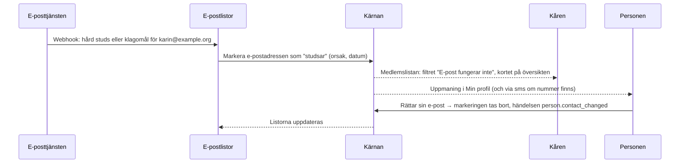

# Plan: modulen E-postlistor

> Version 0.1, 2026-10-18. Del av [modulplanen](../06-moduler.md). Modulens id är `mailing_lists`.
> Bygger på [analysen](../01-analys-av-scoutnet.md) (8.2, 9.1 och 10), Scoutnets manual för kårens kommunikation (Mejllistor) och erfarenheter från Google-Scoutnet-synk.

## Sammanfattning

E-post är kårens viktigaste kanal till vårdnadshavare och ledare. Modulen gör listorna till något som **sköter sig självt**:

- **Listor finns från början.** När en avdelning skapas får den listor för scouter, vårdnadshavare och ledare. Kåren får listor för ledare, styrelse och alla vårdnadshavare. Namn och adresser följer enheten.
- **En lista är ett urval i medlemslistan.** Samma filter som i medlemslistan (gren, ålder, roll, registerutdrag …) plus en **målgrupp**: medlemmen själv, vårdnadshavarna eller båda. "Skapa e-postlista av den här vyn" är ett klick. Mottagarna visas med skälet till att de är med.
- **Vårdnadshavare är en egen målgrupp.** Det är inte samma sak som "barnets e-postfält". En förälder med tre barn i kåren får ett meddelande, inte tre.
- **Tre sätt att skicka:**
  - **skriv i Scoutnet 2**, med mallar, fält som "barnets namn" och förhandsvisning
  - **skicka till listans adress** från den egna e-postklienten
  - **synka till Google Workspace eller Microsoft 365**, för kårer som använder det
- **Varje mottagare får ett eget meddelande.** Ingen ser andras adresser, och svaren går till avsändaren.
- **Arkiv för mottagarna:** vårdnadshavare läser tidigare utskick i Min profil, så att inget missas.
- **Studsar syns.** En e-postadress som inte fungerar markeras och syns i medlemslistan och för personen själv, på samma sätt som returpost i Fakturering.
- **Mottagaren väljer själv** vilka frivilliga utskick hen vill ha. Information som hör till medlemskapet går alltid fram.

## 1. Så fungerar det i dag

I Scoutnet finns listorna under *Kårnamn → Kommunikation → Mejllistor* (även per avdelning):

- **Typer:** *fördefinierade listor* (synliga och ändringsbara för andra i kåren) och *egna listor* (dolda), som är *fasta* (manuella) eller *dynamiska* (regler).
- **Regler** bygger listan:
  - filter för medlemskap (nivå och underliggande nivåer)
  - roller
  - medlemsprofil (t.ex. födelsedatum)
  - övriga egenskaper (t.ex. utmärkelser)

  Varje regel granskas och godkänns, och listan måste markeras som aktiv.
- **Adresser:** medlemmens primära e-postadress. Alternativa adresser tas med bara om man kryssar för det **på varje medlemsprofil**.
- **Varje lista har en e-postadress** (Mailman) och knappen *Sänd e-post*. Det finns svarsadress, skräppostfilter och konton som får skicka.
- **Listan kan laddas ned** (xls/csv).
- **Som API-urval:** listor används för att välja medlemmar i API:t ("medlemslistor baserade på e-postlistor"), bland annat av Google-Scoutnet-synk.

Det här fungerar dåligt:

1. **Svårt att bygga listor.** Manualens exempel ("ledare, utmanare, rover och kårfunktionärer") kräver fem regler i tre olika filtertyper. Avdelningsledare saknar ofta behörighet att ändra listor som skapats på kårnivå.
2. **Vårdnadshavare är otydligt.** Det framgår inte om och hur föräldrar nås. Föräldrar med flera barn får dubbletter.
3. **Inget skäl till att någon är med.** Det är svårt att se varför en person är med eller saknas.
4. **Studsar och fel adresser syns inte.** Ingen vet vilka adresser som inte fungerar.
5. **Inget arkiv.** Den som missade ett utskick kan inte läsa det i efterhand.
6. **Leveransproblem.** Utskick via Mailman på egen server riskerar att hamna i skräpposten (SPF, DKIM och DMARC för många avsändare).
7. **Synk till Google och M365 sker utanför Scoutnet** och har långvariga problem: dubbletter, funktionsadresser och regeltyper (analysen 10).
8. **Ingen hantering av samtycke och val.** Allt eller inget.

## 2. Mål

| Mål | Mått |
|---|---|
| Listor utan underhåll | Varje avdelning har sina standardlistor från första dagen. Inga manuella ändringar när scouter byter avdelning. |
| Rätt mottagare | 0 dubbletter per utskick. Varje mottagare har ett synligt skäl. |
| Når fram | Minst 98 % leverans. Studsar syns för kåren inom ett dygn. |
| Ingen missar | Vårdnadshavare kan läsa alla utskick som rör deras barn i Min profil |
| Enkelt | En ledare skickar till avdelningens vårdnadshavare på under en minut, från mobilen |
| Integritet | Ingen mottagare ser andras adresser. Frivilliga utskick kan väljas bort med ett klick. |

## 3. Begrepp

- **Lista (mottagargrupp):**
  - ett **urval** (samma filterspråk som medlemslistan och sparade vyer)
  - en **målgrupp**: *medlemmen*, *vårdnadshavare* eller *båda*
  - **tillägg och undantag** för hand (personer, eller externa adresser som kårens revisor)
- **Kategori:** varje utskick har en kategori. *Verksamhetsinformation* och *kallelser* går alltid fram. *Nyhetsbrev* och *erbjudanden* kan mottagaren välja bort.
- **Adress:** varje lista kan ha en e-postadress, till exempel `sparhundarna-vardnadshavare@listor.bjorkdalen.scout.se`. Både domänen och om adressen ska finnas är val.
- **Avsändare:** vem som får skicka till listan. Det är roller (t.ex. avdelningsledare för avdelningens listor), inte enskilda konton. Andra avsändare kan modereras.
- **E-postadressens status:** `ok`, `studsar` (hård studs eller klagomål) eller `overifierad`. Statusen hör till kärnan, eftersom kontaktuppgiften är kärndata.

## 4. Standardlistor

När en enhet skapas, eller modulen slås på, skapas listorna av sig själva. De går inte att ta bort, men de kan stängas av.

| Enhet | Lista | Urval och målgrupp |
|---|---|---|
| Avdelning | *Spårhundarna – vårdnadshavare* | Aktiva scouter i avdelningen, vårdnadshavare |
| Avdelning | *Spårhundarna – scouter* | Aktiva scouter 13 år och äldre med egen e-post, medlemmen (åldersgränsen är en inställning) |
| Avdelning | *Spårhundarna – ledare* | Ledare placerade i avdelningen, medlemmen |
| Kår | *Alla ledare* | Alla med ledarplacering eller funktionärsroll i kåren |
| Kår | *Styrelsen* | Rollerna kårordförande, kassör, sekreterare och ledamot |
| Kår | *Alla vårdnadshavare* | Alla aktiva scouter under 18, vårdnadshavare |
| Kår | *Väntelistan* | Personer i väntelistan, vårdnadshavare eller medlemmen |
| Distrikt | *Kårordförande i distriktet* | Rollen kårordförande i underliggande kårer |

- **Namn och adresser följer enheten.** När en avdelning byter namn ändras listans namn. Den gamla adressen fungerar som alias i ett år.
- **Funktionsadresser** (`ordforande@`, `kassor@`) pekar på en roll i stället för en person. De följer rollen när den byter innehavare. Det löser ett av de kända problemen i dagens synk.

## 5. Egna listor

- **Från medlemslistan:** filtrera, välj målgrupp och klicka *Skapa e-postlista*. Exempel: "vårdnadshavare till spårare och upptäckare som saknar registrerad närvaro i oktober".
- **Redigera** med samma filterchips som i medlemslistan, inte med en separat regelmotor.
- **Mottagare i förhandsvisningen**, med skäl:
  - "Karin Björk – vårdnadshavare till Juni Björk (Familjescouterna)"
  - "Hugo Lindström – roll: kårordförande"

  Personer utan fungerande e-post visas med varning och länk till personkortet.
- **Ägare och delning:** listan ägs av en enhet (kår eller avdelning). Avdelningsledare kan alltid hantera sin avdelnings listor, vilket löser dagens behörighetsproblem.
- **Fasta listor** (bara manuella tillägg) finns kvar för t.ex. en projektgrupp.

## 6. Skicka

**I Scoutnet 2** (dator och mobil):
- Välj en eller flera listor. **Mottagare som finns i flera listor får ett meddelande.**
- **Mallar:** kallelse, information, påminnelse. Kåren kan ha egna mallar med logga.
- **Fält som fylls i per mottagare:** `{förnamn}`, `{barnets_namn}`, `{avdelning}`, `{nästa_möte}`. Med Närvaro fylls tid och plats för nästa möte i.
- **Bilagor** som länkar. Filen ligger i kårens arkiv och kräver inloggning eller en tidsbegränsad länk, så att inga personuppgifter skickas runt i bilagor.
- **Förhandsvisning** för valfri mottagare, och **testutskick** till dig själv.
- **Schemalägg**, till exempel söndag kväll före måndagsmötet.
- **Kategori** (avgör om mottagaren kan välja bort) och **svarsadress** (avsändaren som standard).

**Till listans adress** från den egna e-postklienten:
- Listan tar emot (inkommande e-post hos leverantören). Avsändaren kontrolleras mot listans avsändarroller och avsändarens e-post i Scoutnet 2, och meddelandet skickas vidare till var och en.
- Andra avsändare hamnar i moderering hos listans ägare. Skräppost och virus stoppas innan något skickas vidare.

**Leverans** (gäller alla sätt):
- **En EU-baserad e-posttjänst** med SPF, DKIM och DMARC för Scouternas domän och kårernas underdomäner.
- **Ett meddelande per mottagare.** Ingen ser andras adresser. List-Unsubscribe används för frivilliga kategorier.
- **Takt per kår och dygn** (skydd mot missbruk och spärrar hos mottagarna).

## 7. Mottagarens perspektiv

- **Min profil → Utskick:** alla meddelanden som skickats till mig eller mina barn, sökbara. Utskicket sparas i 13 månader (inställning per kår).
- **Mina val:**
  - vilka frivilliga kategorier jag vill ha
  - vilken av mina adresser som ska användas (primär eller alternativ, per kategori)
  - om utskick om mina barn ska gå till båda vårdnadshavarna
- **Avregistrera med ett klick** från frivilliga utskick, utan inloggning (signerad länk).
- **Studsande adress:** jag ser en uppmaning att rätta min e-post när jag loggar in.

## 8. Studsar och adresser som inte fungerar

Felmarkeringen delas med Fakturering, där returpost markerar adresser. Kåren ser samma sorts uppgift oavsett om det gäller post eller e-post.

## 9. Synk till Google Workspace och Microsoft 365

Många kårer har Google Workspace (gratis för ideella) och vill ha grupper där. Synken byggs in i modulen i stället för att ligga i externa skript:

- **Kåren ansluter** sitt Workspace eller M365 med ett servicekonto (OAuth, minsta möjliga behörighet). Uppgifterna lagras krypterade.
- **Varje lista kan synkas** till en grupp. Medlemmarna uppdateras **av händelser** (placering, roll, kontaktuppgift) inom några minuter, inte en gång per natt.
- **Funktionsadresser** blir alias eller grupper som följer rollen.
- **Inga dubbletter.** Samma person räknas en gång per grupp, oavsett hur många skäl hen har.
- **Statussida:**
  - senaste synk
  - fel per lista
  - en torrkörning som visar vad synken skulle ändra
- **Konton för ledare** (t.ex. `fornamn.efternamn@kar.se`) är en senare etapp och följer samma principer.

## 10. API och integrationer

- `GET /v1/lists/{id}/members` returnerar mottagare med skäl. Behörigheten följer kontaktuppgifterna.
- **Kompatibilitet:** Scoutnets "medlemslistor baserade på e-postlistor" finns i modulen Integrationer (samma format). Befintliga synkskript kan flytta utan omskrivning.
- **Webhooks** (via kärnans outbox): `list.member_added`, `list.member_removed`, `message.sent`. Externa appar kan hålla egna listor uppdaterade.
- **API-nycklar** får egna behörigheter (`lists.read`), så att en synk inte behöver hela medlemslistan.

## 11. Behörighet

| Behörighet | Ger | Standardroll |
|---|---|---|
| `lists.read` | Se listor och mottagare (kontaktuppgifter enligt `members_contact_read`) | Ledare, medlemsregistrerare |
| `lists.manage` | Skapa och ändra listor i enheten | Avdelningsledare (sin avdelning), kårordförande, medlemsregistrerare |
| `lists.send` | Skicka till listor där ens roll är avsändare | Ledare (sin avdelning), styrelsen (kåren) |
| `lists.integrations` | Ansluta Google Workspace eller M365 | Kårordförande |

- Ingen kan skicka till fler än den själv får se. Mottagarlistan visas bara med behörighet till kontaktuppgifter.
- **Skyddad identitet:** personen får utskick, men syns inte i mottagarlistor för andra och synkas inte till externa grupper.

## 12. Dataskydd

- **Rättslig grund:**
  - Verksamhetsinformation till medlemmar och vårdnadshavare bygger på medlemskapet (berättigat intresse).
  - Nyhetsbrev och erbjudanden bygger på samtycke (val i Min profil).
- **Minimering:**
  - Utskicksarkivet sparar meddelandet och vilka som fick det. Leveransloggen sparar status (levererad eller studs), **inte** om meddelandet öppnades.
  - Ingen spårning av öppningar eller klick.
- **Gallring:** arkivet sparas 13 månader och leveransloggen 3 månader, båda som inställningar.
- **Barn:** scouter under 13 får inga egna utskick som standard. Vårdnadshavarna nås i stället. Gränsen är en inställning per kår.
- **Leverantör:** personuppgiftsbiträdesavtal och lagring inom EU.

## 13. Datamodell

Modulens egna tabeller ligger i schemat `mailing_lists`:

| Tabell | Innehåll |
|---|---|
| `mailing_lists.list` | Enhet, namn, slug och adress, typ (standard, egen, fast), urval (filterfrågan), målgrupp, kategorier, avsändarroller, moderering, synkmål, aktiv |
| `mailing_lists.manual_entry` | Tillägg och undantag: person eller extern adress, av vem, när |
| `mailing_lists.member` | Materialiserade mottagare: lista, person, adress, skäl (JSON). Uppdateras av händelser. |
| `mailing_lists.message` | Utskick: listor, avsändare, ämne, innehåll (Markdown), kategori, schemalagt, skickat, antal |
| `mailing_lists.delivery` | Leverans per mottagare: status, leverantörens id, tid (gallras efter 3 månader) |
| `mailing_lists.preference` | Personens val per kategori och adress |
| `mailing_lists.sync_target` | Anslutet Workspace eller M365, grupp-id, senaste synk, fel |

**I kärnan:** e-postadressens status (`ok`, `studsar`, `overifierad`) med orsak och datum, och händelser när kontaktuppgifter ändras.

## 14. API (urval)

| Anrop | Beskrivning |
|---|---|
| `GET /v1/bodies/{id}/lists` · `POST /v1/bodies/{id}/lists` | Enhetens listor. Skapa från urval (`query` som i sparade vyer) och målgrupp. |
| `GET /v1/lists/{id}/members?preview=true` | Mottagare med skäl (förhandsvisning för ett nytt urval) |
| `POST /v1/messages` · `GET /v1/messages/{id}` | Skapa och schemalägga utskick, med status per kategori |
| `POST /v1/messages/{id}/test` | Testutskick till avsändaren |
| `GET /v1/me/messages` | Mina utskick (arkivet i Min profil) |
| `PUT /v1/me/mail-preferences` | Mina val |
| `POST /v1/mail/inbound` · `POST /v1/mail/events` | Mottagning från e-posttjänsten (inkommande och studsar), signerat |
| `POST /v1/bodies/{id}/lists/sync-targets` | Anslut Google Workspace eller M365 |

## 15. Modulen i systemet

| Del | E-postlistor |
|---|---|
| Kräver | Bara kärnan |
| Använder om de är på | **Närvaro** (fält för nästa möte, kallelser till möten och årsmöten), **Statsbidrag** och **Fakturering** (påminnelser via listor), **Aktiviteter** (deltagarlistor) |
| Händelser in | `member.joined`, `member.left`, `placement.changed`, `role.assigned`, `role.ended`, `person.contact_changed`, `guardian.changed`, `body.created`, `body.renamed`, `person.erased` |
| Händelser ut | `list.member_added`, `list.member_removed`, `message.sent`, `email.bounced` |
| Menyval | *E-post* för kår, avdelning och distrikt (`lists.read`) |
| Medlemslistan | Massåtgärden *Skicka e-post till valda* (vårdnadshavare eller medlemmar), *Skapa e-postlista av vyn*, filtret *E-post fungerar inte* |
| Personkortet | Fliken *Utskick*: listor personen är med i och varför, och senaste utskicken |
| Översikten | Kortet "Senaste utskick" och "3 e-postadresser studsar" |
| Jobb | Utskickskö, schemalagda utskick, synk till Workspace och M365, gallring |
| Inställningar per enhet | Avsändarnamn, domän eller underdomän, mallar, åldersgräns för egna utskick, gallringstider |
| GDPR | Export: listor och utskick till personen. Radering: personen tas bort från listor och leveransloggen avidentifieras. |

## 16. Vad kärnan behöver

- **Filterspråket som tjänst**, så att en modul kan fråga "vilka personer matchar den här vyn?" med samma behörighet som medlemslistan.
- **Vårdnadshavarrelationer med kontaktuppgifter**, och händelsen `guardian.changed`.
- **Kontaktuppgifters status**, gemensamt med Fakturering (returpost) och E-postlistor (studsar).
- **Roller som adresser:** en uppslagning från roll och enhet till aktuell innehavare.
- **Outbox, jobb och inkommande webhooks** med signaturkontroll.

## 17. Etapper

| Etapp | Innehåll | Klart när |
|---|---|---|
| 0. Demo i prototypen (cirka 1 vecka) | Standardlistor per avdelning, *Skapa e-postlista av vyn* med målgrupp och skäl, skriv och förhandsvisa ett utskick (skickas till en lokal testserver som Mailpit), arkivet i Min profil | Hela flödet kan visas lokalt |
| 1. Listor och utskick | Standard- och egna listor, utskick via EU-tjänst, mallar, arkiv, studsar till kärnan | Pilotkårer slutar använda Mailman-listorna |
| 2. Listadresser och moderering | Inkommande till listadresser, avsändarroller, moderering, funktionsadresser | Kårernas adresser (t.ex. `ledare@`) fungerar via Scoutnet 2 |
| 3. Synk | Google Workspace och M365 med händelser och statussida | Externa synkskript kan stängas av |
| 4. Val och sms | Mottagarens val per kategori, sms för brådskande meddelanden | – |

## 18. Risker och öppna frågor

| Fråga eller risk | Förslag |
|---|---|
| Domäner: Scouternas gemensamma domän eller kårernas egna? | Gemensam domän med underdomän per kår som standard. Egen domän som val med DNS-guide (SPF, DKIM och DMARC). |
| Kostnad för e-posttjänsten | Upphandla en EU-leverantör med ideellt pris. Takt och arkivtid styr volymen. |
| Leverans till Gmail och Outlook (krav på avsändare som skickar mycket) | DMARC, List-Unsubscribe och låg klagomålsfrekvens. Studsar hanteras direkt. |
| Missbruk (stora utskick, fel innehåll) | Bara roller får skicka. Takt per kår. Moderering för externa avsändare. Revisionslogg per utskick. |
| Övergång från Mailman-adresser | Importera listor och adresser. Gamla adresser vidarebefordras under en övergångsperiod. |
