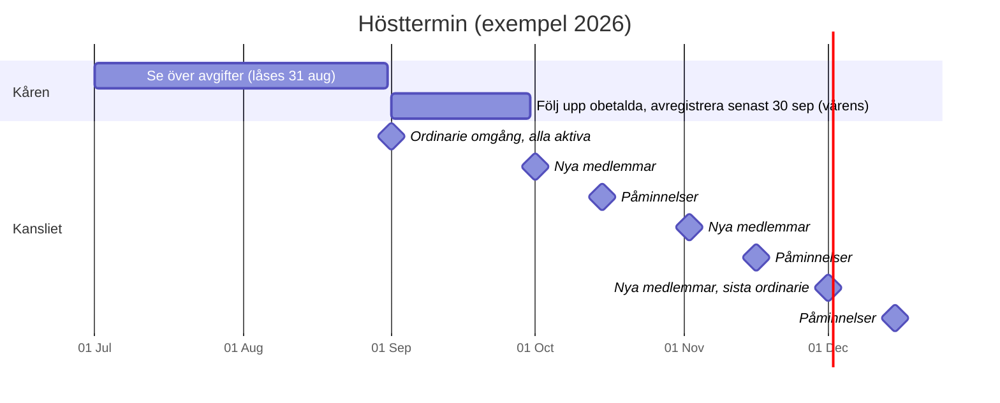
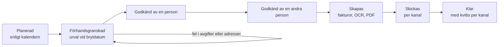
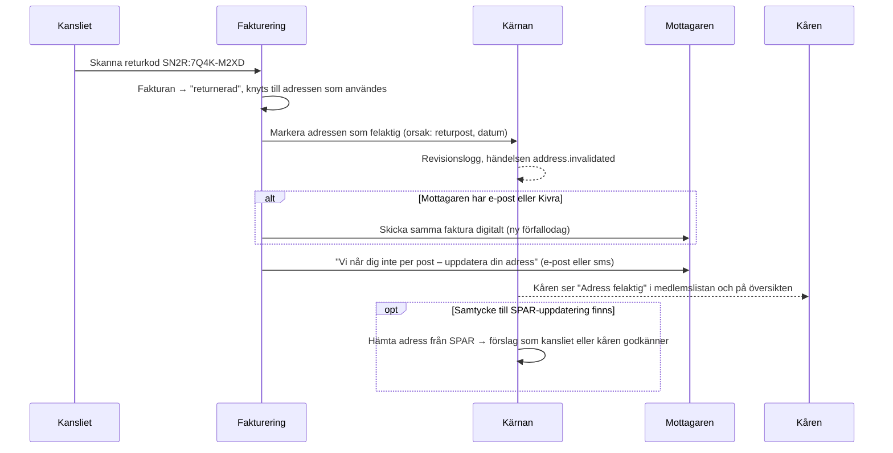

# Plan: modulen Fakturering

> Version 0.1, 2026-10-18. Del av [modulplanen](../06-moduler.md). Modulens id är `billing`.
> Bygger på [analysen](../01-analys-av-scoutnet.md) (avsnitt 8.2 Ekonomi), [huvudplanen](../02-plan.md) (fas 4) och Scouternas supportsidor om medlemsavgifter 2026.

## Sammanfattning

Kansliet fakturerar medlemsavgifterna centralt, två terminer per år, i **omgångar med brytdatum**:
- en stor omgång till alla aktiva medlemmar
- omgångar för nya medlemmar varje månad
- påminnelser i mitten av månaden

Modulen gör det arbetet säkrare och mindre manuellt:

- **Avgifter som data.** Förbundets, distriktets och kårens avgifter per avgiftsgrupp och termin ställs in i gränssnittet och låses vid brytdatum. Ingen kodändring behövs för en ny avgift.
- **Omgångar med förhandsgranskning.** Varje omgång visar exakt vad som kommer att skickas: antal, belopp per kår, kanal och varningar. Den godkänns av två personer innan något skickas och kan inte skickas två gånger.
- **Rätt mottagare och kanal.** Vårdnadshavare för barn, medlemmen själv för vuxna. Kanalen väljs i ordningen e-faktura, Kivra, e-post och post.
- **Returpost skannas in.** Varje pappersfaktura har en **returkod** som syns i kuvertets fönster. Kansliet skannar returnerade brev i följd. Varje skanning markerar adressen som felaktig, skickar fakturan digitalt om det går och ber kåren och vårdnadshavaren rätta adressen.
- **Betalningar till rätt person.** Betalningar från Bankgirot (BgMax), Swish och e-faktura matchas på OCR. Medlemmen får status *betald* för terminen, med uppgift om vem som betalade och hur. Avvikelser hamnar i en kö med förslag på matchning.
- **Kåren ser läget.** Kåren ser obetalda, returnerade adresser och sista dag för att avregistrera obetalda, och utbetalningarna till kåren.
- **Medlemmen ser sina fakturor** och betalar med Swish eller QR-kod i bankappen.

## 1. Så fungerar det i dag

**Årshjulet 2026** enligt Scouternas supportsidor:

| Datum | Vårterminen | Datum | Höstterminen |
|---|---|---|---|
| 15 jan | Påminnelser för höstens fakturor | 1 sep | Fakturor till alla aktiva medlemmar |
| 31 jan | Sista dag för kåren att se över avgifterna | 31 aug | Sista dag för kåren att se över avgifterna |
| 2 feb | Fakturor till alla aktiva medlemmar | 1 okt, 2 nov | Nya medlemmar |
| 2 mar, 1 apr | Nya medlemmar | 15 okt, 16 nov, 15 dec | Påminnelser |
| 16 mar, 15 apr, 18 maj, 15 jun | Påminnelser | 1 dec | Nya medlemmar, sista ordinarie omgången |
| 4 maj | Nya medlemmar, sista ordinarie omgången | 15 jan 2027 | Påminnelser |
| 28 feb | Sista dag att avregistrera obetalda för hösten | 30 sep | Sista dag att avregistrera obetalda för våren |
| 2 mar | Kåren debiteras för obetalda och subventionerade medlemmar | 1 okt | Kåren debiteras för obetalda och subventionerade medlemmar |

Andra förutsättningar:
- **Avgiften:** förbundsavgiften är 180 kr per år (90 kr per termin) inklusive försäkring och tidningen Scout. Avgifter för samverkansorganisation, distrikt och kår tillkommer. Familjescouter under åtta år har 45 kr per termin i rabatt.
- **Kanaler:** e-faktura (anmäls i internetbanken med medlemsnumret, föräldrar kan anmäla för sina barn), Kivra, e-post (standard sedan 2020) och post.
- **I Scoutnet:**
  - fyra faktureringsmetoder
  - lokala avgiftsgrupper och produkter (t.ex. tidning och båtförsäkring)
  - OCR-import, manuell betalning och import från Excel
  - återbetalning till kår och distrikt
  - export till Hogia, Visma och Itella (tryckfil)
- **Begränsningar:** avgiftsändringar är låsta till januari och juli–augusti, och produkter kan bara ändras med en kodändring (analysen, 13.1).

Problem som modulen ska lösa:

1. **Returpost hanteras för hand.** När en pappersfaktura kommer tillbaka för att personen har flyttat, går det inte att snabbt markera adressen som felaktig. Fakturan når aldrig fram, medlemmen får påminnelser till fel adress och avregistreras till slut i onödan.
2. **Betalningar som inte går att matcha** (fel OCR, delbetalning, en betalning för två syskon) kräver handpåläggning utan stöd.
3. **Kåren har svårt att följa upp.** Vem har inte betalat, vem har fel adress, och när måste kåren avregistrera eller själv betala?
4. **Ingen förhandsgranskning.** En omgång kan inte prövas i sin helhet innan den skickas.
5. **Avgiftsmodellen är stel.** Produkter i kod och låsta månader.

## 2. Mål

| Mål | Mått |
|---|---|
| Färre fakturor till fel adress | Andelen returpost som leder till en rättad adress eller digital faktura inom 30 dagar är minst 80 % |
| Mindre manuell matchning | Minst 98 % av betalningarna matchas automatiskt |
| Inga dubbla eller felaktiga utskick | Omgångar är idempotenta, förhandsgranskas och godkänns av två personer |
| Kåren vet sitt läge | Kåren ser obetalda, returpost och nästa sista dag på översikten, utan rapporter |
| Fler digitala fakturor | Andelen pappersfakturor minskar varje termin (mått i Statistik) |
| Rätt till öret | Parallellkörning mot gamla Scoutnet: summor per kår och termin stämmer till öret innan övergång |

## 3. Roller och behörigheter

Behörigheterna deklareras av modulen (se [06-moduler.md](../06-moduler.md), avsnitt 8) och knyts till roller som standard:

| Behörighet | Ger | Standardroll |
|---|---|---|
| `billing.read` | Se fakturor och betalstatus i sin enhet | Kassör, kårordförande, medlemsregistrerare |
| `billing.fees` | Ställa in kårens avgifter och egen text på fakturan före brytdatum | Kassör, kårordförande |
| `billing.runs` | Skapa, förhandsgranska och godkänna omgångar | Kansliet (ekonomi), två personer per godkännande |
| `billing.payments` | Importera betalningar, hantera avvikelser, kreditera och återbetala | Kansliet (ekonomi) |
| `billing.returns` | Skanna in returpost | Kansliet (alla på kansliet som öppnar post) |
| (egen) | Se sina egna och sina barns fakturor och betala | Medlem, vårdnadshavare |

## 4. Årshjulet i systemet

Datumen läggs in som en **faktureringskalender** per termin, och omgångarna planeras automatiskt.



- Varje omgång har ett **brytdatum** (vilka medlemmar och avgifter som räknas), ett **utskicksdatum** och en **förfallodag**.
- Kansliet får en påminnelse några dagar före varje omgång. Kåren får en påminnelse före sin sista dag (avgifter, avregistrering).
- **Låsningen** sker per kår och termin vid brytdatum, inte per kalendermånad. Ändringar efter låsningen gäller nästa omgång eller görs som kreditering.

## 5. Avgifter som data

- **Avgiftskomponenter:** förbund, samverkansorganisation, distrikt, kår och tillval (t.ex. båtförsäkring), med belopp per termin och avgiftsgrupp.
  - Varje nivå äger sin komponent: förbundet sin, distriktet sin, kåren sin.
  - Komponenterna är **versionerade per termin**. Gamla fakturor visar alltid de avgifter som gällde då.
- **Avgiftsgrupper:** kårens egna grupper, till exempel *Ordinarie*, *Familjescout*, *Ledare (avgiftsfri)* och *Syskon*.
- **Regler som data:**
  - rabatt för familjescouter under 8 år (45 kr per termin)
  - syskonrabatt (andra och följande barn i samma hushåll)
  - delterminsavgift för den som börjar sent
  - avgiftsfrihet (ledare, subventionerade)

  Reglerna har tester med exempel, som bidragsreglerna i modulen Bidrag.
- **Förhandsvisning för kåren:** "Så här blir höstens fakturor för Björkdalens scoutkår: 119 fakturor, 82 450 kr, varav kårens del 47 600 kr." Den visas innan avgifterna låses.
- **Egen text på fakturan** per kår, med förhandsvisning.

## 6. Faktureringsomgångar

**Typer:** ordinarie (alla aktiva), nya medlemmar, påminnelse 1, påminnelse 2, kårdebitering (obetalda och subventionerade efter sista dagen) och extra (t.ex. rättelse).



1. **Urval vid brytdatum.** Urvalet sparas som en ögonblicksbild, så att omgången blir densamma om den förhandsgranskas igen. Det omfattar:
   - aktiva medlemmar (ordinarie)
   - medlemmar som blivit aktiva sedan förra omgången (nya)
   - förfallna obetalda fakturor (påminnelser)
2. **Förhandsgranskning**, samma mönster som massåtgärderna i prototypen (torrkörning):
   - antal och belopp per kår, distrikt och kanal
   - **varningar:**
     - adress saknas eller är felaktig och e-post saknas
     - barn utan vårdnadshavare
     - skyddad identitet (då används förmedlingsadressen)
     - avgift 0 kr
     - person som redan har betalat
     - dubbletter
   - stickprov: visa fakturan som PDF för valfri person
3. **Godkännande** av två personer med `billing.runs`. Det loggas, och den andra personen måste ha färsk inloggning (step-up).
4. **Skapande** i en transaktion: fakturanummer, OCR, PDF och utskick i kön. Omgången har en idempotensnyckel, så en andra körning skapar inget nytt.
5. **Utskick** via kön (jobb i PostgreSQL). Varje kanal ger ett kvitto (levererad, studsad eller i tryck). Fel syns per faktura och kan skickas om.

## 7. Fakturan

- **Mottagare (betalare):**
  - barn: vårdnadshavare 1, eller den vårdnadshavare som valt att ta emot fakturor
  - vuxen: medlemmen själv
  - En **samlingsfaktura per hushåll**, där syskon samlas på en faktura, är ett val i en senare etapp.
- **Innehåll:**
  - medlemmens namn och medlemsnummer
  - kår och termin
  - avgiftskomponenter
  - belopp, förfallodag, OCR och betalningsinstruktioner
  - kårens egen text

  **Inget personnummer.**
- **OCR:** löpnummer med kontrollsiffra (Luhn, modulus 10) och längdsiffra enligt Bankgirots regler. OCR:en är unik per faktura, och påminnelser använder samma OCR.
- **QR-kod för betalning** i formatet UsingQR. Bankappar läser den och fyller i bankgiro, OCR, belopp och förfallodag. Exempel:

  ```json
  {"uqr":1,"tp":1,"nme":"Scouterna","cid":"802000-0000","iref":"9000001202614","idt":"20260901","ddt":"20261001","due":180,"pt":"BG","acc":"123-4567"}
  ```

  Organisationsnummer och bankgiro i exemplet är påhittade. Swish-QR läggs till när Swish Handel finns.
- **Returkod** på pappersfakturor: en liten QR-kod bredvid adressen, så att den **syns i kuvertets fönster**.
  - Den innehåller bara en signerad kort referens, t.ex. `SN2R:7Q4K-M2XD`, inte namn eller personnummer.
  - Referensen pekar ut fakturan och mottagarens adress vid utskick. Signaturen gör att koden inte kan gissas eller förfalskas.
- **Kanaler**, i den här ordningen:
  1. e-faktura (om mottagaren har anmält det i sin bank)
  2. Kivra (om mottagaren är ansluten)
  3. e-post med PDF och betallänk (Swish/QR)
  4. post via tryckpartner (PDF-fil per omgång, som Itella i dag)

  Mottagaren väljer i Min profil (fältet `invoice_delivery_membership` finns redan). Kansliet kan tvinga e-post när adressen är felaktig.

## 8. Påminnelser och obetalda

- **Påminnelser** skickas i mitten av månaden till förfallna obetalda fakturor, med samma OCR och en ny förfallodag. Ingen påminnelseavgift.
- **Kårens vy "Obetalda"** visar:
  - fakturor som är förfallna efter sista påminnelsen, med kanal och eventuell returpost
  - nedräkning till sista dag att avregistrera (28 februari och 30 september)
  - massåtgärderna **Avregistrera** och **Kåren betalar** (subventionerad), med förhandsgranskning
- **Kårdebiteringen** (2 mars och 1 oktober) är en egen omgång. Den samlar obetalda och subventionerade medlemmar per kår till en faktura till kåren.
- **När en medlem slutar** före förfallodagen krediteras fakturan automatiskt (händelsen `member.left`). Om medlemmen slutar efter förfallodagen ligger fakturan kvar.

## 9. Returpost och felaktiga adresser

Det här är kansliets vardag, och här gör modulen störst skillnad.

**Skanna in returpost** (sidan *Returpost*):

- **Två sätt att skanna:**
  - En **handskanner** (USB eller Bluetooth, 2D) som skriver koden i ett fält. Den är snabbast för högar av brev.
  - **Kameran** i mobil eller dator (webbläsarens streckkodsläsare med en Wasm-avkodare som reserv).
- **Snabbläge för en hög brev:** varje skanning registreras direkt med ett pip och syns överst i listan med namn, kår och den gamla adressen. Fel brev kan ångras.
- **Reserv:** om returkoden saknas eller är skadad skannas betal-QR:en eller OCR:en inuti brevet, eller så skrivs OCR:en in.

**Vad en skanning gör:**



- **Adressens status hör till kärnan** (adressen är kärndata). Modulen ber kärnan markera den som felaktig med orsak och datum. Då ser alla moduler samma sak. E-postlistor har en motsvarighet för studsande e-post.
- **När adressen rättas** (av medlemmen i Min profil, av kåren eller från SPAR) tas markeringen bort, och returnerade obetalda fakturor kan skickas om.
- **Nästa omgång** väljer inte post för en adress som är markerad som felaktig. Den tar e-post om den finns, och annars blir det en varning i förhandsgranskningen.
- **Statistik för kansliet:** returpost per omgång och kår, och hur många som blev rättade.

## 10. Betalningar

- **Källor:**
  - BgMax-filer från Bankgirot, hämtade automatiskt varje dag eller uppladdade. E-fakturabetalningar kommer samma väg.
  - Swish Handel (betalningsförfrågan från fakturan eller Min profil, med svar till modulen)
  - manuell registrering (t.ex. betalt till kåren)
- **Matchning:**
  - OCR, belopp och datum. Exakt OCR och fullt belopp matchas automatiskt.
  - Övrigt hamnar i **Avvikelser** med förslag: delbetalning, överbetalning, betalning utan OCR, en betalning för flera syskon (förslag utifrån hushåll och belopp) och dubbelbetalning.
  - Kansliet godkänner förslaget, delar upp betalningen, återbetalar eller krediterar.
- **Status till personen:** när fakturan är betald får medlemmen **betald** för terminen. Personkortet visar "Betald 12 september 2026 av Karin Björk (bankgiro, OCR …)". Det som visas om betalaren är bara det som behövs.
- **Bekräftat medlemskap:**
  - En betalning gör medlemskapet **bekräftat** för terminen. Det sparas i kärnan, eftersom Statsbidrag och Statistik behöver det.
  - Avgiftsbefriade bekräftas på annat sätt (se [Statsbidrag](./statsbidrag.md)).
- **Händelser:** `invoice.paid` och `membership.confirmed`. Aktiviteter kan använda samma betalningsflöde för anmälningsavgifter.

## 11. Avräkning och bokföring

- Varje betalning fördelas på sina **avgiftskomponenter**: förbundets, distriktets och kårens del.
- **Utbetalningar** till kårer och distrikt görs med ett intervall som kansliet bestämmer, med specifikation per termin. Kåren ser sina utbetalningar.
- **Export till bokföring** som SIE4 (Visma, Hogia, Fortnox): verifikationer per dag och omgång, med konton per komponent.
- **Rapporter:** fakturerat och betalt per termin och kår, betalande medlemmar per termin, obetalda och returpost.

## 12. Gränssnittet

| Vem | Sida | Innehåll |
|---|---|---|
| Kansliet | **Fakturering** (översikt) | Terminens kalender, nästa omgång med nedräkning, nyckeltal (fakturerat, betalt, obetalt, returpost) |
| Kansliet | **Omgångar** | Lista och detalj: förhandsgranskning, varningar, godkännanden, utskick per kanal, fel som kan skickas om |
| Kansliet | **Returpost** | Skanningsfält eller kamera, snabbläge, dagens skanningar, ångra |
| Kansliet | **Betalningar och avvikelser** | Importerade filer, kö med förslag, kreditering och återbetalning |
| Kåren | **Avgifter** | Kårens komponenter per avgiftsgrupp, förhandsvisning av fakturorna, låsning vid brytdatum |
| Kåren | **Fakturor** (i medlemslistan) | Kolumnerna *Avgift* och *Adress*, filtren *Obetald*, *Returpost* och *Ej skickad*, massåtgärder för obetalda |
| Kåren | **Översikten** | Kortet "Att göra": obetalda, felaktiga adresser och sista dag att avregistrera |
| Medlem och vårdnadshavare | **Min profil → Fakturor** | Fakturor per termin, betala med Swish eller QR, välj kanal, uppdatera adress |

Medlemslistan, personkortet och översikten har redan sina platser för modulernas kolumner, flikar och kort ([06-moduler.md](../06-moduler.md), avsnitt 4.2).

## 13. Datamodell

Modulens egna tabeller ligger i schemat `billing`:

| Tabell | Innehåll |
|---|---|
| `billing.fee_component` | Nivå (enhet), termin, avgiftsgrupp, belopp, konto, giltighet (versionerad) |
| `billing.fee_rule` | Regler som data: rabatter, delterminsavgift, avgiftsfrihet |
| `billing.calendar` | Termin, omgångstyp, brytdatum, utskicksdatum, förfallodag |
| `billing.run` | Omgång: typ, status, ögonblicksbild av urvalet, godkännanden, idempotensnyckel, summor |
| `billing.invoice` | Fakturanummer, OCR, medlem, betalare, kår, termin, belopp, förfallodag, status (skapad, skickad, returnerad, betald, krediterad), kanal |
| `billing.invoice_line` | Komponent och belopp per faktura |
| `billing.delivery` | Utskick per kanal: kvitto, fel, tidpunkt, returkod (signerad) |
| `billing.return_scan` | Skanning: vem, när, faktura, adress, ångrad |
| `billing.payment` | Källa (BgMax-post, Swish, manuell), belopp, OCR, datum, betalarens namn, råpost |
| `billing.allocation` | Koppling mellan betalning och faktura (en betalning kan täcka flera fakturor) |
| `billing.payout` | Utbetalning till kår och distrikt med specifikation |

**I kärnan** (används av flera moduler):
- `person_address.invalid_since` och `invalid_reason`
- `membership_term`: person, kår, termin, bekräftad, sätt och datum. Den ersätter dagens `term_fee.paid_on` som källa för "betald termin".

Prototypens `term_fee` flyttas till `billing.invoice`.

## 14. API (urval)

| Anrop | Beskrivning |
|---|---|
| `GET/PUT /v1/bodies/{id}/billing/fees?term=` | Avgifter för enheten och terminen, med förhandsvisning (`?preview=true`) |
| `GET /v1/billing/runs` · `POST /v1/billing/runs` | Omgångar. Skapa ger en förhandsgranskning. |
| `POST /v1/billing/runs/{id}/approve` · `POST …/send` | Godkänn (två personer) och skicka. Kräver step-up. |
| `GET /v1/people/{id}/invoices` | Fakturor för en person (för personkort och Min profil) |
| `POST /v1/billing/returns` | Skanna returpost: `{code}` ger faktura, person och åtgärd |
| `DELETE /v1/billing/returns/{id}` | Ångra en skanning |
| `POST /v1/billing/payments/import` | Ladda upp en BgMax-fil (också automatiskt via jobb) |
| `GET /v1/billing/exceptions` · `POST …/{id}/resolve` | Avvikelser och lösningar |
| `GET /v1/bodies/{id}/billing/payouts` | Kårens och distriktets utbetalningar |
| `GET /v1/billing/export/sie?from=&to=` | SIE4-export |

## 15. Modulen i systemet

```rust
static MANIFEST: Manifest = Manifest {
    id: "billing",
    name: "Fakturering",
    depends_on: &[],                       // bara kärnan
    nav: &[
        NavEntry { segment: "fakturering", label: "Fakturering", kinds: &["organisation"], permission: "billing.runs" },
        NavEntry { segment: "avgifter",    label: "Avgifter",    kinds: &["district", "group"], permission: "billing.fees" },
    ],
    ..
};
```

| Utbyggnadspunkt | Fakturering bidrar med |
|---|---|
| Händelser in | `member.joined` (nästa omgång för nya), `member.left` (kreditering), `person.address_changed` (ta bort felmarkering, skicka om), `person.erased` (avidentifiera utom bokföringsdata) |
| Händelser ut | `invoice.sent`, `invoice.returned`, `invoice.paid`, `membership.confirmed`, `payout.created` |
| Medlemslistan | Kolumnerna *Avgift* och *Adress*, filtren *Obetald*, *Returpost* och *Ej skickad* |
| Personkortet | Fliken *Fakturor* |
| Översikten | Kortet "Obetalda och returpost" |
| Jobb | Omgångar enligt kalendern, hämtning av BgMax, påminnelser till kåren före sista dag |
| Inställningar per enhet | Kårens egen fakturatext, kontaktadress för frågor |
| GDPR | Export: personens fakturor. Radering: fakturor och betalningar sparas i 7 år enligt bokföringslagen men avidentifieras i gränssnittet. |

## 16. Vad kärnan behöver

Modulen ska kunna byggas utan att kärnan görs om. De här generella utbyggnadspunkterna behövs, och används även av andra moduler:

1. **Behörigheter som moduler deklarerar** (`billing.read` …) med standardroller. Används också av Statsbidrag och E-postlistor.
2. **Kontaktuppgifters giltighet:** felmarkering av adress (returpost) och e-post (studsar), med händelser.
3. **`membership_term`** (bekräftat medlemskap per termin), som Fakturering skriver och Statsbidrag och Statistik läser.
4. **Outbox och jobb** (planen 4.2).
5. **Kolumner, flikar och kort från moduler** ([06-moduler.md](../06-moduler.md), avsnitt 4.2).

## 17. Säkerhet och dataskydd

- **Inga personnummer på fakturor eller i QR-koder.** Returkoden är en signerad referens utan personuppgifter.
- **E-fakturaanmälningar** från banken kan innehålla betalarens personnummer. De lagras krypterade (planen 4.2) och visas aldrig i gränssnittet.
- **Skyddad identitet:** bara förmedlingsadressen används, och returpost för den hanteras av kansliet utan att adressen visas för kåren.
- **Revisionslogg** för omgångar, godkännanden, kreditering, återbetalning och returpostskanning.
- **Bokföringslagen:** verifikationer och fakturor sparas i 7 år. Personuppgifter som inte behövs för bokföringen gallras tidigare.
- **Två personer krävs** för att skicka en omgång och för återbetalningar över ett belopp som kansliet bestämmer.

## 18. Migrering och parallellkörning

- **Importen från Scoutnet** omfattar:
  - avgiftsgrupper och komponenter för innevarande och föregående termin
  - öppna fakturor med OCR, så att betalningar på gamla fakturor matchas
  - betalningshistorik i två år
  - val av kanal
- **Parallellkörning:** en termin beräknas i båda systemen och jämförs per kår och faktura, till öret, innan Scoutnet 2 skickar på riktigt (planen, fas 4).
- **Övergång:** mellan två terminer, efter sista påminnelsen och före kårens översyn av avgifterna.

## 19. Etapper

| Etapp | Innehåll | Klart när |
|---|---|---|
| 0. Demo i prototypen (cirka 1 vecka) | Avgifter som data för en kår, en omgång med förhandsgranskning och PDF med UsingQR och returkod, sidan Returpost med skanner och kamera som markerar adressen som felaktig, import av en BgMax-exempelfil som ger *betald* på personen | Hela flödet kan visas med syntetisk data |
| 1. Fakturor och returpost | Kalender, omgångar med godkännande, e-post och post (tryckfil), returpost, kärnans felmarkering | Kansliet kan köra en testtermin parallellt |
| 2. Betalningar | BgMax, avvikelser, Swish, bekräftat medlemskap, kårens vy för obetalda | 98 % automatisk matchning i parallellkörning |
| 3. Avräkning och bokföring | Utbetalningar, SIE4, rapporter | Revisorn godkänner |
| 4. Digitala kanaler | E-faktura och Kivra via partner, samlingsfaktura per hushåll | Andelen post halverad |

## 20. Risker och öppna frågor

| Fråga eller risk | Förslag |
|---|---|
| Avtal för e-faktura och Kivra (partner och kostnad) | Utred med kansliet. Behåll dagens partner under övergången. |
| Exakta regler för OCR och BgMax | Följ Bankgirots specifikationer och testa mot bankens testmiljö |
| Är UsingQR rätt QR-standard för alla banker? | Pröva med de största bankernas appar före etapp 1 |
| SPAR-uppdatering kräver avtal och samtycke | Fältet `spar_sync` finns. Avtal och rättslig grund utreds. |
| Postens hantering av returer (kan returen ha en streckkod?) | Pröva med tryckpartnern: returkoden i fönstret måste klara Postens maskiner |
| Ekonomifel | Regler som data med tester, parallellkörning till öret, två personer per omgång |
