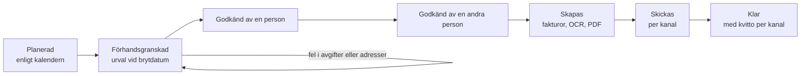
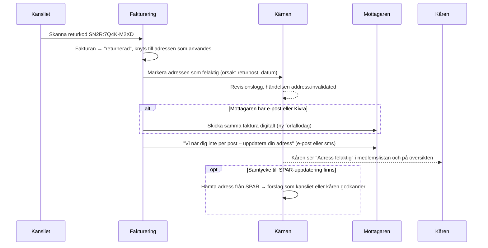
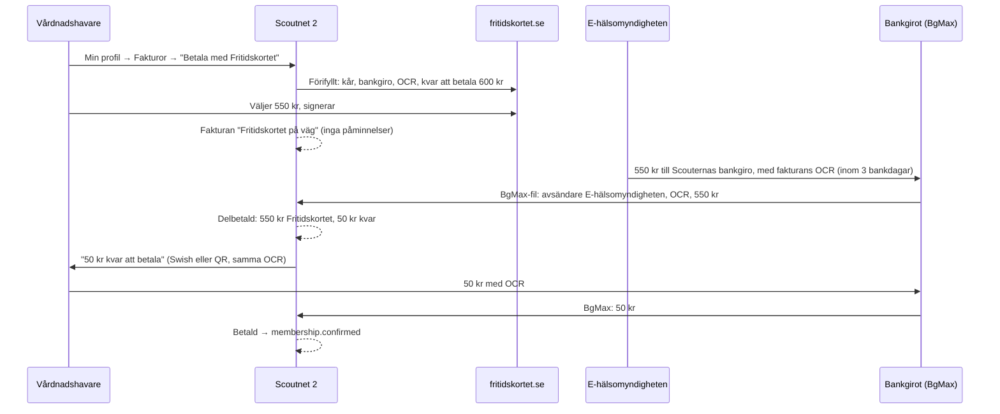

# Plan: modulen Fakturering

> Version 0.3, 2026-10-19. Del av [modulplanen](../06-moduler.md). Modulens id är `billing`.
> Bygger på [analysen](../01-analys-av-scoutnet.md) (avsnitt 8.2 Ekonomi), [huvudplanen](../02-plan.md) (fas 4), Scouternas supportsidor om medlemsavgifter 2026 och Fritidskortet, samt information från fritidskortet.se och E-hälsomyndigheten.
>
> **Ändringar i 0.3:** Kåren anger **Scouternas centrala bankgiro** i Fritidskortets register. Då hanterar kansliet betalningarna centralt, och kåren slipper registrera dem för hand. Kårens eget bankgiro stöds bara som undantag, för kårer som redan angett det, tills de har bytt (avsnitt 11).
>
> **Ändringar i 0.2:** Fritidskortet (avsnitt 11): betalningar från staten via E-hälsomyndigheten som täcker hela eller delar av avgiften, kårens anslutning, delbetalning, återbetalning till Fritidskortet och dataskydd.

## Sammanfattning

Kansliet fakturerar medlemsavgifterna centralt, två terminer per år, i **omgångar med brytdatum**:
- en stor omgång till alla aktiva medlemmar
- omgångar för nya medlemmar varje månad
- påminnelser i mitten av månaden

Modulen gör det arbetet säkrare och mindre manuellt:

- **Avgifter som data.** Förbundets, distriktets och kårens avgifter per avgiftsgrupp och termin ställs in i gränssnittet och låses vid brytdatum. Ingen kodändring behövs för en ny avgift.
- **Omgångar med förhandsgranskning.** Varje omgång visar exakt vad som kommer att skickas: antal, belopp per kår, kanal och varningar. Den godkänns av två personer innan något skickas och kan inte skickas två gånger.
- **Rätt mottagare och kanal.** Vårdnadshavare för barn, medlemmen själv för vuxna. Kanalen väljs i ordningen e-faktura, Kivra, e-post och post.
- **Returpost skannas in.** Varje pappersfaktura har en **returkod** som syns i kuvertets fönster. Kansliet skannar returnerade brev i följd. Varje skanning markerar adressen som felaktig, skickar fakturan digitalt om det går och ber kåren och vårdnadshavaren rätta adressen.
- **Betalningar till rätt person.** Betalningar från Bankgirot (BgMax), Swish och e-faktura matchas på OCR. Medlemmen får status *betald* för terminen, med uppgift om vem som betalade och hur. Avvikelser hamnar i en kö med förslag på matchning.
- **Fritidskortet** (avsnitt 11). Statens stöd till barns fritidsaktiviteter betalas ut av E-hälsomyndigheten och kan täcka **hela eller delar av** avgiften.
  - Vårdnadshavaren betalar via en knapp vid fakturan.
  - Delbetalningen och resten matchas på samma OCR, och påminnelser gäller bara det som är kvar.
  - Återbetalningar går tillbaka till Fritidskortet, inte till vårdnadshavaren.
  - Kåren ansluter sig med **Scouternas centrala bankgiro**. Då hanterar kansliet betalningarna centralt, och kåren har ingen egen administration av dem.
- **Kåren ser läget.** Kåren ser obetalda, returnerade adresser och sista dag för att avregistrera obetalda, och utbetalningarna till kåren.
- **Medlemmen ser sina fakturor** och betalar med Fritidskortet, Swish eller QR-kod i bankappen.

## 1. Så fungerar det i dag

**Årshjulet 2026** enligt Scouternas supportsidor:

| Datum | Vårterminen | Datum | Höstterminen |
|---|---|---|---|
| 15 jan | Påminnelser för höstens fakturor | 1 sep | Fakturor till alla aktiva medlemmar |
| 31 jan | Sista dag för kåren att se över avgifterna | 31 aug | Sista dag för kåren att se över avgifterna |
| 2 feb | Fakturor till alla aktiva medlemmar | 1 okt, 2 nov | Nya medlemmar |
| 2 mar, 1 apr | Nya medlemmar | 15 okt, 16 nov, 15 dec | Påminnelser |
| 16 mar, 15 apr, 18 maj, 15 jun | Påminnelser | 1 dec | Nya medlemmar, sista ordinarie omgången |
| 4 maj | Nya medlemmar, sista ordinarie omgången | 15 jan 2027 | Påminnelser |
| 28 feb | Sista dag att avregistrera obetalda för hösten | 30 sep | Sista dag att avregistrera obetalda för våren |
| 2 mar | Kåren debiteras för obetalda och subventionerade medlemmar | 1 okt | Kåren debiteras för obetalda och subventionerade medlemmar |

Andra förutsättningar:
- **Avgiften:** förbundsavgiften är 180 kr per år (90 kr per termin) inklusive försäkring och tidningen Scout. Avgifter för samverkansorganisation, distrikt och kår tillkommer. Familjescouter under åtta år har 45 kr per termin i rabatt.
- **Kanaler:** e-faktura (anmäls i internetbanken med medlemsnumret, föräldrar kan anmäla för sina barn), Kivra, e-post (standard sedan 2020) och post.
- **I Scoutnet:**
  - fyra faktureringsmetoder
  - lokala avgiftsgrupper och produkter (t.ex. tidning och båtförsäkring)
  - OCR-import, manuell betalning och import från Excel
  - återbetalning till kår och distrikt
  - export till Hogia, Visma och Itella (tryckfil)
- **Begränsningar:** avgiftsändringar är låsta till januari och juli–augusti, och produkter kan bara ändras med en kodändring (analysen, 13.1).
- **Fritidskortet** (sedan september 2025):
  - Vårdnadshavare kan betala hela eller delar av medlemsavgiften med Fritidskortet, om kåren är ansluten till Fritidskortets register.
  - Scoutnet är ett anslutet föreningssystem: vid fakturan finns en knapp som öppnar Fritidskortets betalformulär med uppgifterna förifyllda.
  - Det som inte täcks betalas till Scouternas bankgiro med fakturans OCR.
  - Kåren kan ange Scouternas centrala bankgiro i Fritidskortets register. Då hanterar kansliet betalningen centralt, och kåren slipper hantera den för hand.

Problem som modulen ska lösa:

1. **Returpost hanteras för hand.** När en pappersfaktura kommer tillbaka för att personen har flyttat, går det inte att snabbt markera adressen som felaktig. Fakturan når aldrig fram, medlemmen får påminnelser till fel adress och avregistreras till slut i onödan.
2. **Betalningar som inte går att matcha** (fel OCR, delbetalning, en betalning för två syskon) kräver handpåläggning utan stöd.
3. **Kåren har svårt att följa upp.** Vem har inte betalat, vem har fel adress, och när måste kåren avregistrera eller själv betala?
4. **Ingen förhandsgranskning.** En omgång kan inte prövas i sin helhet innan den skickas.
5. **Avgiftsmodellen är stel.** Produkter i kod och låsta månader.
6. **Fritidskortet gör betalningarna mer sammansatta.** En faktura betalas ofta i två delar från två betalare (staten och vårdnadshavaren). Återbetalningar ska gå till Fritidskortet, och reglerna (belopp, ålder, sista dag) ändras varje år.

## 2. Mål

| Mål | Mått |
|---|---|
| Färre fakturor till fel adress | Andelen returpost som leder till en rättad adress eller digital faktura inom 30 dagar är minst 80 % |
| Mindre manuell matchning | Minst 98 % av betalningarna matchas automatiskt |
| Inga dubbla eller felaktiga utskick | Omgångar är idempotenta, förhandsgranskas och godkänns av två personer |
| Kåren vet sitt läge | Kåren ser obetalda, returpost och nästa sista dag på översikten, utan rapporter |
| Fler digitala fakturor | Andelen pappersfakturor minskar varje termin (mått i Statistik) |
| Rätt till öret | Parallellkörning mot gamla Scoutnet: summor per kår och termin stämmer till öret innan övergång |
| Fritidskortet fungerar för alla som kan använda det | Knappen visas för alla barn i rätt ålder i anslutna kårer. Minst 98 % av betalningarna från Fritidskortet matchas automatiskt. Ingen påminnelse går ut för en del som redan är betald med Fritidskortet. |

## 3. Roller och behörigheter

Behörigheterna deklareras av modulen (se [06-moduler.md](../06-moduler.md), avsnitt 8) och knyts till roller som standard:

| Behörighet | Ger | Standardroll |
|---|---|---|
| `billing.read` | Se fakturor och betalstatus i sin enhet | Kassör, kårordförande, medlemsregistrerare |
| `billing.fees` | Ställa in kårens avgifter och egen text på fakturan före brytdatum | Kassör, kårordförande |
| `billing.runs` | Skapa, förhandsgranska och godkänna omgångar | Kansliet (ekonomi), två personer per godkännande |
| `billing.payments` | Importera betalningar, hantera avvikelser, kreditera och återbetala | Kansliet (ekonomi) |
| `billing.returns` | Skanna in returpost | Kansliet (alla på kansliet som öppnar post) |
| `billing.fritidskortet` | Registrera och se kårens anslutning till Fritidskortet. I undantagsfall: registrera betalningar från Fritidskortet som kommit till kårens eget bankgiro. | Kassör, kårordförande. Kansliet för alla kårer. |
| (egen) | Se sina egna och sina barns fakturor och betala | Medlem, vårdnadshavare |

## 4. Årshjulet i systemet

Datumen läggs in som en **faktureringskalender** per termin, och omgångarna planeras automatiskt.


- Varje omgång har ett **brytdatum** (vilka medlemmar och avgifter som räknas), ett **utskicksdatum** och en **förfallodag**.
- Kansliet får en påminnelse några dagar före varje omgång. Kåren får en påminnelse före sin sista dag (avgifter, avregistrering).
- **Låsningen** sker per kår och termin vid brytdatum, inte per kalendermånad. Ändringar efter låsningen gäller nästa omgång eller görs som kreditering.
- **Fritidskortet följer kalenderåret.** Kortet kan användas till och med den 30 november, och det som inte används kan inte sparas till nästa år. Kalendern har därför det datumet som en egen händelse:
  - Höstens fakturor och påminnelser visar sista dag för Fritidskortet.
  - Kåren och vårdnadshavare får en påminnelse i början av november om obetalda fakturor som kan betalas med kortet.
  - Fakturor från 1 december (nya medlemmar) visar inte knappen förrän kortet för nästa år går att använda (se avsnitt 21).

## 5. Avgifter som data

- **Avgiftskomponenter:** förbund, samverkansorganisation, distrikt, kår och tillval (t.ex. båtförsäkring), med belopp per termin och avgiftsgrupp.
  - Varje nivå äger sin komponent: förbundet sin, distriktet sin, kåren sin.
  - Komponenterna är **versionerade per termin**. Gamla fakturor visar alltid de avgifter som gällde då.
- **Avgiftsgrupper:** kårens egna grupper, till exempel *Ordinarie*, *Familjescout*, *Ledare (avgiftsfri)* och *Syskon*.
- **Regler som data:**
  - rabatt för familjescouter under 8 år (45 kr per termin)
  - syskonrabatt (andra och följande barn i samma hushåll)
  - delterminsavgift för den som börjar sent
  - avgiftsfrihet (ledare, subventionerade)

  Reglerna har tester med exempel, som bidragsreglerna i modulen Bidrag.
- **Förhandsvisning för kåren:** "Så här blir höstens fakturor för Björkdalens scoutkår: 119 fakturor, 82 450 kr, varav kårens del 47 600 kr." Den visas innan avgifterna låses.
- **Egen text på fakturan** per kår, med förhandsvisning.

## 6. Faktureringsomgångar

**Typer:** ordinarie (alla aktiva), nya medlemmar, påminnelse 1, påminnelse 2, kårdebitering (obetalda och subventionerade efter sista dagen) och extra (t.ex. rättelse).



1. **Urval vid brytdatum.** Urvalet sparas som en ögonblicksbild, så att omgången blir densamma om den förhandsgranskas igen. Det omfattar:
   - aktiva medlemmar (ordinarie)
   - medlemmar som blivit aktiva sedan förra omgången (nya)
   - förfallna obetalda fakturor (påminnelser)
2. **Förhandsgranskning**, samma mönster som massåtgärderna i prototypen (torrkörning):
   - antal och belopp per kår, distrikt och kanal
   - **varningar:**
     - adress saknas eller är felaktig och e-post saknas
     - barn utan vårdnadshavare
     - skyddad identitet (då används förmedlingsadressen)
     - avgift 0 kr
     - person som redan har betalat
     - dubbletter
   - stickprov: visa fakturan som PDF för valfri person
3. **Godkännande** av två personer med `billing.runs`. Det loggas, och den andra personen måste ha färsk inloggning (step-up).
4. **Skapande** i en transaktion: fakturanummer, OCR, PDF och utskick i kön. Omgången har en idempotensnyckel, så en andra körning skapar inget nytt.
5. **Utskick** via kön (jobb i PostgreSQL). Varje kanal ger ett kvitto (levererad, studsad eller i tryck). Fel syns per faktura och kan skickas om.

## 7. Fakturan

- **Mottagare (betalare):**
  - barn: vårdnadshavare 1, eller den vårdnadshavare som valt att ta emot fakturor
  - vuxen: medlemmen själv
  - En **samlingsfaktura per hushåll**, där syskon samlas på en faktura, är ett val i en senare etapp.
- **Innehåll:**
  - medlemmens namn och medlemsnummer
  - kår och termin
  - avgiftskomponenter
  - belopp, förfallodag, OCR och betalningsinstruktioner
  - kårens egen text
  - **"Betala med Fritidskortet"** med kort instruktion och sista dag (30 november). Den visas när kåren är ansluten och barnet har rätt ålder enligt årets regler (avsnitt 11).

  **Inget personnummer.**
- **OCR:** löpnummer med kontrollsiffra (Luhn, modulus 10) och längdsiffra enligt Bankgirots regler. OCR:en är unik per faktura, och påminnelser använder samma OCR.
- **QR-kod för betalning** i formatet UsingQR. Bankappar läser den och fyller i bankgiro, OCR, belopp och förfallodag. Exempel:

  ```json
  {"uqr":1,"tp":1,"nme":"Scouterna","cid":"802000-0000","iref":"9000001202614","idt":"20260901","ddt":"20261001","due":180,"pt":"BG","acc":"123-4567"}
  ```

  Organisationsnummer och bankgiro i exemplet är påhittade. Swish-QR läggs till när Swish Handel finns.
- **Returkod** på pappersfakturor: en liten QR-kod bredvid adressen, så att den **syns i kuvertets fönster**.
  - Den innehåller bara en signerad kort referens, t.ex. `SN2R:7Q4K-M2XD`, inte namn eller personnummer.
  - Referensen pekar ut fakturan och mottagarens adress vid utskick. Signaturen gör att koden inte kan gissas eller förfalskas.
- **Kanaler**, i den här ordningen:
  1. e-faktura (om mottagaren har anmält det i sin bank)
  2. Kivra (om mottagaren är ansluten)
  3. e-post med PDF och betallänk (Swish/QR)
  4. post via tryckpartner (PDF-fil per omgång, som Itella i dag)

  Mottagaren väljer i Min profil (fältet `invoice_delivery_membership` finns redan). Kansliet kan tvinga e-post när adressen är felaktig.

## 8. Påminnelser och obetalda

- **Påminnelser** skickas i mitten av månaden till förfallna obetalda fakturor, med samma OCR och en ny förfallodag. Ingen påminnelseavgift.
  - En delbetald faktura, t.ex. efter Fritidskortet, får en påminnelse **bara för det som är kvar**. Påminnelsen talar om vad som redan är betalt.
  - En faktura med en Fritidskortsbetalning **på väg** (avsnitt 11) påminns inte förrän betalningen har kommit eller tiden har gått ut.
- **Kårens vy "Obetalda"** visar:
  - fakturor som är förfallna efter sista påminnelsen, med kanal och eventuell returpost
  - nedräkning till sista dag att avregistrera (28 februari och 30 september)
  - massåtgärderna **Avregistrera** och **Kåren betalar** (subventionerad), med förhandsgranskning
- **Kårdebiteringen** (2 mars och 1 oktober) är en egen omgång. Den samlar obetalda och subventionerade medlemmar per kår till en faktura till kåren.
- **När en medlem slutar** före förfallodagen krediteras fakturan automatiskt (händelsen `member.left`). Om medlemmen slutar efter förfallodagen ligger fakturan kvar.

## 9. Returpost och felaktiga adresser

Det här är kansliets vardag, och här gör modulen störst skillnad.

**Skanna in returpost** (sidan *Returpost*):

- **Två sätt att skanna:**
  - En **handskanner** (USB eller Bluetooth, 2D) som skriver koden i ett fält. Den är snabbast för högar av brev.
  - **Kameran** i mobil eller dator (webbläsarens streckkodsläsare med en Wasm-avkodare som reserv).
- **Snabbläge för en hög brev:** varje skanning registreras direkt med ett pip och syns överst i listan med namn, kår och den gamla adressen. Fel brev kan ångras.
- **Reserv:** om returkoden saknas eller är skadad skannas betal-QR:en eller OCR:en inuti brevet, eller så skrivs OCR:en in.

**Vad en skanning gör:**



- **Adressens status hör till kärnan** (adressen är kärndata). Modulen ber kärnan markera den som felaktig med orsak och datum. Då ser alla moduler samma sak. E-postlistor har en motsvarighet för studsande e-post.
- **När adressen rättas** (av medlemmen i Min profil, av kåren eller från SPAR) tas markeringen bort, och returnerade obetalda fakturor kan skickas om.
- **Nästa omgång** väljer inte post för en adress som är markerad som felaktig. Den tar e-post om den finns, och annars blir det en varning i förhandsgranskningen.
- **Statistik för kansliet:** returpost per omgång och kår, och hur många som blev rättade.

## 10. Betalningar

- **Källor:**
  - BgMax-filer från Bankgirot, hämtade automatiskt varje dag eller uppladdade. E-fakturabetalningar kommer samma väg.
  - **Fritidskortet:** utbetalningar från E-hälsomyndigheten. De kommer i BgMax eftersom kåren har angett Scouternas centrala bankgiro, och känns igen på avsändaren. Har kåren undantagsvis angett sitt eget bankgiro registrerar kåren dem (avsnitt 11).
  - Swish Handel (betalningsförfrågan från fakturan eller Min profil, med svar till modulen)
  - manuell registrering (t.ex. betalt till kåren)
- **Matchning:**
  - OCR, belopp och datum. Exakt OCR och fullt belopp matchas automatiskt.
  - **Delbetalningar på samma OCR samlas på fakturan**, och fakturan är betald när summan räcker. Det är vanligt med Fritidskortet: en del från staten och resten från vårdnadshavaren.
  - Övrigt hamnar i **Avvikelser** med förslag: överbetalning, betalning utan OCR, en betalning för flera syskon (förslag utifrån hushåll och belopp) och dubbelbetalning.
  - Kansliet godkänner förslaget, delar upp betalningen, återbetalar eller krediterar.
- **Status till personen:** när fakturan är betald får medlemmen **betald** för terminen.
  - Personkortet visar betalningarna med datum och källa, till exempel "Betald 14 september 2026: 550 kr med Fritidskortet och 50 kr av Karin Björk (bankgiro)".
  - Källa och belopp syns bara för den som har ekonomibehörighet, och för vårdnadshavaren själv (avsnitt 18). Andra ser bara *betald*.
- **Bekräftat medlemskap:**
  - En betalning gör medlemskapet **bekräftat** för terminen. Det sparas i kärnan, eftersom Statsbidrag och Statistik behöver det.
  - Avgiftsbefriade bekräftas på annat sätt (se [Statsbidrag](./statsbidrag.md)).
- **Händelser:** `invoice.paid` och `membership.confirmed`. Aktiviteter kan använda samma betalningsflöde för anmälningsavgifter.

## 11. Fritidskortet

### 11.1 Så fungerar Fritidskortet

Fritidskortet är statens stöd till barns regelbundna fritidsaktiviteter.

- **Myndigheterna:** *Försäkringskassan* för registret över anslutna anordnare. *E-hälsomyndigheten* driver betaltjänsten (fritidskortet.se) och betalar ut pengarna.
- **Belopp och ålder** för 2026: 550 kr per barn och år, eller 2 500 kr om hushållet fick bostadsbidrag eller bostadstillägg året innan.
  - E-hälsomyndigheten anger barn från det år de fyller 7 till och med det år de fyller 16. Scouternas sida anger 6–16.
  - 2025 var det 500 kr eller 2 000 kr för barn 8–16 år. **Reglerna ändras alltså varje år.**
- **Gäller till och med 30 november.** Det som inte används kan inte sparas till nästa år.
- **Bara regelbundna, ledarledda aktiviteter** (minst sex tillfällen inom högst sex månader). Inom Scouterna gäller det **bara medlemsavgiften**, inte läger och arrangemang.
- **Kåren** (föreningen, med eget organisationsnummer) ska vara ansluten till Fritidskortets register med ett eller flera bankgiron. Vårdnadshavaren väljer något av dem. Pengarna kommer inom tre bankdagar.
- **Kåren kan ange Scouternas centrala bankgiro.** Då går pengarna till Scouterna, och kansliet hanterar betalningen centralt tillsammans med fakturan. Kåren slipper hantera betalningen för hand.
- **Hel- eller delbetalning:** vårdnadshavaren anger fakturans OCR och ett belopp mellan 1 och 2 500 kr. Det som inte täcks betalas på vanligt sätt till Scouternas bankgiro med samma OCR.
- **Regler för vårdnadshavaren:**
  - Kortet får användas först när OCR-numret finns, och inte för en faktura som redan är betald.
  - Det är vårdnadshavaren som barnet är folkbokfört hos som kan betala.
- **Återbetalning går till Fritidskortet, inte till vårdnadshavaren.** Föreningen får barnets unika OCR för återbetalningen och E-hälsomyndighetens bankgiro från Fritidskortets kundservice. Varje återbetalning kräver ett eget OCR.
- **Scoutnet är ett anslutet föreningssystem.** Knappen *Fritidskortet* vid fakturan öppnar betalformuläret på fritidskortet.se med uppgifterna förifyllda, om kåren är ansluten.

### 11.2 Vad modulen gör

**1. Regler som data per år.** Belopp, ålder (räknat på födelseår), sista dag och vilka avgifter kortet får användas till läggs in per kalenderår av kansliet. Belopp och regler kontrolleras mot fritidskortet.se varje år. Modulen räknar inte ut barnets saldo, eftersom det bara Fritidskortet känner till.

**2. Kårens anslutning:**
- **Standard är Scouternas centrala bankgiro.** Då behöver kåren inte göra något med betalningarna: kansliet tar emot, matchar och avräknar dem som andra betalningar.
- Varje kår har uppgifterna *ansluten till Fritidskortet sedan*, *vilket bankgiro som är angivet i registret* (Scouternas centrala eller, som undantag, kårens eget) och *kontrollerad av kansliet*.
- Kåren får en guide med länkar till Försäkringskassans e-tjänst och Scouternas instruktion. Guiden visar det centrala bankgirot att ange och förklarar att kåren då slipper all hantering av betalningarna.
- Kansliet ser vilka kårer som är anslutna och vilka som har fakturor där kortet inte går att använda.
- Kansliet ser också vilka kårer som har angett sitt eget bankgiro. De kårerna ser på sin sida en uppmaning att byta till det centrala.

**3. Knappen "Betala med Fritidskortet"** i Min profil → Fakturor, och som länk i e-postfakturan. Den visas när:
- kåren är ansluten
- barnet är i rätt ålder enligt årets regler
- fakturan är obetald eller delbetald
- det är före den 30 november

Knappen öppnar Fritidskortets formulär med kåren, bankgiro, OCR, beloppet som är kvar (högst 2 500 kr) och aktivitetstyp förifyllt. Scoutnet 2 måste därför vara **anslutet föreningssystem** hos E-hälsomyndigheten, på samma sätt som Scoutnet är i dag.

**4. Betalning på väg:**
- När vårdnadshavaren kommer tillbaka från Fritidskortet, eller själv markerar "Jag har betalat med Fritidskortet", märks fakturan *Fritidskortet på väg* i fem bankdagar.
- Under den tiden skickas inga påminnelser, och kåren ser statusen.
- Om integrationen ger ett kvitto används det i stället för vårdnadshavarens markering.

**5. Matchning:**



- Betalningar från E-hälsomyndigheten får källan *Fritidskortet* och samlas med vårdnadshavarens betalningar på samma faktura.
- Med det centrala bankgirot sker allt ovan utan att kåren gör något. Kansliet hanterar avvikelserna centralt.
- **Undantag: kåren har angett sitt eget bankgiro i registret.** Det stöds för kårer som redan har angett sitt eget bankgiro, tills de har bytt, så att inga betalningar tappas bort:
  - Pengarna hamnar hos kåren, medan fakturan ligger centralt.
  - Kåren registrerar betalningen på fakturan (*Betald med Fritidskortet till kåren*), en och en eller med kårens kontoutdrag.
  - Avräkningen kvittar beloppet (avsnitt 12).
  - Kåren uppmanas att byta till Scouternas centrala bankgiro.

**6. Avvikelser** som gäller just Fritidskortet:

| Fall | Vad modulen gör |
|---|---|
| Betalning från Fritidskortet utan giltig OCR | Avvikelse med förslag (kår, belopp, öppna fakturor för barn i rätt ålder). Annars kontaktar kansliet Fritidskortets kundservice. |
| Fritidskortet betalar en faktura som redan är betald | Överbetalning. Återbetalning **till Fritidskortet** föreslås. |
| Fritidskortet betalar mer än det som är kvar | Det överskjutande återbetalas till Fritidskortet. Det ligger inte kvar som tillgodo, eftersom pengarna är öronmärkta för barnet. |
| Fritidskortet betalar före fakturan (utan OCR, mot reglerna) | Avvikelse. Kansliet kan koppla betalningen till kommande faktura, eller återbetala till Fritidskortet. |
| Fritidskortet används för ett läger eller arrangemang | Knappen visas aldrig där. En sådan betalning till Scouternas bankgiro blir en avvikelse och återbetalas till Fritidskortet. |

**7. Kreditering och återbetalning:**
- En faktura som krediteras (medlemmen slutar, fel avgift) och som är betald med Fritidskortet återbetalas **i första hand till Fritidskortet**, upp till det belopp som kom därifrån. Det som vårdnadshavaren betalat går tillbaka till vårdnadshavaren.
- Modulen skapar ett återbetalningsärende med de uppgifter som behövs:
  - barnet, beloppet och den ursprungliga betalningen
  - en uppgift att hämta det unika OCR:et för återbetalning från Fritidskortets kundservice

  Utbetalningen godkänns av två personer, som andra återbetalningar.
- Ordningen (Fritidskortet först) är en inställning som fastställs med kansliet.

**8. Statistik:** andelen medlemsfakturor som betalats helt eller delvis med Fritidskortet, per termin, kår och distrikt. Det visar hur stödet används och var kårer saknar anslutning. Statistiken är bara aggregerad (avsnitt 18).

**9. Andra moduler:** modulen Aktiviteter erbjuder aldrig Fritidskortet. Statsbidrag räknar en betalning med Fritidskortet som bekräftat medlemskap, som andra betalningar.

## 12. Avräkning och bokföring

- Varje betalning fördelas på sina **avgiftskomponenter**: förbundets, distriktets och kårens del.
- **Utbetalningar** till kårer och distrikt görs med ett intervall som kansliet bestämmer, med specifikation per termin. Kåren ser sina utbetalningar.
- **Fritidskortet fördelas som andra betalningar** på avgiftskomponenterna. Det är medlemsavgift, bara med staten som betalare.
  - Med det centrala bankgirot behövs inget särskilt: betalningen fördelas och betalas ut som andra.
  - Har pengarna undantagsvis gått till **kårens eget bankgiro**, har kåren redan fått hela beloppet. Förbundets och distriktets delar dras då av från kårens nästa utbetalning (kvittning). Om utbetalningen inte räcker faktureras kåren.
  - Specifikationen visar det per faktura.
- **Export till bokföring** som SIE4 (Visma, Hogia, Fortnox): verifikationer per dag och omgång, med konton per komponent. Betalningar från Fritidskortet får en egen märkning i verifikationen, så att de går att följa upp.
- **Rapporter:** fakturerat och betalt per termin och kår, betalande medlemmar per termin, obetalda, returpost och andel betalt med Fritidskortet.

## 13. Gränssnittet

| Vem | Sida | Innehåll |
|---|---|---|
| Kansliet | **Fakturering** (översikt) | Terminens kalender, nästa omgång med nedräkning, nyckeltal (fakturerat, betalt, obetalt, returpost) |
| Kansliet | **Omgångar** | Lista och detalj: förhandsgranskning, varningar, godkännanden, utskick per kanal, fel som kan skickas om |
| Kansliet | **Returpost** | Skanningsfält eller kamera, snabbläge, dagens skanningar, ångra |
| Kansliet | **Betalningar och avvikelser** | Importerade filer, kö med förslag, kreditering och återbetalning (även till Fritidskortet) |
| Kansliet | **Fritidskortet** | Årets regler (belopp, ålder, sista dag), vilka kårer som är anslutna och med vilket bankgiro (kårer med eget bankgiro markeras), återbetalningsärenden, statistik |
| Kåren | **Avgifter** | Kårens komponenter per avgiftsgrupp, förhandsvisning av fakturorna, låsning vid brytdatum |
| Kåren | **Fritidskortet** (under Avgifter) | Om kåren är ansluten och med vilket bankgiro, guide för att ansluta med Scouternas centrala bankgiro. Bara för kårer med eget bankgiro: uppmaning att byta och registrering av betalningarna. |
| Kåren | **Fakturor** (i medlemslistan) | Kolumnerna *Avgift* och *Adress*, filtren *Obetald*, *Delbetald*, *Fritidskortet på väg*, *Returpost* och *Ej skickad*, massåtgärder för obetalda |
| Kåren | **Översikten** | Kortet "Att göra": obetalda, felaktiga adresser och sista dag att avregistrera |
| Medlem och vårdnadshavare | **Min profil → Fakturor** | Fakturor per termin med betalt och kvar att betala, **Betala med Fritidskortet** (när det går), betala resten med Swish eller QR, välj kanal, uppdatera adress |

Medlemslistan, personkortet och översikten har redan sina platser för modulernas kolumner, flikar och kort ([06-moduler.md](../06-moduler.md), avsnitt 4.2).

## 14. Datamodell

Modulens egna tabeller ligger i schemat `billing`:

| Tabell | Innehåll |
|---|---|
| `billing.fee_component` | Nivå (enhet), termin, avgiftsgrupp, belopp, konto, giltighet (versionerad) |
| `billing.fee_rule` | Regler som data: rabatter, delterminsavgift, avgiftsfrihet |
| `billing.calendar` | Termin, omgångstyp, brytdatum, utskicksdatum, förfallodag |
| `billing.run` | Omgång: typ, status, ögonblicksbild av urvalet, godkännanden, idempotensnyckel, summor |
| `billing.invoice` | Fakturanummer, OCR, medlem, betalare, kår, termin, belopp, betalt hittills, förfallodag, status (skapad, skickad, returnerad, delbetald, Fritidskortet på väg, betald, krediterad), kanal |
| `billing.invoice_line` | Komponent och belopp per faktura |
| `billing.delivery` | Utskick per kanal: kvitto, fel, tidpunkt, returkod (signerad) |
| `billing.return_scan` | Skanning: vem, när, faktura, adress, ångrad |
| `billing.payment` | Källa (BgMax-post, **Fritidskortet**, Swish, manuell, Fritidskortet till kårens bankgiro), belopp, OCR, datum, betalarens namn, råpost |
| `billing.allocation` | Koppling mellan betalning och faktura. En betalning kan täcka flera fakturor, och en faktura kan ha flera betalningar. |
| `billing.refund` | Återbetalning: mottagare (vårdnadshavare eller **Fritidskortet**), belopp, ursprunglig betalning, OCR för återbetalning, status, två godkännanden |
| `billing.fritidskortet_year` | Regler per kalenderår: belopp, ålder (födelseår från och till), sista dag, vilka avgiftstyper som får betalas |
| `billing.fritidskortet_body` | Kårens anslutning: ansluten sedan, bankgiro i registret (Scouternas centrala som standard, eller kårens eget som undantag), kontrollerad av och när |
| `billing.payout` | Utbetalning till kår och distrikt med specifikation, inklusive kvittning av Fritidskortet till kårens bankgiro |

**I kärnan** (används av flera moduler):
- `person_address.invalid_since` och `invalid_reason`
- `membership_term`: person, kår, termin, bekräftad, sätt och datum. Den ersätter dagens `term_fee.paid_on` som källa för "betald termin".

Prototypens `term_fee` flyttas till `billing.invoice`.

## 15. API (urval)

| Anrop | Beskrivning |
|---|---|
| `GET/PUT /v1/bodies/{id}/billing/fees?term=` | Avgifter för enheten och terminen, med förhandsvisning (`?preview=true`) |
| `GET /v1/billing/runs` · `POST /v1/billing/runs` | Omgångar. Skapa ger en förhandsgranskning. |
| `POST /v1/billing/runs/{id}/approve` · `POST …/send` | Godkänn (två personer) och skicka. Kräver step-up. |
| `GET /v1/people/{id}/invoices` | Fakturor för en person (för personkort och Min profil) |
| `POST /v1/billing/returns` | Skanna returpost: `{code}` ger faktura, person och åtgärd |
| `DELETE /v1/billing/returns/{id}` | Ångra en skanning |
| `POST /v1/billing/payments/import` | Ladda upp en BgMax-fil (också automatiskt via jobb) |
| `GET /v1/billing/exceptions` · `POST …/{id}/resolve` | Avvikelser och lösningar |
| `GET /v1/people/{id}/invoices/{inv}/fritidskortet` | Länk till Fritidskortets förifyllda formulär (kår, bankgiro, OCR, kvar att betala). Ger 409 om kortet inte kan användas, med förklaring. |
| `POST /v1/people/{id}/invoices/{inv}/fritidskortet-pending` | Vårdnadshavaren markerar "betalt med Fritidskortet" (fem bankdagar utan påminnelse) |
| `GET/PUT /v1/bodies/{id}/billing/fritidskortet` | Kårens anslutning och bankgiro |
| `POST /v1/bodies/{id}/billing/fritidskortet/payments` | Kåren registrerar betalningar som kommit till kårens eget bankgiro (bara i undantagsfallet) |
| `GET/PUT /v1/billing/fritidskortet/years/{year}` | Årets regler (kansliet) |
| `GET /v1/billing/refunds` · `POST …/{id}/approve` | Återbetalningar, även till Fritidskortet, med två godkännanden |
| `GET /v1/bodies/{id}/billing/payouts` | Kårens och distriktets utbetalningar |
| `GET /v1/billing/export/sie?from=&to=` | SIE4-export |

## 16. Modulen i systemet

```rust
static MANIFEST: Manifest = Manifest {
    id: "billing",
    name: "Fakturering",
    depends_on: &[],                       // bara kärnan
    nav: &[
        NavEntry { segment: "fakturering", label: "Fakturering", kinds: &["organisation"], permission: "billing.runs" },
        NavEntry { segment: "avgifter",    label: "Avgifter",    kinds: &["district", "group"], permission: "billing.fees" },
    ],
    ..
};
```

| Utbyggnadspunkt | Fakturering bidrar med |
|---|---|
| Händelser in | `member.joined` (nästa omgång för nya), `member.left` (kreditering), `person.address_changed` (ta bort felmarkering, skicka om), `person.erased` (avidentifiera utom bokföringsdata) |
| Händelser ut | `invoice.sent`, `invoice.returned`, `invoice.partially_paid`, `invoice.paid`, `membership.confirmed`, `refund.created`, `payout.created` |
| Medlemslistan | Kolumnerna *Avgift* och *Adress*, filtren *Obetald*, *Delbetald*, *Fritidskortet på väg*, *Returpost* och *Ej skickad* |
| Personkortet | Fliken *Fakturor* |
| Översikten | Kortet "Obetalda och returpost" |
| Jobb | Omgångar enligt kalendern, hämtning av BgMax, påminnelser till kåren före sista dag, påminnelse om Fritidskortet i början av november, utgång av *Fritidskortet på väg* |
| Inställningar per enhet | Kårens egen fakturatext, kontaktadress för frågor, anslutning till Fritidskortet |
| GDPR | Export: personens fakturor. Radering: fakturor och betalningar sparas i 7 år enligt bokföringslagen men avidentifieras i gränssnittet. |

## 17. Vad kärnan behöver

Modulen ska kunna byggas utan att kärnan görs om. De här generella utbyggnadspunkterna behövs, och används även av andra moduler:

1. **Behörigheter som moduler deklarerar** (`billing.read` …) med standardroller. Används också av Statsbidrag och E-postlistor.
2. **Kontaktuppgifters giltighet:** felmarkering av adress (returpost) och e-post (studsar), med händelser.
3. **`membership_term`** (bekräftat medlemskap per termin), som Fakturering skriver och Statsbidrag och Statistik läser.
4. **Outbox och jobb** (planen 4.2).
5. **Kolumner, flikar och kort från moduler** ([06-moduler.md](../06-moduler.md), avsnitt 4.2).

## 18. Säkerhet och dataskydd

- **Inga personnummer på fakturor eller i QR-koder.** Returkoden är en signerad referens utan personuppgifter.
- **E-fakturaanmälningar** från banken kan innehålla betalarens personnummer. De lagras krypterade (planen 4.2) och visas aldrig i gränssnittet.
- **Skyddad identitet:** bara förmedlingsadressen används, och returpost för den hanteras av kansliet utan att adressen visas för kåren.
- **Revisionslogg** för omgångar, godkännanden, kreditering, återbetalning och returpostskanning.
- **Bokföringslagen:** verifikationer och fakturor sparas i 7 år. Personuppgifter som inte behövs för bokföringen gallras tidigare.
- **Två personer krävs** för att skicka en omgång och för återbetalningar över ett belopp som kansliet bestämmer.
- **Fritidskortet kan avslöja ekonomisk utsatthet.**
  - Att en faktura betalats med Fritidskortet, och särskilt med ett belopp över grundbeloppet, kan visa att hushållet fått bostadsbidrag eller bostadstillägg.
  - Betalningens källa och belopp syns därför bara för ekonomiroller (kansliet, kassören) och för vårdnadshavaren själv. Ledare och medlemsregistrerare ser bara *betald*.
  - Statistik om Fritidskortet visas bara aggregerat, och aldrig för grupper med färre än 5 medlemmar.
  - Uppgiften används inte för något annat än betalningen.

## 19. Migrering och parallellkörning

- **Importen från Scoutnet** omfattar:
  - avgiftsgrupper och komponenter för innevarande och föregående termin
  - öppna fakturor med OCR, så att betalningar på gamla fakturor matchas
  - betalningshistorik i två år
  - val av kanal
- **Parallellkörning:** en termin beräknas i båda systemen och jämförs per kår och faktura, till öret, innan Scoutnet 2 skickar på riktigt (planen, fas 4).
- **Fritidskortet under övergången:**
  - Scoutnet 2 ansluts som föreningssystem hos E-hälsomyndigheten **innan** fakturorna flyttar, så att knappen aldrig försvinner för vårdnadshavarna.
  - OCR-serien behålls, så att betalningar från Fritidskortet på gamla fakturor matchas.
  - Kårernas anslutning, med bankgiro, importeras från Scoutnet.
  - Kårer som har angett sitt eget bankgiro får hjälp att byta till Scouternas centrala bankgiro före övergången.
- **Övergång:** mellan två terminer, efter sista påminnelsen och före kårens översyn av avgifterna.

## 20. Etapper

| Etapp | Innehåll | Klart när |
|---|---|---|
| 0. Demo i prototypen (cirka 1 vecka) | Avgifter som data för en kår, en omgång med förhandsgranskning och PDF med UsingQR och returkod, sidan Returpost med skanner och kamera som markerar adressen som felaktig, import av en BgMax-exempelfil som ger *betald* på personen. Exempelfilen innehåller en delbetalning från Fritidskortet och resten från vårdnadshavaren. | Hela flödet kan visas med syntetisk data |
| 1. Fakturor och returpost | Kalender, omgångar med godkännande, e-post och post (tryckfil), returpost, kärnans felmarkering | Kansliet kan köra en testtermin parallellt |
| 2. Betalningar och Fritidskortet | BgMax, delbetalningar, avvikelser, Swish, bekräftat medlemskap, kårens vy för obetalda. Fritidskortet: regler per år, kårens anslutning, knappen med förifyllt formulär (anslutet föreningssystem), *på väg*, återbetalning till Fritidskortet. | 98 % automatisk matchning i parallellkörning, även för Fritidskortet |
| 3. Avräkning och bokföring | Utbetalningar, SIE4, rapporter | Revisorn godkänner |
| 4. Digitala kanaler | E-faktura och Kivra via partner, samlingsfaktura per hushåll | Andelen post halverad |

## 21. Risker och öppna frågor

| Fråga eller risk | Förslag |
|---|---|
| Avtal för e-faktura och Kivra (partner och kostnad) | Utred med kansliet. Behåll dagens partner under övergången. |
| Exakta regler för OCR och BgMax | Följ Bankgirots specifikationer och testa mot bankens testmiljö |
| Är UsingQR rätt QR-standard för alla banker? | Pröva med de största bankernas appar före etapp 1 |
| SPAR-uppdatering kräver avtal och samtycke | Fältet `spar_sync` finns. Avtal och rättslig grund utreds. |
| Postens hantering av returer (kan returen ha en streckkod?) | Pröva med tryckpartnern: returkoden i fönstret måste klara Postens maskiner |
| Ekonomifel | Regler som data med tester, parallellkörning till öret, två personer per omgång |
| Kårer som redan har angett sitt eget bankgiro i Fritidskortets register | Det centrala bankgirot är standard: kansliet hanterar betalningarna och kåren slipper administrationen. Kansliet tar fram listan över kårer med eget bankgiro och ber dem byta. Tills dess registrerar kåren betalningarna, och avräkningen kvittar. |
| Hur ser integrationen med fritidskortet.se ut (förifyllda fält, kvitto tillbaka)? | Hämta specifikationen för anslutna föreningssystem från E-hälsomyndigheten och ansök om anslutning för Scoutnet 2 tidigt. Utan kvitto används vårdnadshavarens egen markering *betalt*. |
| Belopp, ålder och sista dag ändras varje år, och källorna anger olika åldrar | Regler som data per år, uppdaterade av kansliet i december, med fritidskortet.se och E-hälsomyndigheten som källa |
| Kan nästa års kort betala en faktura från december eller en påminnelse i januari? | Fråga Fritidskortet. Tills vidare visas knappen från det datum kansliet anger för det nya året. |
| Ordningen vid återbetalning (Fritidskortet först eller i proportion) | Förslaget är Fritidskortet först, som en inställning. Fastställs med kansliet och revisorn. |
| Hushåll där vårdnadshavarna inte bor ihop | Bara den vårdnadshavare som barnet är folkbokfört hos kan betala med Fritidskortet. Fakturan kan ha gått till den andra. Knappen visas för båda med en förklaring, och OCR:en är densamma. |
