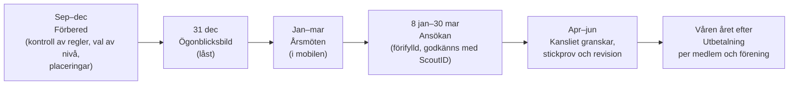

# Plan: modulen Statsbidrag

> Version 0.1, 2026-10-18. Del av [modulplanen](../06-moduler.md). Modulens id är `state_grant`.
> Bygger på [analysen](../01-analys-av-scoutnet.md) (8.2 och 12) och Scouternas supportsidor om statsbidrag (omgången 2026).

**Namnet:** i Scoutnet heter funktionen *Statsbidrag*. Det är statsbidraget från MUCF (Myndigheten för ungdoms- och civilsamhällesfrågor), som kårerna söker via Scouterna varje år. Det är **inte** samma sak som det kommunala aktivitetsbidraget. Det finns redan i modulen [Bidrag](../06-moduler.md#11-de-föreslagna-modulerna) (DAK och kommunens regler). Modulerna hålls isär, eftersom de har olika regler, tider och användare.

## Sammanfattning

Statsbidraget betalas per **medlem** och per **medlemsförening**. Kåren väljer om medlemsföreningarna ska vara kåren, avdelningarna eller patrullerna. Varje medlemsförening måste hålla ett **årsmöte efter årsskiftet** och ha det dokumenterat. Det är i dag ett pappers- och formulärarbete, och på patrullnivå mycket arbete.

Modulen gör det till en del av den vanliga verksamheten:

- **Ögonblicksbilden den 31 december tas automatiskt** och kan inte ändras i efterhand. Rättelser görs med motivering och syns i revisionsloggen.
- **Reglerna kontrolleras hela tiden** under hösten. Kåren ser vilka avdelningar eller patruller som uppfyller kraven (minst 5 medlemmar, minst 60 % i åldern 6–25) och vad varje nivå skulle ge i bidrag.
- **Årsmötet hålls med stöd i mobilen.** Patrullen eller avdelningen går igenom en guide anpassad för barn och unga:
  - närvaro (från modulen Närvaro om den är på)
  - val av patrulledare, vice och revisor bland medlemmarna
  - stadgar som antas ur en mall
  - verksamhetsredovisning ifylld med terminens möten
  - revisionsberättelse

  Protokollet skapas av sig självt och arkiveras. Det ersätter dagens formulär där mötet förs in i efterhand.
- **Ansökan fylls i av sig själv** från ögonblicksbilden och årsmötena. Kåren granskar och skickar.
- **Godkännande med ScoutID** i stället för länkar i e-post: ansvarig ledare godkänner sin medlemsförening, och kårordföranden skickar in.
- **Avgiftsbefriade bekräftar digitalt** (medlemmen eller vårdnadshavaren) i stället för på papper.
- **Kansliet får en arbetsyta:** inkomna ansökningar, kontroller, stickprov till revision, underlag till MUCF och fördelning av utbetalningen.

## 1. Så fungerar det i dag

Processen, enligt Scouternas information för omgången 2026:

1. **Uppdatera Scoutnet före årsskiftet.** Alla medlemmar ska ligga i rätt avdelning och patrull. Ansökan bygger på läget den **31 december**.
2. **Bestäm nivå.** Kår, avdelning eller patrull blir *medlemsförening*. Hela kåren söker på samma nivå. Fler medlemsföreningar ger mer bidrag men mer arbete.
3. **Medlemsföreningarna håller årsmöte efter årsskiftet.** De antar stadgar, väljer patrull- eller avdelningsledare, revisor och andra roller, och fyller i verksamhetsredovisning och revisionsberättelse. Protokoll och dokument lämnas till kåren, som ska arkivera dem inför revision.
4. **Ansökan i Scoutnet**, öppen 8 januari till 30 mars 2026. Guiden har sju steg:
   1. välj nivå
   2. registrera avgiftsbefriade medlemmars skriftliga bekräftelse med datum
   3. kontrollera medlemsföreningarna; *Ändringar* flyttar medlemmar bara i ansökan, inte i registret
   4. fyll i kontaktuppgifter per förening: ordförande = patrull- eller avdelningsledare, vice, ledning, ansvarig ledare (vuxen)
   5. välj underskrift via Scoutnet (e-post) eller PDF per post
   6. skicka
   7. följ status: när ledaren godkänt och när kansliet godkänt
5. **Revision** under våren: Scouternas revisorer granskar ett urval medlemsföreningar, och MUCF gör egna revisioner.
6. **Utbetalning** våren året efter, per medlem och per medlemsförening.

Reglerna i korthet:
- Bidragsgrundande medlemmar är 6–25 år.
- En medlemsförening har minst 5 medlemmar, och om den har fler ska minst 60 % vara 6–25 år.
- Medlemskapet ska vara bekräftat: betald avgift, eller skriftlig bekräftelse för avgiftsbefriade.
- En ledare kan godkänna flera men inte alla medlemsföreningar i en kår.

Det här gör det tungt i dag:

- **Placeringarna i december avgör allt**, men felen syns först i januari. Då är det för sent att flytta i registret, och *Ändringar* gör att ansökan och registret visar olika saker.
- **Årsmötet förs in i efterhand.** Protokoll skrivs på papper eller i Word, uppgifterna skrivs av till Scoutnets formulär, och dokumenten arkiveras av kåren på egen hand.
- **Underskrift via e-postlänk** eller utskriven PDF per post.
- **Bekräftelser från avgiftsbefriade** samlas på papper.
- **Revisionen** kräver att kåren letar fram dokument.
- Formulären har teknisk skuld (`max_input_vars = 3000` "because of the poorly designed Statsbidrag forms", analysen avsnitt 4).

## 2. Mål

| Mål | Mått |
|---|---|
| Fler kårer söker, och på rätt nivå | Andelen kårer som söker ökar. Kåren ser uppskattat bidrag per nivå före årsskiftet. |
| Mindre arbete per medlemsförening | Ett årsmöte på patrullnivå tar under 30 minuter att dokumentera, i samband med mötet |
| Rätt från början | Inga *Ändringar* i ansökan. Avvikelser mot reglerna syns före 31 december. |
| Underlag redo för revision | Alla dokument finns digitalt hos kåren och kansliet, och revisionen kräver inget letande |
| Säker underskrift | Godkännande med ScoutID (färsk inloggning), inga länkar i e-post |

## 3. Årshjulet

Datumen ligger som inställningar per bidragsår, eftersom MUCF och Scouterna kan ändra dem.

## 4. Förberedelse under hösten: nivåval och kontroll av reglerna

Sidan *Statsbidrag* för kåren är öppen hela året.

- **Kontroll i realtid** av de valda medlemsföreningarna mot reglerna. Reglerna är data per bidragsår: ålder 6–25, minst 5 medlemmar, minst 60 %, bekräftat medlemskap. Kontrollen visar per förening:
  - antal medlemmar, antal i åldern 6–25 och andelen
  - hur många som har bekräftat medlemskap
  - ✅ eller ⚠ med förklaring, till exempel: "Patrull Ugglan: 4 medlemmar, behöver minst 5"
- **Jämförelse mellan nivåerna:** antal medlemsföreningar och uppskattat bidrag för kår, avdelning och patrull, med förra årets belopp per medlem och förening.
- **Förslag** som kåren själv väljer om den vill följa, till exempel:
  - "3 scouter saknar patrull i Spårhundarna"
  - "Patrull Lodjuret och Patrull Räven har tillsammans 7 medlemmar"
- **Påminnelser** i november och december till kårordföranden och avdelningsledarna om placeringar och obekräftade medlemskap. Påminnelserna går via modulen E-postlistor om den är på.

Kontrollen bygger på kärnans placeringar och på det bekräftade medlemskapet (`membership_term`, som Fakturering skriver). Den ändrar ingenting.

## 5. Ögonblicksbilden 31 december

- **Ett jobb fryser läget vid årsskiftet** per kår: medlemmar, ålder, placering (avdelning och patrull), bekräftat medlemskap och kårens valda nivå.
- **Den kan inte ändras.** Ansökan bygger alltid på den.
- **Rättelser** (t.ex. en medlem som felaktigt låg utan patrull) görs som en **rättelse med motivering** i ansökan. Rättelsen syns för kansliet och i revisionsloggen. Den ersätter dagens *Ändringar*, som tyst skiljer ansökan från registret.
- **Samma ögonblicksbild används av modulen Statistik** för årsrapporter (antal medlemmar 31/12), så att siffrorna är desamma överallt.

## 6. Årsmötet, digitalt och på barnens nivå

Det här är den största förbättringen för patrullnivån. I dag hålls mötet med papper och förs in i Scoutnets formulär i efterhand. I stället blir årsmötet ett eget flöde i mobilen, för ledaren tillsammans med patrullen.

1. **Planera:** årsmötet läggs in som ett möte av typen *årsmöte*. Med modulen Närvaro hamnar det i terminsplaneringen och kalendern. En kallelse kan skickas till vårdnadshavare via E-postlistor.
2. **Under mötet**, med en guide som följer Scouternas mall och årsmötesspelet:
   - **närvaro:** ett tryck per scout (samma som närvaron)
   - **mötesordförande, sekreterare och justerare** väljs bland de närvarande
   - **stadgar:** Scouternas exempelstadga (versionerad) visas och antas med ett tryck
   - **val:** patrulledare, vice patrulledare, revisor och ledning, bland medlemmarna, med ansvarig vuxen ledare
   - **verksamhetsredovisning:** förifylld med förra årets möten, hajker och antal deltagare från Närvaro. Patrullen kan lägga till egna rader och bilder.
   - **revisionsberättelse:** revisorn svarar på mallens frågor
   - **beslut:** egna punkter i fritext
3. **Protokoll:**
   - Protokollet skapas som PDF av det som registrerats.
   - Det **justeras** av justerarna och den ansvariga vuxna ledaren med ScoutID. Unga justerare utan eget ScoutID-konto kan justera på ledarens telefon, och det noteras i protokollet.
   - Protokollet arkiveras i kårens arkiv för bidragsåret.
4. **Klart:** medlemsföreningens kontaktuppgifter till ansökan (ordförande, vice, ledning, ansvarig ledare) hämtas från valen, så att inget skrivs av.

Avdelningsnivån har samma flöde. På kårnivå används kårens ordinarie årsmöte (kårstämman), och protokollet laddas upp eller förs in på samma sätt.

## 7. Bekräftat medlemskap och avgiftsbefriade

- **Betald termin ger bekräftat medlemskap automatiskt** via modulen Fakturering och kärnans `membership_term`.
- **Avgiftsbefriade:**
  1. Kåren markerar dem.
  2. Medlemmen, eller vårdnadshavaren för barn, får en begäran om att bekräfta sitt medlemskap. Den kommer i Min profil och som länk i e-post.
  3. Bekräftelsen görs med ScoutID, eller med en engångslänk för den som saknar konto. Datum och sätt sparas.

  Det ersätter skriftliga bekräftelser på papper.
- **Lista över obekräftade:** kåren ser vem som saknar bekräftelse, och kan skicka påminnelser eller registrera en papperbekräftelse (med inskannat underlag).

## 8. Ansökan

- Ansökan **öppnar för kåren 8 januari**, enligt årets inställning. Den är **förifylld** från ögonblicksbilden och årsmötena.
- **Granskning i ett steg** per medlemsförening: medlemmar, regelkontroll, årsmötesprotokoll, kontaktuppgifter och rättelser. Saknade delar listas med länk dit de rättas.
- **Ansvarig ledare godkänner** sin medlemsförening i Scoutnet 2 med ScoutID och färsk inloggning. Regeln att en ledare inte får godkänna alla medlemsföreningar i en kår kontrolleras.
- **Kårordföranden skickar in** när alla har godkänt. Status syns för kåren:
  - godkänd av ledare
  - inskickad
  - godkänd av kansliet
  - utvald för revision
  - utbetald
- **PDF per post** finns kvar som reserv för den som inte kan godkänna digitalt. Kansliet registrerar det inkomna.

## 9. Kansliets arbete

- **Översikt över årets ansökningar:** inkomna, saknade och ofullständiga ansökningar, och flaggor:
  - rättelser
  - medlemsföreningar nära gränserna
  - många avgiftsbefriade
  - protokoll som inte är justerade
- **Stickprov till revision:** slumpmässigt och viktat urval (t.ex. fler rättelser ger större chans att väljas). Urvalet sparas.
  - Utvalda kårer meddelas automatiskt.
  - Revisorn får **läsbehörighet för en begränsad tid** till de utvalda medlemsföreningarnas underlag.
- **Underlag till MUCF:** antal medlemmar och medlemsföreningar per kår, som export. Personuppgifter lämnas bara ut när det krävs.
- **Utbetalning:** när MUCF:s belopp är känt beräknas kårens del per medlem och förening. Utbetalningen görs via Fakturerings utbetalningar och bokförs med SIE4.

## 10. Gränssnittet

| Vem | Sida | Innehåll |
|---|---|---|
| Kårordförande | **Statsbidrag** (kåren) | Årshjulet med "du är här", nivåval med jämförelse, regelkontroll per förening, årsmötenas status, obekräftade, ansökan, status och utbetalning |
| Avdelningsledare | **Statsbidrag** (avdelningen) | Den egna avdelningens och patrullernas regelkontroll och årsmöten. Godkänna sin medlemsförening. |
| Ledare med patrull | **Årsmöte** (mobil) | Guiden under mötet: närvaro, val, stadgar, redovisning, protokoll |
| Medlem och vårdnadshavare | **Min profil** | Bekräfta medlemskap (avgiftsbefriade). Se protokoll från patrullens årsmöte. |
| Kansliet | **Statsbidrag** (förbundet) | Ansökningar, flaggor, stickprov, underlag till MUCF, utbetalning |
| Revisor | **Revision** | Tidsbegränsad läsåtkomst till utvalda föreningars underlag |

## 11. Datamodell

Modulens egna tabeller ligger i schemat `state_grant`:

| Tabell | Innehåll |
|---|---|
| `state_grant.year` | Bidragsår: datum (ögonblicksbild, öppning, stängning), regler (JSON med tester), belopp per medlem och förening när de är kända |
| `state_grant.snapshot` | Låst ögonblicksbild per kår och år: medlem, födelseår, placering, bekräftelse (sparad som rader, inte som en vy) |
| `state_grant.application` | Kårens ansökan: nivå, status, inskickad av och när, godkänd av kansliet |
| `state_grant.association` | Medlemsförening i ansökan: enhet (kår, avdelning eller patrull), regelresultat, kontaktuppgifter, ansvarig ledare, godkänd när och av vem |
| `state_grant.correction` | Rättelse mot ögonblicksbilden: person, från, till, motivering, av vem |
| `state_grant.annual_meeting` | Årsmöte: enhet, datum, närvarande, funktionärer, stadgeversion, beslut, protokoll (dokument), justeringar |
| `state_grant.confirmation` | Bekräftelse för avgiftsbefriad: person, sätt (ScoutID, engångslänk, papper), datum, underlag |
| `state_grant.audit_sample` | Stickprov: år, förening, urvalsgrund, revisorns åtkomst och resultat |
| `state_grant.payout` | Fördelning per kår, kopplad till Fakturerings utbetalning |

**Dokument** (protokoll, stadgar, redovisningar) sparas i kärnans arkiv per enhet, i blob-lagring med åtkomstkontroll (planen 4.1).

## 12. API (urval)

| Anrop | Beskrivning |
|---|---|
| `GET /v1/bodies/{id}/state-grant?year=` | Kårens läge: regelkontroll per förening, jämförelse mellan nivåer, årsmöten, ansökan |
| `PUT /v1/bodies/{id}/state-grant/level` | Välj nivå (kår, avdelning eller patrull) |
| `POST /v1/bodies/{id}/annual-meetings` · `PATCH /v1/annual-meetings/{id}` | Skapa och fylla i årsmöte (stegvis) |
| `POST /v1/annual-meetings/{id}/sign` | Justera protokollet (ScoutID, step-up) |
| `POST /v1/people/{id}/membership-confirmations` | Begär eller registrera bekräftelse för avgiftsbefriad |
| `POST /v1/state-grant/applications/{id}/associations/{aid}/approve` | Ansvarig ledare godkänner (step-up) |
| `POST /v1/state-grant/applications/{id}/submit` | Kårordföranden skickar in |
| `GET /v1/state-grant/applications?year=&status=` | Kansliets översikt |
| `POST /v1/state-grant/years/{year}/samples` | Dra stickprov till revision |
| `GET /v1/state-grant/years/{year}/report` | Underlag till MUCF (aggregerat) |

## 13. Modulen i systemet

| Del | Statsbidrag |
|---|---|
| Kräver | Bara kärnan |
| Använder om de är på (valfria beroenden) | **Närvaro** (årsmötet som möte, närvaro, verksamhetsredovisning), **Fakturering** (bekräftat medlemskap, utbetalning), **E-postlistor** (kallelser och påminnelser), **Statistik** (samma ögonblicksbild) |
| Händelser in | `placement.changed`, `member.joined`, `member.left` (uppdatera regelkontrollen under hösten), `membership.confirmed`, `meeting.held` (verksamhetsredovisning), `person.erased` |
| Händelser ut | `state_grant.snapshot_taken`, `state_grant.submitted`, `state_grant.sampled`, `state_grant.paid` |
| Menyval | *Statsbidrag* för kår, avdelning och förbund (`state_grant.read`) |
| Översikten | Kortet "Statsbidrag 2027: 2 av 6 årsmöten klara, ansökan stänger om 12 dagar" |
| Personkortet | Bekräftat medlemskap och om personen räknas i årets ansökan |
| Jobb | Ögonblicksbild 31/12, påminnelser i november, december och mars, låsning när ansökan stänger |
| Behörigheter | `state_grant.read`, `state_grant.manage` (kårordförande), `state_grant.approve` (ansvarig ledare, kontrolleras per förening), `state_grant.admin` (kansliet), `state_grant.audit` (revisor, tidsbegränsad) |
| GDPR | Export: personens del i ögonblicksbilder, protokoll och bekräftelser. Radering: underlaget sparas så länge MUCF kräver det för revision, och avidentifieras därefter. |

## 14. Vad kärnan behöver

- **Bekräftat medlemskap per termin** (`membership_term`), gemensamt med Fakturering.
- **Arkiv per enhet** för dokument, med åtkomstkontroll och gallring.
- **Behörigheter som moduler deklarerar**, med tidsbegränsade tilldelningar (för revisorn).
- **Ögonblicksbilder** som en gemensam tjänst, eller en publik läsfunktion i modulen Statistik som Statsbidrag använder.
- **Underskrift med ScoutID:** step-up och en signeringstjänst som sparar vem, när och vad (en hash av dokumentet).

## 15. Säkerhet och dataskydd

- **Protokoll innehåller namn på barn.** Bara kåren, de valda funktionärerna, kansliet och revisorn (tidsbegränsat) ser dem.
- **Personnummer behövs inte** för ansökan i Scoutnet 2. Om MUCF begär individuppgifter vid revision lämnas de ut för den utvalda föreningen, och det loggas.
- **Underskrifter:** vem, när, med vilken inloggningsnivå, och en hash av protokollet. Ändrat protokoll kräver ny justering.
- **Gallring:** underlaget sparas den tid MUCF och Scouterna kräver för revision. Tiden fastställs med kansliet och läggs som regel per bidragsår.

## 16. Etapper

| Etapp | Innehåll | Klart när |
|---|---|---|
| 0. Demo i prototypen (cirka 1 vecka) | Regelkontroll och jämförelse mellan nivåerna på syntetiska data, ögonblicksbild, årsmötesguiden för en patrull med protokoll som PDF, förifylld ansökan | Hela flödet för en patrull kan visas |
| 1. Förberedelse och ögonblicksbild | Regelkontroll under hösten, påminnelser, låst ögonblicksbild | Används hösten före första digitala ansökan |
| 2. Årsmöten och ansökan | Årsmötesguiden, justering med ScoutID, förifylld ansökan, godkännande, bekräftelser från avgiftsbefriade | Pilotkårer söker digitalt (med PDF som reserv) |
| 3. Kansliet och revision | Översikt, stickprov, revisorsåtkomst, underlag till MUCF, utbetalning | Kansliet hanterar en hel omgång i Scoutnet 2 |

## 17. Risker och öppna frågor

| Fråga eller risk | Förslag |
|---|---|
| Godtar MUCF och Scouternas revisorer digitala protokoll och justering med ScoutID? | Stäm av med kansliet och revisorerna före etapp 2. Behåll PDF och papper som reserv. |
| Justering av barn utan eget konto | Justering på ledarens enhet, noterad i protokollet. Pröva med pilotpatruller. |
| Exakta regler (åldersberäkning, gränsfall) ändras | Regler som data per år, med testfall från kansliet |
| Risk att kåren organiserar om patruller bara för bidragets skull | Förslagen är bara förslag och följer Scouternas anvisningar. Stickprovet väger in större omorganisationer nära årsskiftet. |
| Belastning i mars, när många kårer gör ansökan sent | Förifyllda ansökningar och påminnelser i tid. Kapacitet enligt planen (avsnitt 16). |
